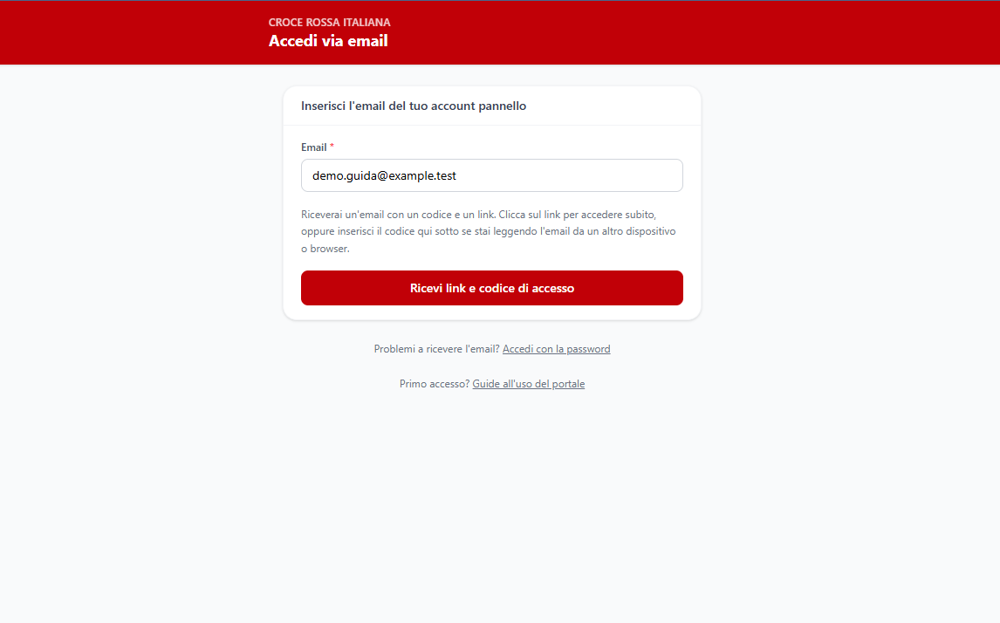
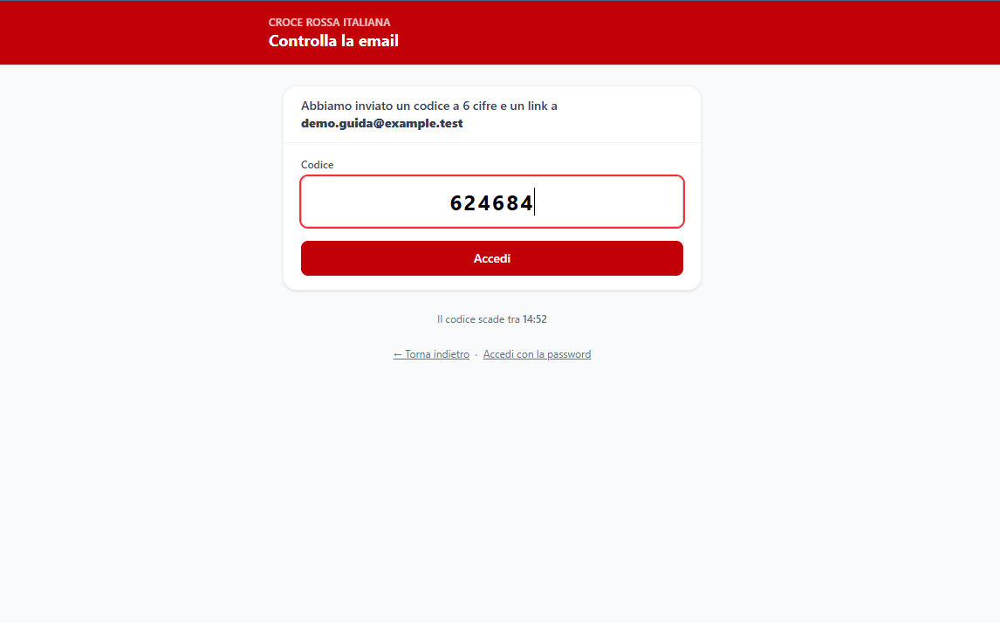
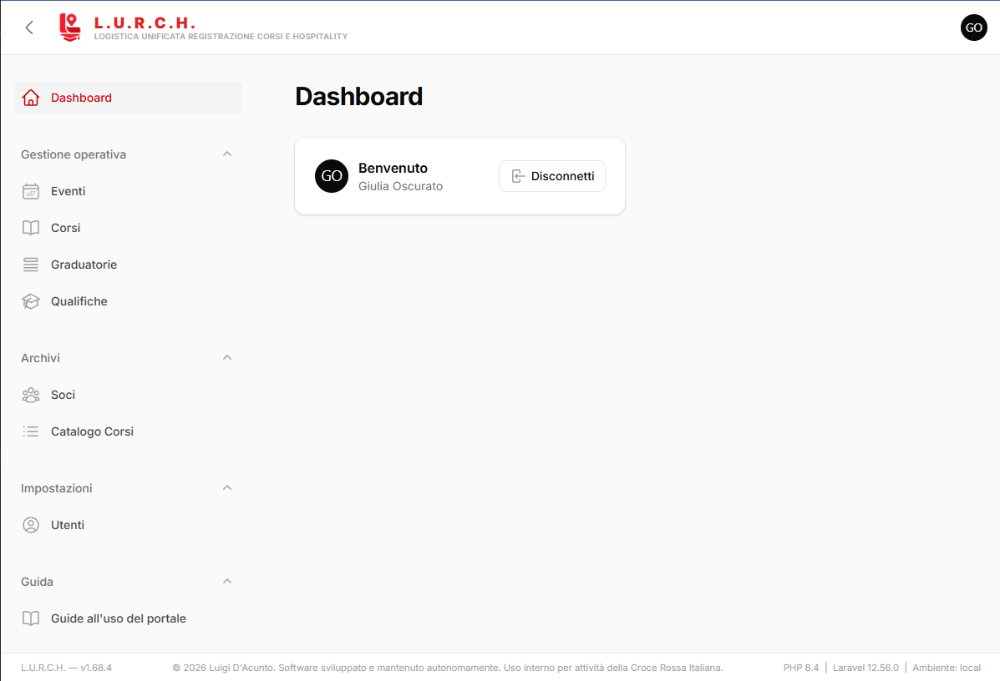

# Accesso al pannello

> **A chi serve:** operatori e amministratori del pannello.

Per entrare nel pannello non serve una password. Ogni volta che accedi ricevi un'email con un **link** su cui cliccare e un **codice a 6 cifre** da digitare: basta la casella email del tuo account.

## 1. Apri la pagina di accesso

Vai all'indirizzo del pannello che ti è stato comunicato: si apre la pagina **Accedi via email** (indirizzo `/admin-login`).

<!-- screenshot: route=/admin-login · v1.68.4 · 2026-09-01 -->

## 2. Inserisci la tua email

Scrivi l'indirizzo email del tuo account e premi **Ricevi link e codice di accesso**.

> Usa esattamente l'indirizzo con cui è stato creato il tuo account. Se non sei sicuro di quale sia, chiedi a chi ti ha registrato (il tuo amministratore regionale o locale).

## 3. Controlla l'email

Ricevi un messaggio con due modi per entrare:

- **pulsante «Accedi al pannello»**: se apri l'email sullo stesso dispositivo e browser da cui hai chiesto l'accesso, entri direttamente;
- **codice a 6 cifre**: usalo se leggi l'email su un altro telefono o computer. Torna alla pagina **Controlla la email** e scrivilo nel campo **Codice**: all'ultima cifra la pagina procede da sola.

<!-- screenshot: route=/admin-login/verifica · v1.68.4 · 2026-09-01 -->

Link e codice **valgono 15 minuti** e si possono usare una sola volta. Se scadono, ripeti dal punto 2.

## 4. Sei dentro

Dopo la verifica arrivi alla **Dashboard**. Nel menu a sinistra vedi solo le sezioni per cui hai un permesso: se ti aspetti una voce che non c'è, è una questione di permessi, parlane con il tuo amministratore.

<!-- screenshot: route=/admin · v1.68.4 · 2026-09-01 -->

## Problemi frequenti

| Situazione | Cosa fare |
|---|---|
| Non ricevo l'email | Controlla lo spam e aspetta qualche minuto. Verifica di aver scritto bene l'indirizzo. |
| «Troppi tentativi» alla richiesta | Dalla stessa connessione si possono chiedere al massimo 3 email ogni 10 minuti: attendi il tempo indicato e riprova. |
| «Link non valido o scaduto» | Il link è già stato usato o sono passati 15 minuti: usa il codice, se è ancora valido, oppure richiedine uno nuovo dal punto 2. |
| Sbaglio il codice più volte | Dopo 5 tentativi errati il codice si blocca per 30 minuti. Attendi, oppure usa il link dell'email. |
| Ho cambiato email | Non puoi cambiarla da solo: la modifica la fa il tuo amministratore regionale o locale. |

## E la password?

Il pannello funziona **solo con email e codice o link**: non c'è una password da impostare o ricordare. La password esiste solo come **soluzione di emergenza temporanea** per un problema con le email che dura un po' (un indirizzo da cambiare, il servizio di posta non raggiungibile per qualche ora). Se ti serve, chiedi al supporto: un superadmin te ne genera una e ti dà il link per usarla (**Accedi con la password**, in fondo alla pagina di accesso). Appena le email tornano a funzionare e rientri con il codice, quella password si disattiva da sola.
