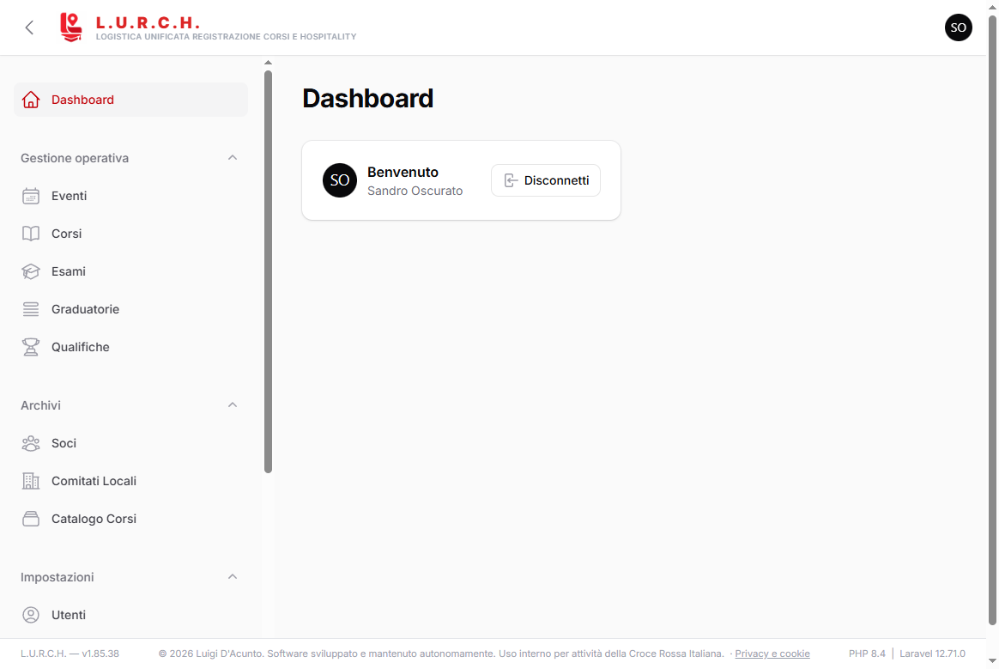
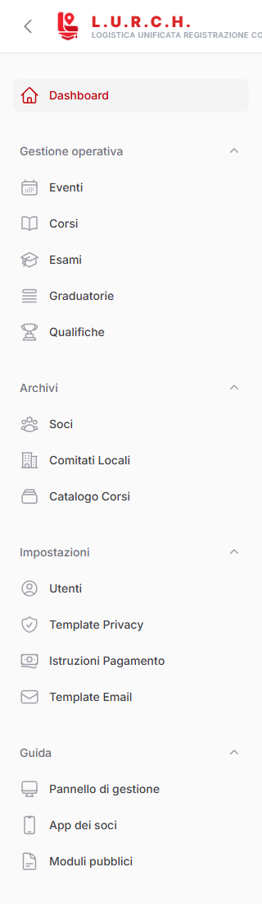
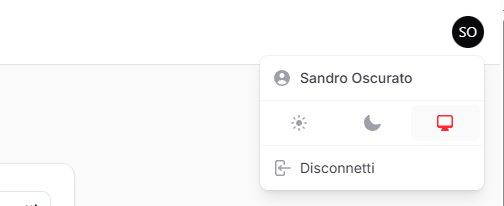

# Menu e dashboard

> **A chi serve:** operatori e amministratori del pannello.

Ogni pagina del pannello ha la stessa struttura: una barra in alto, il menu a sinistra, il contenuto al centro e una riga di informazioni in fondo.

<!-- screenshot: route=/admin · v1.85.38-dev · 2026-11-17 -->

## La barra in alto

- **Freccia a sinistra**: chiude il menu laterale lasciando solo le icone, per avere più spazio; un altro clic lo riapre.
- **Logo L.U.R.C.H.**: riporta alla Dashboard da qualsiasi pagina.
- **Cerchio con le tue iniziali**: apre il menu personale (vedi sotto).

## Il menu a sinistra

Le voci sono divise in gruppi; ogni gruppo si chiude e si riapre con la freccia accanto al nome. **Vedi solo le voci che il tuo ruolo permette**: l'immagine mostra il menu di un amministratore regionale, un operatore ne vede di solito molte meno (vedi [Ruoli e permessi](03-ruoli-e-permessi.md)).

<!-- screenshot: route=/admin · v1.85.38-dev · 2026-11-17 · menu dell'admin regionale -->

| Gruppo | Voce | A cosa serve |
|---|---|---|
| Gestione operativa | [Eventi](../02-gestione-operativa/01-eventi/README.md) | Eventi e campi: staff, partecipanti, badge, check-in, presenze, pasti e pernottamenti |
| | [Corsi](../02-gestione-operativa/02-corsi.md) | Corsi dentro gli eventi: iscritti, moduli di preregistrazione, comunicazioni, quote |
| | [Esami](../02-gestione-operativa/03-esami.md) | Esami di fine corso, per i corsi che li prevedono |
| | [Graduatorie](../02-gestione-operativa/04-graduatorie.md) | Selezioni con candidatura pubblica e classifica |
| | [Qualifiche](../02-gestione-operativa/05-qualifiche.md) | Ricerca dei soci per qualifica ed export |
| Archivi | [Soci](../03-archivi/01-soci.md) | Anagrafica dei volontari, importata da GAIA |
| | [Comitati Regionali](../03-archivi/02-comitati-regionali.md) | Solo superadmin: dati, dominio, logo e posta di ogni regione |
| | [Comitati Locali](../03-archivi/03-comitati-locali.md) | Comitati e sedi della regione |
| | [Catalogo Corsi](../03-archivi/04-catalogo-corsi.md) | Elenco dei tipi di corso e delle loro scadenze |
| | [Patenti CRI](../03-archivi/05-patenti-cri.md) | Solo superadmin: tipi di patente di guida CRI |
| Impostazioni | [Utenti](../04-impostazioni/01-utenti.md) | Chi può entrare nel pannello, con quale ruolo |
| | [Template Privacy](../04-impostazioni/02-template-privacy.md) | Testi dell'informativa mostrati nei moduli |
| | [Istruzioni Pagamento](../04-impostazioni/03-istruzioni-pagamento.md) | Indicazioni di pagamento delle quote dei corsi |
| | [Template Email](../04-impostazioni/04-template-email.md) | Testi delle email inviate a iscritti e staff |
| | [Opzioni Alimentari](../04-impostazioni/05-opzioni-alimentari.md) | Solo superadmin: allergeni, intolleranze, diete |
| Guida | Pannello di gestione, App dei soci, Moduli pubblici | Questa guida, dentro il pannello |

## Il menu personale

Un clic sul cerchio con le iniziali, in alto a destra, apre il menu personale:

- il tuo **nome**;
- i tre pulsanti per l'aspetto: **chiaro**, **scuro** o **automatico** (segue l'impostazione del computer o del telefono);
- **Modifica password**, solo se ti è stata data una password temporanea (vedi [Password e profilo](04-password-e-profilo.md));
- **Disconnetti**, per uscire.

<!-- screenshot: route=/admin · v1.85.38-dev · 2026-11-17 · menu personale aperto -->

## La Dashboard

È la prima pagina dopo l'accesso. Per ora mostra solo il riquadro di benvenuto con il tuo nome e il pulsante **Disconnetti**: per lavorare si parte dalle voci del menu.

## Le tabelle

Quasi tutte le sezioni si aprono con una tabella (eventi, corsi, soci, utenti…). Funzionano tutte allo stesso modo:

- **casella di ricerca** sopra la tabella: filtra le righe mentre scrivi;
- **filtri** (icona a imbuto): restringono l'elenco, per esempio per regione o per stato;
- **colonne** (icona a colonne, accanto ai filtri): mostrano o nascondono le colonne facoltative;
- **intestazioni delle colonne**: un clic ordina la tabella per quella colonna, un secondo clic inverte l'ordine;
- **azioni sulla riga**: le icone all'inizio di ogni riga aprono o modificano quell'elemento; quelle che cancellano qualcosa stanno nel menu a tre puntini, in rosso, e chiedono sempre conferma;
- **in fondo**: quante righe mostrare per pagina e i pulsanti per cambiare pagina.

Alcune sezioni con molti dati, come Soci e Qualifiche, al posto della ricerca libera hanno un modulo di ricerca: si scelgono i criteri e si preme **Avvia ricerca**.

## La riga in fondo

Riporta la **versione** di L.U.R.C.H. (utile quando si segnala un problema) e il link **Privacy e cookie** all'informativa.

## Su telefono e tablet

Il pannello funziona anche da schermi piccoli: il menu a sinistra si nasconde e si apre con l'icona a tre linee in alto.
