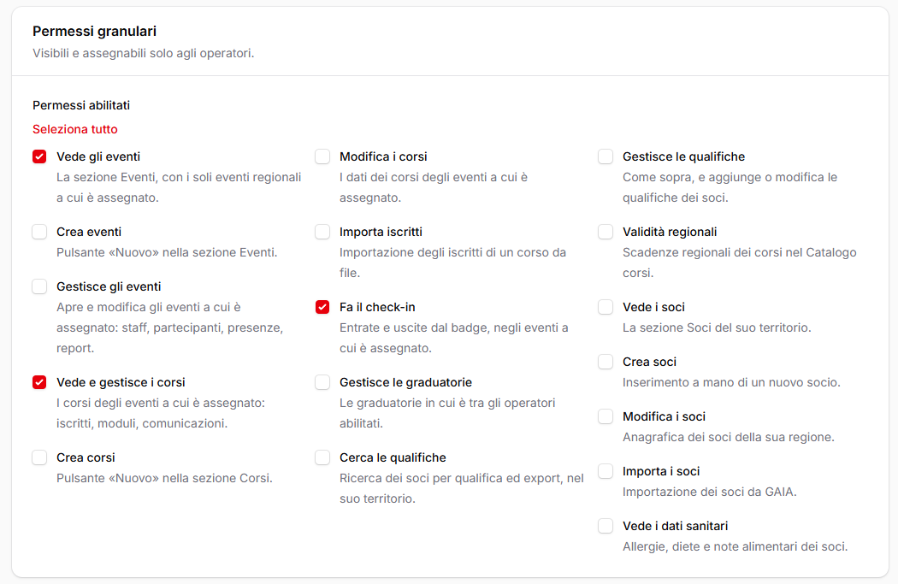

# Ruoli e permessi

> **A chi serve:** operatori e amministratori del pannello.

Ogni utente del pannello ha un **ruolo** e un **territorio** (una regione, a volte un comitato locale). Il ruolo decide quali voci compaiono nel menu, il territorio quali dati si vedono dentro ciascuna voce: un amministratore della Toscana non vede gli eventi della Campania, e viceversa.

## I quattro ruoli

| Ruolo | Territorio | Cosa vede e cosa fa |
|---|---|---|
| **Superadmin** | tutte le regioni | Tutto. Solo il superadmin gestisce Comitati Regionali, Patenti CRI, Opzioni Alimentari, crea e modifica i corsi del Catalogo e genera una password temporanea per un utente. |
| **Admin regionale** | la sua regione | Tutto ciò che riguarda la sua regione: eventi, corsi, esami, graduatorie, qualifiche, soci (dati sanitari compresi), comitati locali, utenti (altri admin regionali, admin locali e operatori della regione), testi di privacy, email e istruzioni di pagamento della regione. Il Catalogo corsi è in sola lettura. |
| **Admin locale** | il suo comitato locale | Eventi, corsi, esami, graduatorie, qualifiche e soci del suo comitato (senza i dati sanitari). Crea e modifica gli operatori del suo comitato, ma non li elimina. Il Catalogo corsi è in sola lettura. Non vede comitati e impostazioni dei testi. |
| **Operatore** | la sua regione, o il suo comitato | Di partenza solo Dashboard e Guida: vede una sezione solo se ha il permesso relativo (vedi sotto). Per eventi, corsi, check-in e graduatorie serve anche essere **assegnato** a quell'evento o a quella graduatoria. |

Gli amministratori non possono modificare, disattivare o eliminare il proprio account: lo fa un altro amministratore della regione o un superadmin.

## Ruoli legati a un corso

Alcune persone vedono qualcosa in più per il ruolo che hanno in un corso, non per il ruolo nel pannello:

- il **direttore del corso** vede il suo corso e il relativo esame anche se nel pannello è un semplice operatore;
- il **presidente** e i **docenti della commissione d'esame** leggono l'esame del corso (vedi [Esami](../02-gestione-operativa/03-esami.md)).

Per questo serve che il loro account sia collegato alla loro scheda socio (campo «Socio collegato» nella scheda utente).

## I permessi degli operatori

L'admin che crea o modifica un operatore sceglie i permessi nella sezione **Permessi granulari** della sua scheda (vedi [Utenti](../04-impostazioni/01-utenti.md)). Ogni permesso ha una breve spiegazione accanto.

<!-- screenshot: route=/admin/utenti/{id}/edit · v1.85.38-dev · 2026-11-18 · permessi di un operatore -->

| Permesso | Cosa consente |
|---|---|
| Vede gli eventi | La sezione Eventi, con i soli eventi regionali a cui è assegnato |
| Crea eventi | Il pulsante «Nuovo» nella sezione Eventi |
| Gestisce gli eventi | Aprire e modificare gli eventi a cui è assegnato: staff, partecipanti, presenze, report |
| Vede e gestisce i corsi | I corsi degli eventi a cui è assegnato: iscritti, moduli, comunicazioni |
| Crea corsi | Il pulsante «Nuovo» nella sezione Corsi |
| Modifica i corsi | I dati dei corsi degli eventi a cui è assegnato |
| Importa iscritti | L'importazione degli iscritti di un corso da file |
| Fa il check-in | Entrate e uscite dal badge, negli eventi a cui è assegnato |
| Gestisce le graduatorie | Le graduatorie in cui è tra gli «Operatori abilitati» |
| Cerca le qualifiche | La ricerca dei soci per qualifica e l'export, nel suo territorio |
| Gestisce le qualifiche | Come sopra, e aggiungere o modificare le qualifiche dei soci |
| Validità regionali | Le scadenze regionali dei corsi nel Catalogo corsi (oggi la tabella è nella pagina di modifica del catalogo, riservata al superadmin) |
| Vede i soci | La sezione Soci del suo territorio |
| Crea soci | L'inserimento a mano di un nuovo socio |
| Modifica i soci | L'anagrafica dei soci della sua regione |
| Importa i soci | L'importazione dei soci da GAIA |
| Vede i dati sanitari | Allergie, diete e note alimentari dei soci |

**L'assegnazione** si fa dall'evento (campo «Operatori assegnati») o dalla graduatoria (campo «Operatori abilitati»): il permesso da solo apre la sezione, ma la lista resta vuota finché l'operatore non è assegnato a qualcosa.
