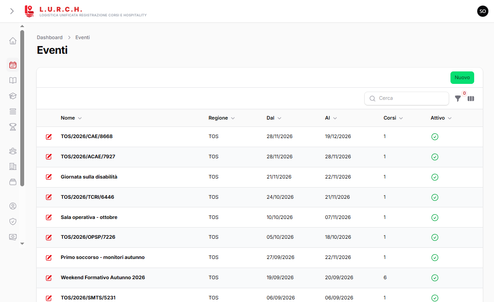
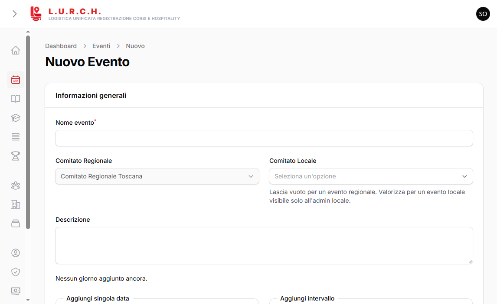
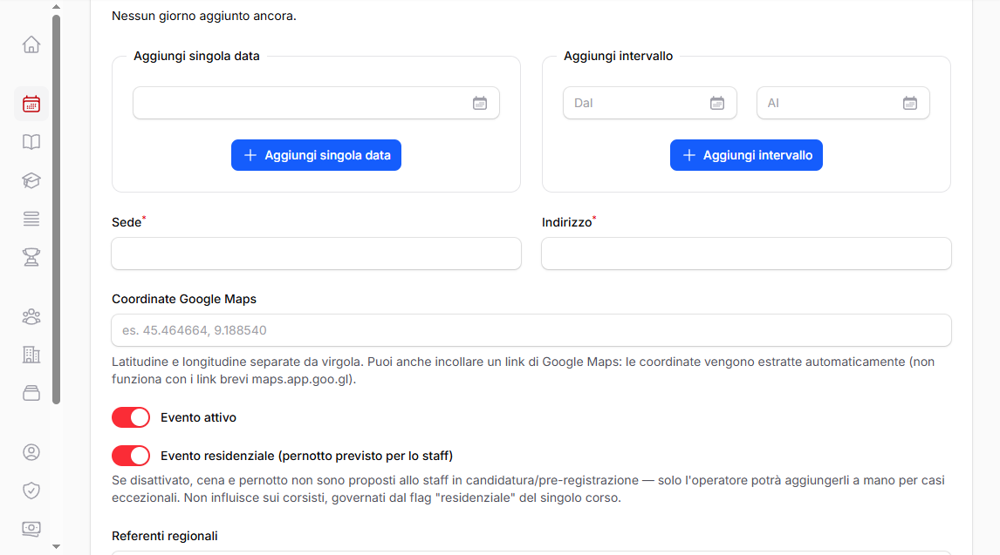
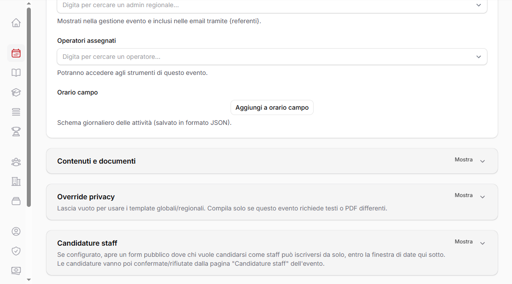

# Elenco e creazione

> **A chi serve:** operatori e amministratori del pannello.

Da **Gestione operativa → Eventi** si vedono gli eventi a cui si ha accesso e si può crearne di nuovi.

## Evento e corso: due aree che si completano

In L.U.R.C.H. **ogni corso appartiene a un evento**, e le due cose servono a scopi diversi:

- il **corso** è la parte didattica e amministrativa: iscritti, moduli di preregistrazione, quote di iscrizione, comunicazioni ai corsisti;
- l'**evento** è la parte logistica: date e luogo, staff, pasti e pernottamenti, badge, check-in e presenze.

Un evento può ospitare un solo corso oppure molti, che condividono luogo, giorni e organizzazione (per esempio un weekend con una decina di corsi). Per questo un corso non si può creare senza un evento: lo si sceglie, o lo si crea al volo, nel modulo del corso (vedi [Corsi](../02-corsi.md)).

Il **nome dell'evento è libero**. Qualche abitudine utile:

- per un evento con un solo corso si usa spesso il protocollo del corso (per esempio `TOS/2026/CAE/8668`); lo fa da sola l'azione **Crea evento singolo per questo corso** del modulo del corso;
- per un evento che ospita più corsi conviene un nome che dica cos'è, per esempio «Campo Formativo Estate 2026» o «Weekend Formativo Autunno 2026».

## L'elenco

<!-- screenshot: route=/admin/eventi · v1.85.38-dev · 2026-11-18 · menu laterale chiuso -->

Ogni riga è un evento, dal più recente al più vecchio. **Un clic sulla riga apre la gestione dell'evento** ([Gestione dell'evento](02-gestione-evento.md)); l'icona a matita all'inizio modifica invece i dati di base dell'evento.

| Colonna | Cosa mostra |
|---|---|
| Nome | Il nome dell'evento (vedi sopra); i nomi lunghi sono accorciati e passando il mouse si legge il nome intero |
| Regione | La sigla della regione (TOS, CAM…); il nome intero compare al passaggio del mouse |
| Dal / Al | Primo e ultimo giorno |
| Corsi | Quanti corsi contiene |
| Attivo | La spunta verde indica un evento attivo |

Altre colonne si possono mostrare con l'icona a colonne accanto ai filtri: **Tipo** (regionale o locale), **Comitato Locale** (vuoto per gli eventi regionali) e **Sede**.

> Su uno schermo non molto largo conviene chiudere il menu a sinistra con la freccia in alto: la tabella ha più spazio.

### Cercare e filtrare

- La casella **Cerca** trova gli eventi per nome, regione, comitato locale o sede.
- Il filtro **Stato** mostra solo gli eventi attivi o solo quelli non attivi.
- Il filtro **Regione** c'è solo per il superadmin, che vede gli eventi di tutte le regioni.
- Le intestazioni delle colonne ordinano la tabella.

### Chi vede quali eventi

- Il **superadmin** vede tutti gli eventi.
- L'**amministratore regionale** vede quelli della sua regione.
- L'**amministratore locale** vede solo gli eventi del suo comitato locale.
- L'**operatore** vede solo gli eventi regionali a cui è stato assegnato (vedi [Ruoli e permessi](../../01-primi-passi/03-ruoli-e-permessi.md)); il pulsante **Nuovo** compare solo se ha anche il permesso di creare eventi.

## Creare un evento

L'evento si può creare in due modi: dal pulsante **Nuovo** di questa pagina, descritto qui sotto, oppure **in modo rapido dal modulo di creazione di un corso** con l'azione **Crea evento singolo per questo corso** (vedi [Corsi](../02-corsi.md)). Il modo rapido chiede solo i giorni, usa il protocollo del corso come nome e lascia sede e indirizzo su «Da definire», da completare poi da questa pagina: è comodo per i corsi autonomi, con un solo corso nell'evento.

Il pulsante verde **Nuovo**, in alto sopra la tabella, apre il modulo. La prima sezione, «Informazioni generali», è sempre aperta e contiene tutti i campi obbligatori (contrassegnati da un asterisco rosso).

<!-- screenshot: route=/admin/eventi/create · v1.85.38-dev · 2026-11-18 -->

- **Nome evento**: libero; vedi le abitudini descritte all'inizio. Un evento nuovo non ha ancora corsi: si aggiungono poi dalla pagina [Corsi](../02-corsi.md), scegliendo questo evento.
- **Comitato Regionale**: già impostato sulla tua regione; l'amministratore regionale e quello locale non lo possono cambiare.
- **Comitato Locale**: lascialo vuoto per un evento regionale. Se lo scegli, l'evento è locale e lo vede solo l'amministratore di quel comitato.
- **Descrizione**: testo libero, facoltativo.

<!-- screenshot: route=/admin/eventi/create · v1.85.38-dev · 2026-11-18 · date, luogo e interruttori -->

- **Giorni evento**: aggiungi i giorni uno per uno con **Aggiungi singola data**, oppure un periodo con **Aggiungi intervallo** (Dal / Al). I giorni possono non essere contigui (per esempio due weekend); ogni giorno aggiunto compare sopra come etichetta e si toglie con la sua «×».
- **Sede** e **Indirizzo**: obbligatori. Un evento creato al volo dal modulo del corso li ha impostati su «Da definire»: vanno completati da qui.
- **Coordinate Google Maps**: latitudine e longitudine separate da virgola. Puoi incollare un link completo di Google Maps e le coordinate vengono estratte da sole (i link brevi `maps.app.goo.gl` non funzionano).
- **Evento attivo**: segna se l'evento è in uso; nell'elenco compare come spunta e si può filtrare per stato. Spegnilo per gli eventi conclusi o sospesi: l'evento e i suoi dati restano consultabili.
- **Evento residenziale**: se è acceso, allo staff vengono proposti cena e pernotto in candidatura e preregistrazione; se è spento, solo l'operatore può aggiungerli a mano per i casi eccezionali. Non riguarda i corsisti, che dipendono dall'impostazione «residenziale» del singolo corso.
- **Referenti regionali**: amministratori regionali, mostrati nella gestione dell'evento e inseriti nelle email con il segnaposto `{referenti}`.
- **Operatori assegnati**: gli operatori che potranno accedere agli strumenti di questo evento.
- **Orario campo**: schema giornaliero delle attività (giorno o fascia, orario, note), facoltativo.

<!-- screenshot: route=/admin/eventi/create · v1.85.38-dev · 2026-11-18 · sezioni richiuse -->

Sotto le informazioni generali ci sono sezioni richiuse, da aprire con **Mostra** solo se servono:

| Sezione | A cosa serve |
|---|---|
| Contenuti e documenti | Immagine di intestazione e testo della comunicazione mostrati nell'app dei soci e inviati per email a staff e iscritti, documenti allegati (programma, mappa, regolamento), camere e pernotti |
| Override privacy | Testi o PDF di informativa e di consenso foto/video diversi da quelli del comitato, per un evento che li richiede |
| Candidature staff | Apre un modulo pubblico dove chi vuole può candidarsi come staff entro una finestra di date (vedi [Candidature staff](04-candidature-staff.md)) |
| Badge | Immagine di sfondo e posizione dei testi e del codice QR sul badge (vedi [Partecipanti e badge](05-partecipanti-e-badge.md)) |

I pulsanti in fondo al modulo salvano l'evento o tornano all'elenco senza salvare.

## Modificare ed eliminare

L'icona a matita sulla riga riapre lo stesso modulo con i dati dell'evento.

Nel menu a tre puntini della riga, in rosso, c'è **Elimina**. Compare solo se l'evento non ha corsi né staff iscritto, e comunque chiede conferma. Un evento che contiene già dati compilati (moduli di preregistrazione, consensi, check-in) non si elimina dal pannello: si può spegnere l'interruttore **Evento attivo**; per eliminarlo davvero bisogna rivolgersi a un amministratore di sistema.
