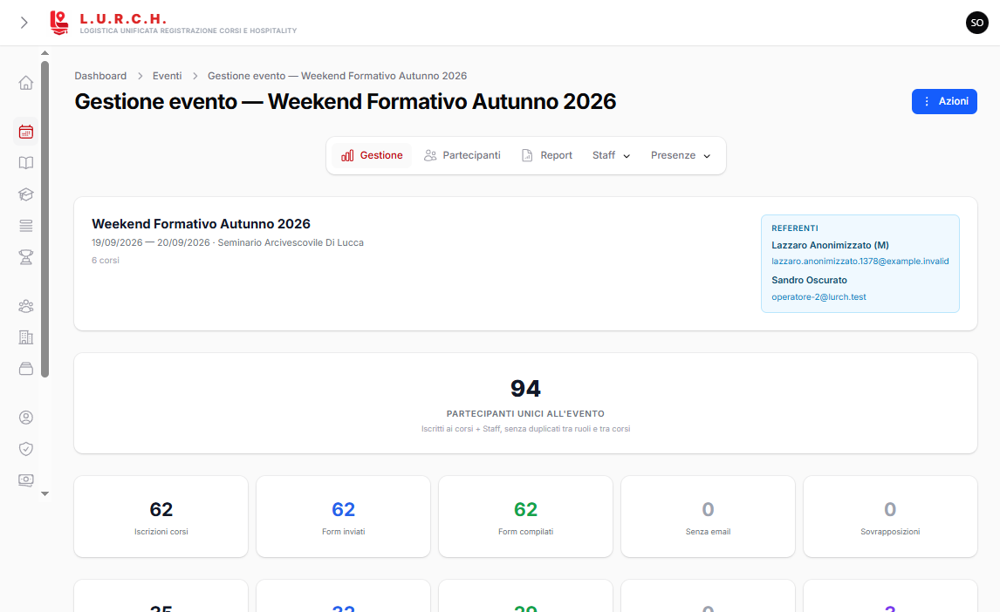
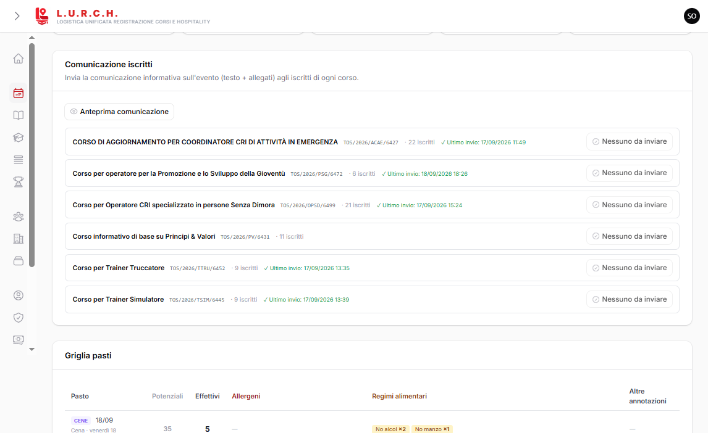
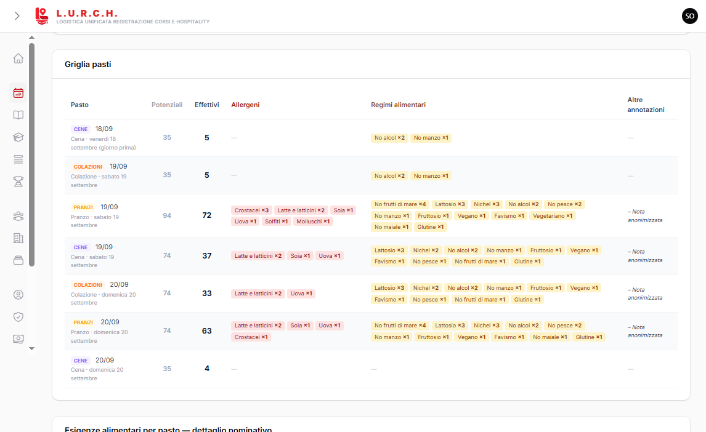
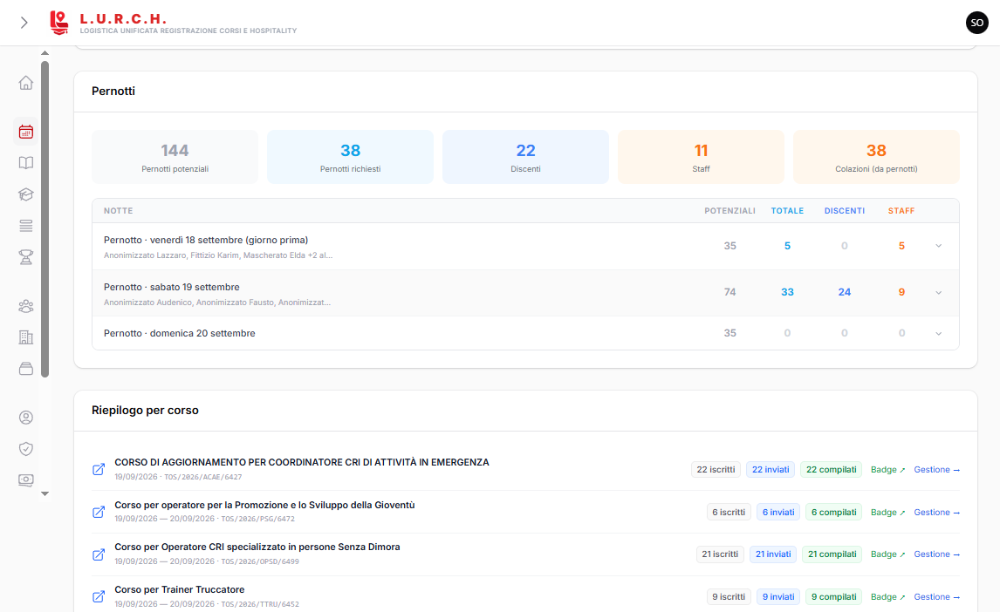
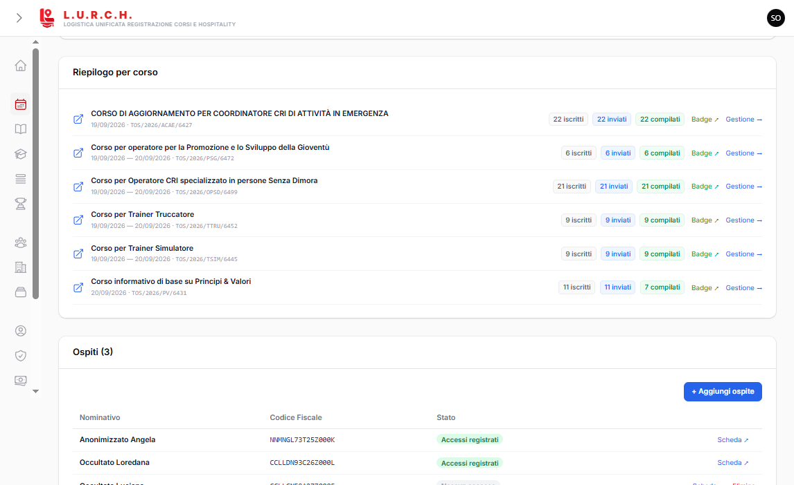
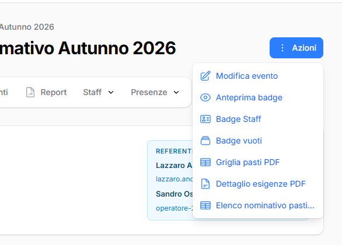

# Gestione dell'evento

> **A chi serve:** operatori e amministratori del pannello.

È la pagina che si apre con un clic su una riga dell'[elenco eventi](01-elenco-e-creazione.md) ed è il quadro d'insieme della **logistica**: quante persone partecipano, quanti pasti e pernottamenti servono, a quali corsi e a quali iscritti è già stata inviata la comunicazione. Sopra c'è la barra con le altre pagine dell'evento (Gestione, Partecipanti, Report, Staff, Presenze), descritte nelle pagine successive di questo capitolo; a destra il pulsante **Azioni**.

Per le cose che riguardano il singolo corso (iscritti, quote, moduli) si passa dalla gestione del corso: da qui ci si arriva con i collegamenti del «Riepilogo per corso» (vedi [Corsi](../02-corsi.md)).

<!-- screenshot: route=/admin/eventi/{id}/gestione · v1.85.38-dev · 2026-11-18 -->

## L'intestazione e i numeri

In alto la scheda dell'evento riporta nome, date, sede e numero di corsi, con i **referenti** (gli amministratori regionali indicati nel modulo dell'evento) e il loro indirizzo email.

Sotto, i numeri, in tre gruppi:

- **Partecipanti unici all'evento**: iscritti ai corsi più staff, contati una volta sola anche se una persona è in più corsi o ha più ruoli.
- **Iscrizioni ai corsi**: iscrizioni totali, moduli di preregistrazione inviati e compilati, iscritti senza email (a cui il modulo non può arrivare) e **sovrapposizioni**.
- **Staff**: membri dello staff, moduli staff inviati e compilati, senza email e quanti sono anche iscritti a un corso.

I numeri colorati di arancione (come «Senza email» maggiore di zero) indicano qualcosa da sistemare.

### Sovrapposizioni

Se qualcuno è iscritto a due corsi dello stesso evento con date che si sovrappongono, compare una tabella con i nomi, i due corsi e un pulsante per **inviare una mail di segnalazione** alla persona, già compilata e modificabile prima dell'invio.

## Comunicazione iscritti

<!-- screenshot: route=/admin/eventi/{id}/gestione · v1.85.38-dev · 2026-11-18 · comunicazione e inizio griglia pasti -->

Invia a tutti gli iscritti di un corso la **comunicazione informativa dell'evento**: il testo e i documenti scritti nella sezione «Contenuti e documenti» del modulo dell'evento (vedi [Elenco e creazione](01-elenco-e-creazione.md)). Senza testo né documenti la sezione lo segnala e i pulsanti restano spenti.

- **Anteprima comunicazione** mostra la mail come arriverà.
- Per ogni corso, il pulsante **Invia a tutti (N)** manda la comunicazione a chi non l'ha ancora ricevuta; accanto al corso compare la data dell'ultimo invio. Quando tutti l'hanno ricevuta il pulsante diventa «Nessuno da inviare».
- Il pulsante è spento, con la spiegazione al passaggio del mouse, se il corso è concluso o annullato, se non ha iscritti o se manca il contenuto.

## Griglia pasti

<!-- screenshot: route=/admin/eventi/{id}/gestione · v1.85.38-dev · 2026-11-18 -->

Una riga per ogni pasto (cena, colazione, pranzo) di ogni giorno. Le colonne vanno lette così:

- **Potenziali**: le persone previste, in base a quanto è stato dichiarato nei moduli di preregistrazione e nelle candidature dello staff, contate una volta sola.
- **Effettivi**: le persone che hanno confermato il pasto al check-in, quindi presenti davvero (vedi [Presenze effettive](08-presenze-effettive.md)).
- **Allergeni**, **Regimi alimentari**, **Altre annotazioni**: le esigenze alimentari di chi partecipa a quel pasto, con quante persone per ciascuna.

Subito sotto, **Esigenze alimentari per pasto**, la stessa griglia in dettaglio nominativo: ogni pasto si apre e mostra tutte le persone previste, con allergeni, diete e note accanto al nome di chi ne ha. Serve a chi prepara i pasti per sapere chi ha cosa.

> Il confronto tra potenziali ed effettivi è la differenza tra ciò che le persone hanno dichiarato in anticipo e ciò che è stato confermato sul posto: i primi servono alla logistica prima dell'evento, i secondi dicono come è andata.

## Pernotti

<!-- screenshot: route=/admin/eventi/{id}/gestione · v1.85.38-dev · 2026-11-18 -->

In testa i totali: pernotti potenziali, pernotti richiesti, quanti sono discenti e quanti staff, e le colazioni che ne derivano (chi pernotta fa colazione). Sotto, una riga per ogni notte, che si apre per mostrare i nomi divisi tra discenti e staff. **Scarica Excel** (in alto a destra della sezione) esporta l'elenco di chi pernotta.

La sezione compare solo se l'evento prevede pernottamenti.

## Riepilogo per corso

<!-- screenshot: route=/admin/eventi/{id}/gestione · v1.85.38-dev · 2026-11-18 -->

Una riga per ogni corso dell'evento, con le date, il protocollo e tre contatori: **iscritti**, moduli **inviati** e **compilati**. A destra:

- **Badge** stampa i badge dei corsisti di quel corso;
- **Gestione** apre la gestione del corso;
- l'icona a sinistra apre la stessa gestione in una nuova scheda.

## Ospiti

Gli ospiti sono persone presenti all'evento che non sono né iscritte a un corso né nello staff. **+ Aggiungi ospite** chiede cognome, nome e codice fiscale; ogni ospite ha una **Scheda** per il check-in. Un ospite si può eliminare solo finché non ha accessi registrati.

## Il pulsante Azioni

<!-- screenshot: route=/admin/eventi/{id}/gestione · v1.85.38-dev · 2026-11-18 · menu Azioni aperto -->

| Voce | Cosa fa |
|---|---|
| Modifica evento | Apre il modulo dell'evento (vedi [Elenco e creazione](01-elenco-e-creazione.md)) |
| Anteprima badge | Mostra come verrà il badge con lo sfondo e le posizioni impostati nell'evento |
| Badge Staff | PDF con i badge dello staff |
| Badge vuoti | PDF con badge senza nome, per chi non è in elenco |
| Griglia pasti PDF | La griglia pasti di questa pagina in PDF |
| Dettaglio esigenze PDF | Il dettaglio nominativo delle esigenze alimentari in PDF |
| Elenco nominativo pasti Excel | Tutti i pasti con i nomi, in Excel |

I PDF si aprono in una nuova scheda. I badge dei corsisti si stampano dal «Riepilogo per corso»; per l'elenco unificato di tutte le persone vedi [Partecipanti e badge](05-partecipanti-e-badge.md).
