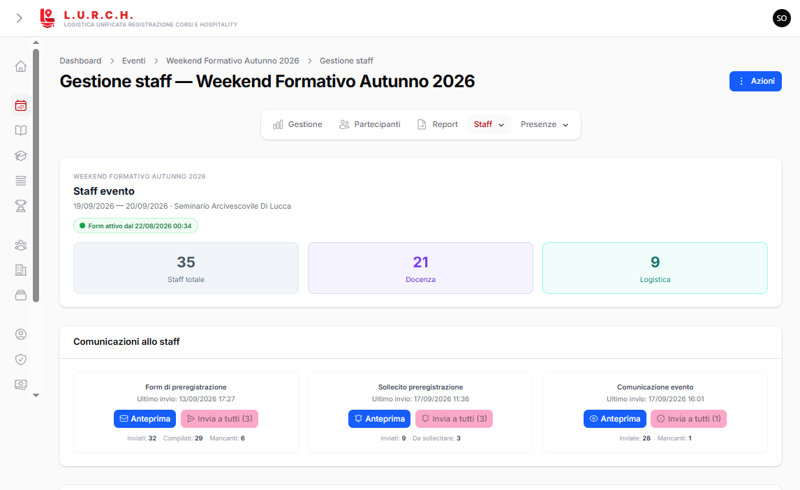
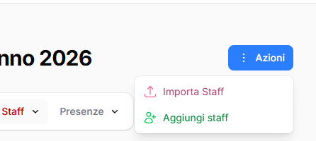
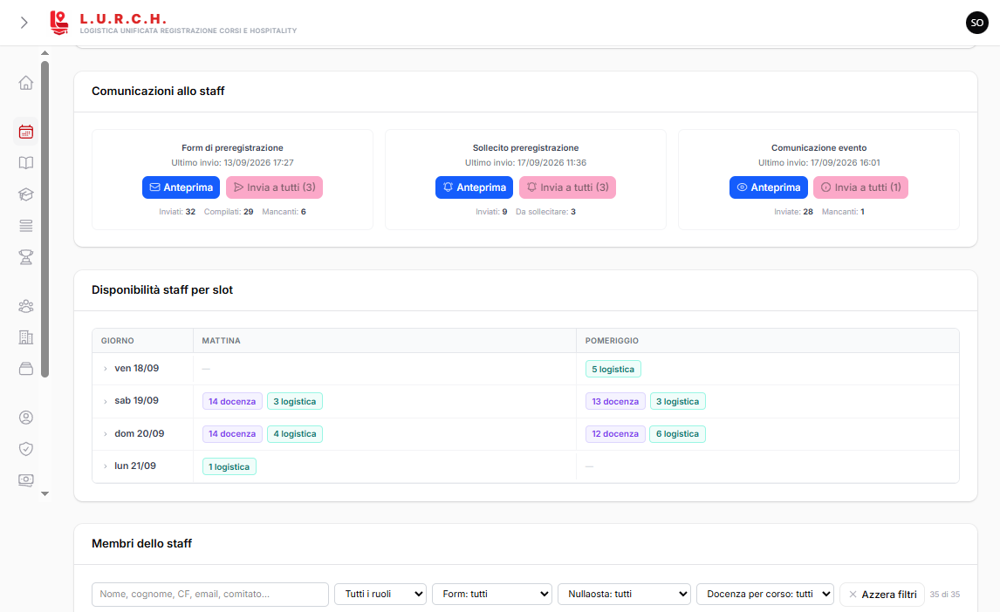
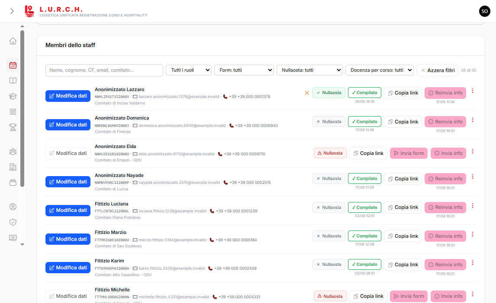
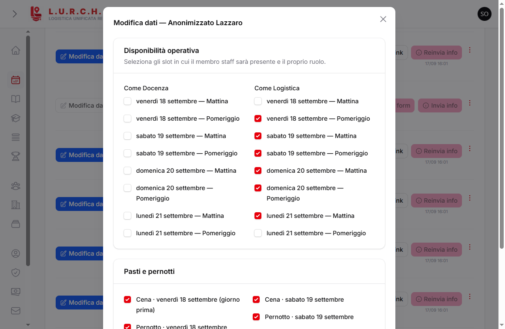
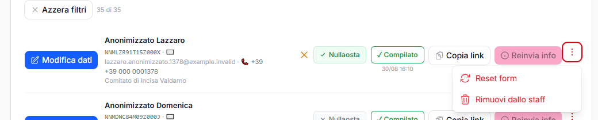

# Staff

> **A chi serve:** operatori e amministratori del pannello.

Lo **staff** è l'insieme delle persone che lavorano all'evento: docenti (**Docenza**) e chi si occupa dell'organizzazione (**Logistica**). Si gestisce dalla scheda **Staff → Gestione staff** della barra dell'evento. Le persone arrivano in due modi: dalle [candidature](04-candidature-staff.md) confermate, oppure aggiunte direttamente da questa pagina.

<!-- screenshot: route=/admin/eventi/{id}/staff · v1.85.38-dev · 2026-11-18 -->

## L'intestazione

Riporta nome, date e sede dell'evento, lo stato del **form staff** («Form attivo dal…») e tre numeri: staff totale, quanti fanno **Docenza** e quanti **Logistica** (una persona può fare entrambe). Il form staff è il modulo che ogni membro compila per indicare disponibilità, pasti e pernotti; si attiva dalla sezione «Candidature staff» del modulo dell'evento (vedi [Elenco e creazione](01-elenco-e-creazione.md)) e le email non partono finché non è attivo.

## Aggiungere e importare lo staff

Il pulsante **Azioni**, in alto a destra, ha due voci:

<!-- screenshot: route=/admin/eventi/{id}/staff · v1.85.38-dev · 2026-11-18 · menu Azioni -->

- **Aggiungi staff**: si scrive il codice fiscale e **Cerca** compila i dati se la persona è già tra i soci; altrimenti si completano a mano cognome, nome, email, telefono e comitato. Se la persona è già nello staff dell'evento, lo dice e non la aggiunge due volte.
- **Importa Staff**: carica un file Excel (`.xlsx` o `.xls`) con più persone insieme. Al termine una notifica dice quante sono state importate e se ci sono errori.

## Comunicazioni allo staff

<!-- screenshot: route=/admin/eventi/{id}/staff · v1.85.38-dev · 2026-11-18 -->

Tre riquadri, uno per ogni email che si può mandare a tutto lo staff. Ognuno ha **Anteprima** (mostra l'email com'è) e **Invia a tutti (N)** (la manda a chi non l'ha ancora ricevuta; chiede conferma e salta chi non ha l'email). Sotto, i contatori:

| Riquadro | Cosa manda | Contatori |
|---|---|---|
| Form di preregistrazione | Il link personale al form staff | inviati, compilati, mancanti |
| Sollecito preregistrazione | Un promemoria a chi non ha ancora compilato il form | inviati, da sollecitare |
| Comunicazione evento | Il testo e i documenti dell'evento (sezione «Contenuti e documenti», vedi [Elenco e creazione](01-elenco-e-creazione.md)) | inviate, mancanti |

Un pulsante appare **sbiadito** quando non è disponibile: se l'evento è concluso, se tutti hanno già ricevuto l'email, o se per la comunicazione manca il contenuto. Passando il mouse si legge il motivo.

## Disponibilità staff per slot

Una tabella con i giorni dell'evento e due fasce, mattina e pomeriggio. In ogni casella, quante persone hanno dato disponibilità come docenza e quante come logistica, così si vede subito dove manca qualcuno. Un clic sul giorno mostra i nomi.

## Membri dello staff

<!-- screenshot: route=/admin/eventi/{id}/staff · v1.85.38-dev · 2026-11-18 · elenco membri -->

L'elenco ha in alto una casella di ricerca (nome, cognome, codice fiscale, email, comitato) e quattro filtri: **ruolo** (docenza o logistica), **form** (compilato o mancante), **nullaosta** e **docenza per corso**. In fondo ai filtri, quante persone si vedono sul totale e **Azzera filtri**. Un clic su email o telefono li copia.

Ogni riga ha, da sinistra a destra:

- **Modifica dati**: apre una finestra per correggere a mano la disponibilità (slot come docenza e come logistica) e i pasti e pernotti della persona. È utile quando qualcuno comunica un cambio e non vuole ricompilare il form.

<!-- screenshot: route=/admin/eventi/{id}/staff · v1.85.38-dev · 2026-11-18 · finestra Modifica dati -->

- **Nullaosta**: serve a chi ha dato disponibilità come logistica ed è il documento di autorizzazione da allegare nel form. Lo stato è nel colore: rosso se manca, evidenziato se allegato e **da verificare**, verde se già **verificato**, grigio se non è richiesto. Un clic apre il documento; con le piccole icone accanto lo si segna come verificato (o si toglie la verifica) e, finché non è verificato, si può sostituire il file.
- **Compilato**: il form è stato compilato, con la data.
- **Copia link**: copia il link personale del form, da mandare per un altro canale.
- **Invia form / Invia sollecito / Invia info** (o **Reinvia**): spedisce a quella persona il form, il sollecito o la comunicazione dell'evento. Il pulsante cambia in base a ciò che ha già ricevuto.
- **Menu a tre puntini**, in rosso, con le azioni che cancellano qualcosa:

<!-- screenshot: route=/admin/eventi/{id}/staff · v1.85.38-dev · 2026-11-18 · menu della riga -->

  - **Reset form**: elimina tutto ciò che la persona ha compilato (comprese le presenze modificate dalla segreteria) e le permette di ricompilare dal link originale. È riservato a superadmin e amministratori regionali, e chiede conferma.
  - **Rimuovi dallo staff**: toglie la persona dallo staff dell'evento. Se arrivava da una candidatura, questa torna «in attesa». Chiede conferma.

> Lo staff che compare qui compare anche nell'elenco unificato dei [Partecipanti](05-partecipanti-e-badge.md) e nei pasti e pernottamenti di [Gestione dell'evento](02-gestione-evento.md).
