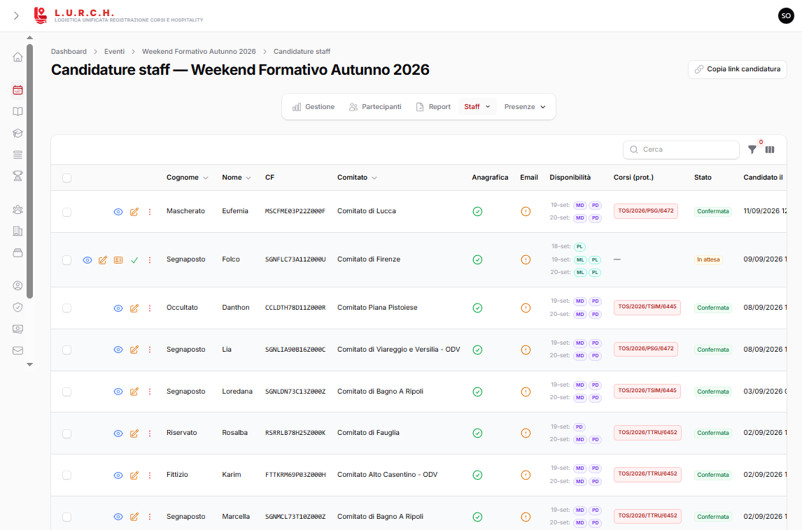
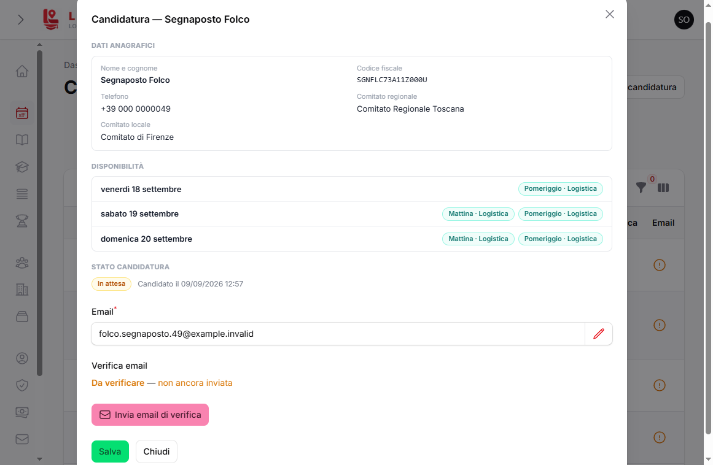
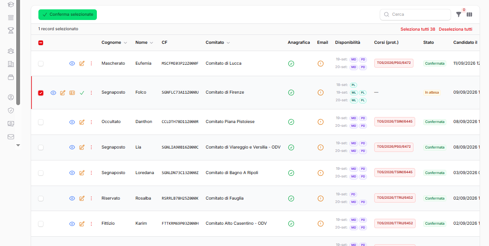

# Candidature staff

> **A chi serve:** operatori e amministratori del pannello.

Per gli eventi che ne hanno bisogno, lo staff può **candidarsi da solo** con un modulo pubblico, senza che qualcuno lo inserisca a mano. Le candidature arrivano in questa pagina (scheda **Staff → Candidature** della barra dell'evento), dove un operatore le esamina e **sceglie chi confermare**. La conferma è una scelta organizzativa: nessuna candidatura diventa staff da sola, anche se la persona è già un socio.

Per aggiungere lo staff senza candidatura (a mano o con un file Excel) vedi [Staff](03-staff.md).

## Come funziona, in breve

1. Nel modulo dell'evento, sezione **Candidature staff**, si impostano apertura e chiusura delle candidature (vedi [Elenco e creazione](01-elenco-e-creazione.md)).
2. Il pulsante **Copia link candidatura**, in alto a destra in questa pagina, copia il link da diffondere. Fuori dalle date il link mostra che le candidature sono chiuse.
3. Chi si candida inserisce il codice fiscale, controlla i propri contatti e per ogni mezza giornata dell'evento indica se è disponibile come **docente** o come **logistica** (una scelta o l'altra per ogni fascia). Se sceglie docenza deve indicare anche **in quali corsi**. Riceve un'email per verificare il proprio indirizzo. Ogni codice fiscale può presentare **una sola candidatura per evento**: chi riprova (anche dopo un rifiuto) vede il messaggio «Questo codice fiscale ha già presentato una candidatura per questo evento» e non può inviarne un'altra.
4. La candidatura arriva qui **in attesa**. L'operatore la conferma o la rifiuta.
5. Quando è confermata, la persona entra nello [Staff](03-staff.md) dell'evento e da lì riceve il form di preregistrazione come ogni altro membro.

Il modulo visto da chi si candida è descritto in [Candidatura staff](../../../03-moduli-pubblici/04-candidatura-staff.md).

## La tabella

<!-- screenshot: route=/admin/eventi/{id}/candidature-staff · v1.85.38-dev · 2026-11-18 -->

| Colonna | Cosa mostra |
|---|---|
| Cognome, Nome, CF, Comitato | I dati dichiarati da chi si candida |
| Anagrafica | Se il codice fiscale corrisponde a un socio in archivio: spunta verde = socio trovato; croce rossa = non trovato, da controllare; un segno grigio = confermato come **esterno** |
| Email | Se l'indirizzo è stato verificato (il punto esclamativo arancione indica che non lo è ancora) |
| Disponibilità | Per ogni giorno le fasce scelte: **M** mattina e **P** pomeriggio, con **D** per docenza (viola) e **L** per logistica (verde acqua); passando il mouse si legge per esteso |
| Corsi (prot.) | I corsi, con il protocollo, in cui la persona ha dato disponibilità come docente |
| Stato | In attesa, Confermata o Rifiutata |
| Candidato il | Data e ora della candidatura |

Sopra la tabella ci sono la ricerca e, con l'icona a imbuto, i filtri: **Stato**, **disponibilità docenti**, **disponibilità logistica**, **anagrafica** (socio trovato, confermato esterno, da verificare) ed **email verificata**. L'icona a colonne mostra o nasconde le colonne.

## Esaminare una candidatura

Le azioni sono le icone all'inizio di ogni riga.

- **Dettagli** (occhio) apre la scheda completa: dati anagrafici, disponibilità giorno per giorno, stato e verifica dell'email.

<!-- screenshot: route=/admin/eventi/{id}/candidature-staff · v1.85.38-dev · 2026-11-18 · scheda Dettagli -->

  Dalla scheda si può **correggere l'email** (matita accanto all'indirizzo, poi **Salva**), utile quando è stata scritta male, e **Invia email di verifica** per rimandare il messaggio di controllo.
- **Modifica disponibilità** (matita) corregge le fasce e se sono docenza o logistica, per esempio quando qualcuno ha scelto logistica per errore. I dati anagrafici non si toccano da qui.
- **Correggi CF** corregge un codice fiscale scritto male e riprova ad agganciare la persona a un socio. Se un'altra candidatura dello stesso evento ha già quel codice, lo segnala e non procede. Compare solo finché la candidatura è in attesa.
- **Esterno** conferma che la persona non è un socio CRI (per esempio un docente esterno): la candidatura resta senza socio collegato e il segnale «non trovato» si spegne. Se poi risultasse un socio, **Correggi CF** resta disponibile.

## Confermare, rifiutare, ripensarci

Si può passare liberamente da uno stato all'altro, e **non parte mai nessuna email** (la persona non viene avvisata dell'esito: se serve, le si scrive a parte). Una persona rifiutata non può ricandidarsi con lo stesso codice fiscale: se si ripensa, la si riporta in attesa da qui.

- **Conferma** (spunta verde): la persona entra nello [Staff](03-staff.md) dell'evento e i suoi dati vengono allineati all'anagrafica dei soci (se non è ancora socio viene creata la scheda). Se era già nello staff, i suoi dati e il link già inviato non cambiano.
- **Rifiuta**: la candidatura passa a «Rifiutata». Se era già confermata, la persona viene tolta dallo staff.
- **Ritira conferma** (nel menu a tre puntini, sulle candidature confermate): toglie la persona dallo staff e riporta la candidatura «in attesa».
- **Riporta in attesa** (stesso menu, sulle rifiutate): rimette in attesa una candidatura rifiutata.

Quindi solo una candidatura **confermata** corrisponde a una persona presente nello staff.

### Confermare più candidature insieme

Si spuntano le caselle all'inizio delle righe (o **Seleziona tutti**, che prende tutte le candidature, anche quelle delle altre pagine) e si preme **Conferma selezionate**, in alto a sinistra. Chiede conferma e salta quelle già confermate.

<!-- screenshot: route=/admin/eventi/{id}/candidature-staff · v1.85.38-dev · 2026-11-18 · selezione per conferma multipla -->

> Le candidature rifiutate restano nella tabella con il loro stato, non spariscono: servono come storico e si possono sempre ripensare.
