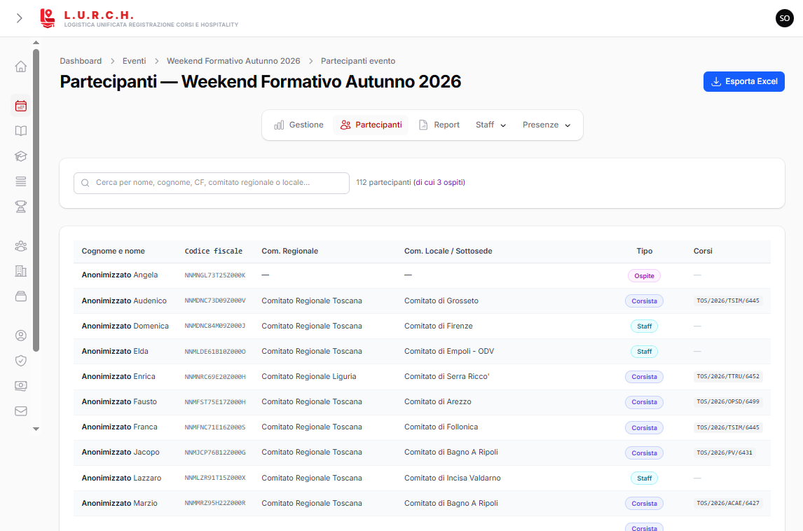
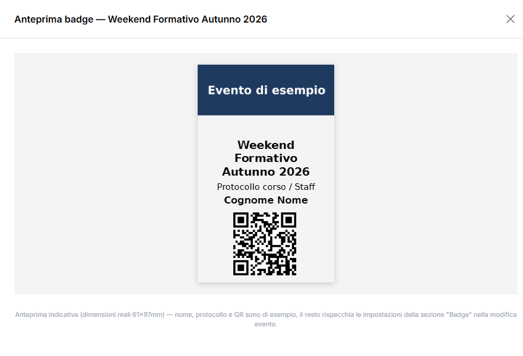

# Partecipanti e badge

> **A chi serve:** operatori e amministratori del pannello.

Tutte le persone di un evento in un unico elenco, e i badge con cui si presentano all'ingresso.

## Partecipanti

La scheda **Partecipanti** della barra dell'evento riunisce chi è coinvolto in qualunque modo: **corsisti** (iscritti a uno dei corsi dell'evento), **staff** e **ospiti**. Una persona che ha più ruoli, per esempio iscritta a un corso e anche nello staff, compare **una volta sola**, con tutti i ruoli.

<!-- screenshot: route=/admin/eventi/{id}/partecipanti · v1.85.38-dev · 2026-11-18 -->

| Colonna | Cosa mostra |
|---|---|
| Cognome e nome | Ordinati alfabeticamente per cognome |
| Codice fiscale | |
| Com. Regionale | Il comitato regionale di appartenenza (un trattino per gli ospiti) |
| Com. Locale / Sottosede | Il comitato locale o la sottosede |
| Tipo | Corsista, Staff e/o Ospite |
| Corsi | Il protocollo dei corsi a cui la persona è iscritta |

In alto, la casella **Cerca** filtra mentre si scrive per nome, cognome, codice fiscale o comitato (regionale o locale), e il contatore riporta quanti sono i partecipanti e quanti di loro sono ospiti.

**Esporta Excel**, in alto a destra, scarica l'elenco in un foglio Excel. Se hai scritto qualcosa nella ricerca, l'esportazione contiene solo le persone trovate.

La pagina è di sola lettura: per modificare una persona si passa dalla sua pagina di origine (il corso per gli iscritti, [Staff](03-staff.md) per lo staff, [Gestione dell'evento](02-gestione-evento.md) per gli ospiti).

## Badge

Il badge è il cartellino con il **codice QR personale** che si scansiona all'ingresso per registrare il check-in (vedi [Presenze live](06-presenze-live.md)). Ogni persona ha un QR proprio, che non contiene dati personali: porta alla sua scheda di presenza.

### Dove si stampano

I PDF sono in formato A6 verticale, quattro per ogni foglio A4, e si aprono in una nuova scheda:

- **Corsisti**: dal [riepilogo per corso](02-gestione-evento.md) di Gestione dell'evento, con il collegamento **Badge** di ciascun corso (vedi anche [Corsi](../02-corsi.md)).
- **Staff**: dal menu **Azioni** di Gestione dell'evento, voce **Badge Staff**.
- **Badge vuoti**: dallo stesso menu, voce **Badge vuoti**: lo sfondo dell'evento senza nomi, per chi si presenta senza essere in elenco.

### Come si imposta l'aspetto

Si imposta nella sezione **Badge** del modulo dell'evento, che si apre da **Modifica evento** (vedi [Elenco e creazione](01-elenco-e-creazione.md)):

- lo **sfondo** da caricare (PNG o JPG, dimensione consigliata 610×970 pixel, verticale);
- se **stampare il titolo dell'evento**: da attivare solo se lo sfondo non lo contiene già, altrimenti uscirebbe due volte;
- la **posizione e la dimensione** del titolo, del nome e cognome, del protocollo e del codice QR, in millimetri dal bordo del badge (61 × 97 mm);
- se **includere il QR nell'email di comunicazione** dell'evento: così ognuno riceve il proprio QR anche per posta elettronica, come immagine dentro il messaggio.

Per controllare il risultato senza stampare, dal menu **Azioni** di Gestione dell'evento c'è **Anteprima badge**:

<!-- screenshot: route=/admin/eventi/{id}/gestione · v1.85.38-dev · 2026-11-18 · anteprima badge -->

Nome, protocollo e QR sono di esempio; il resto rispecchia le impostazioni dell'evento.
