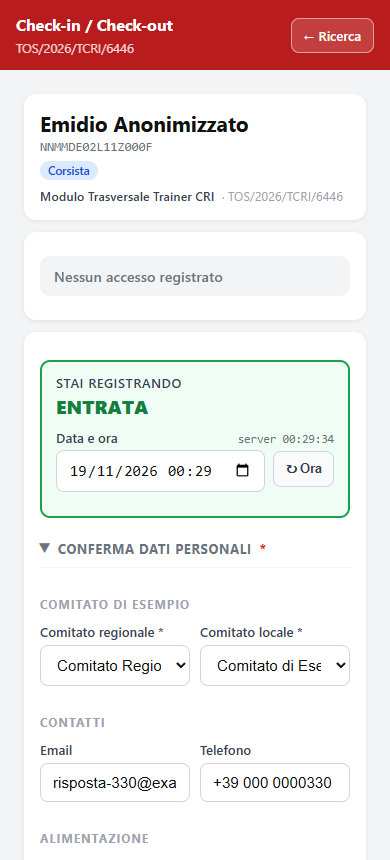
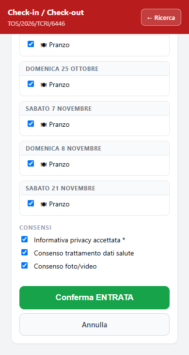
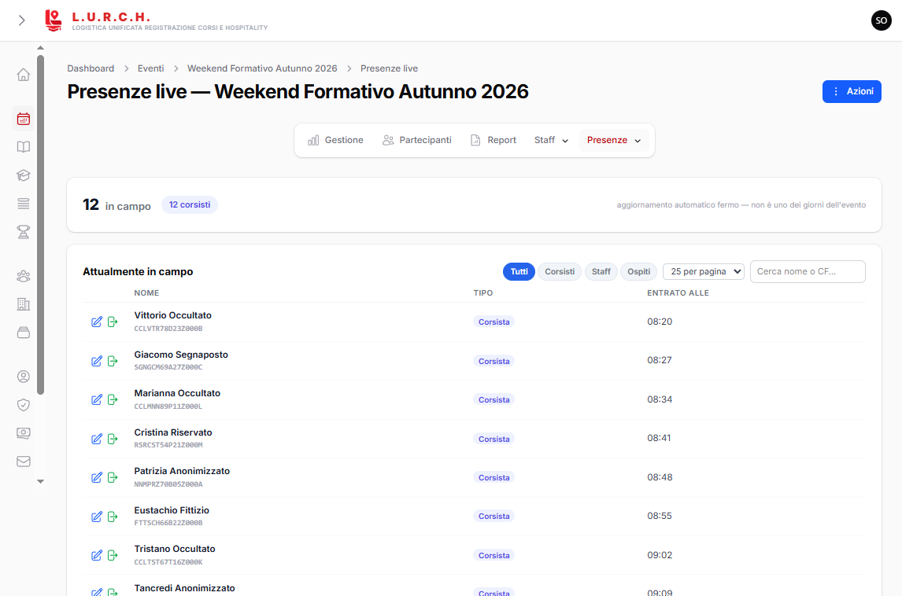
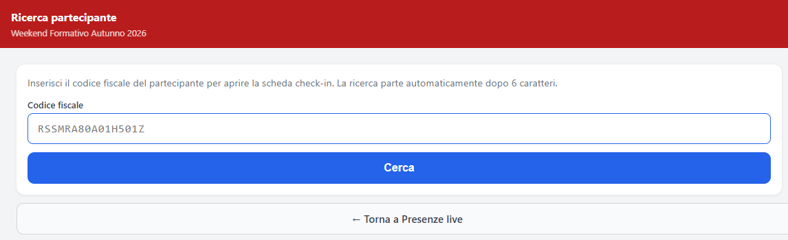

# Presenze live

> **A chi serve:** operatori e amministratori del pannello.

Durante l'evento questa pagina dice **chi è dentro in questo momento** e conserva lo storico di tutti gli ingressi e le uscite. Si apre dalla scheda **Presenze → Presenze live** della barra dell'evento.

Gli ingressi e le uscite si registrano scansionando il **codice QR del badge** con il telefono, come spiegato qui sotto ([Partecipanti e badge](05-partecipanti-e-badge.md) per la stampa dei badge). Questa pagina non registra gli ingressi: li mostra, e permette di correggere o chiudere quelli sbagliati.

## Registrare ingressi e uscite

All'ingresso un operatore inquadra il badge della persona con il proprio telefono. La scheda di check-in si apre **solo se** sul telefono c'è un accesso attivo al pannello e l'utente può gestire il check-in di quell'evento: superadmin, amministratori del territorio, operatori assegnati all'evento con il permesso di check-in. Chi non è collegato, o non è abilitato, vede invece la [pagina pubblica per lasciare un messaggio](../../../03-moduli-pubblici/06-badge-e-messaggi.md). Prima di aprire i varchi conviene quindi entrare nel pannello dal browser del telefono che si userà.

La scheda **Check-in / Check-out** mostra nome, codice fiscale, ruolo (corsista, staff o entrambi) e l'ultimo accesso registrato. La grafica è quella, semplice, dell'app, pensata per il telefono.

<!-- screenshot: route=/badge/{evento}/{token} · v1.85.38-dev · 2026-11-19 · operatore collegato, comitati di esempio -->

- **Entrata o uscita** si decide da sola: se la persona è fuori si registra l'entrata, se è dentro l'uscita. Data e ora sono quelle del momento; **Ora** le riporta all'istante attuale.
- Al **primo ingresso** la scheda chiede di confermare i dati: comitato, contatti, alimentazione, pasti e pernottamenti, consensi. Arrivano già compilati da tutti i form di preregistrazione della persona per quell'evento (corsi e staff insieme): si controllano con lei e si correggono se è cambiato qualcosa. Da quel momento valgono questi dati, non quelli dei form: sono le [risposte al check-in](07-risposte-checkin.md). Se la persona non ha nessun pasto all'evento (per esempio un corso con tutti i [pasti non forniti dall'organizzazione](../02-corsi/02-creare-e-modificare.md#pasti-non-forniti-dallorganizzazione)), la scheda non mostra l'alimentazione né il consenso ai dati sulla salute.
- **Conferma ENTRATA** (o **Conferma USCITA**) registra il passaggio, con il nome dell'operatore.

<!-- screenshot: route=/badge/{evento}/{token} · v1.85.38-dev · 2026-11-19 · operatore collegato -->

**← Ricerca** apre la ricerca per codice fiscale (la stessa di **Cerca per CF**, più sotto), per chi ha dimenticato il badge e per registrare un ospite non iscritto. Il check-in si registra solo nei giorni dell'evento e nel giorno prima e dopo ogni blocco di giorni (per un evento su più fine settimana, non nei giorni in mezzo): fuori da questi giorni la conferma risponde «Il check-in non è disponibile al di fuori dei giorni dell'evento».

## Chi è in campo

<!-- screenshot: route=/admin/eventi/{id}/presenze-live · v1.85.38-dev · 2026-11-18 · dati di prova -->

In alto il numero di persone in campo, diviso in corsisti, staff e ospiti. Una persona è «in campo» se il suo ultimo passaggio registrato è un **ingresso**: il tipo si alterna da solo, ingresso poi uscita poi ingresso, senza bisogno di sceglierlo.

Sotto, l'elenco **Attualmente in campo**, con nome, codice fiscale, tipo (corsista, staff, corsista e staff, ospite) e ora di ingresso. Si può filtrare per tipo con i pulsanti **Tutti / Corsisti / Staff / Ospiti**, cercare per nome o codice fiscale e scegliere quante righe vedere per pagina.

Sul lato destro del riquadro in alto compare «aggiornamento automatico fermo» fuori dai giorni dell'evento: **nei giorni dell'evento la pagina si aggiorna da sola**, senza bisogno di ricaricarla, così si può lasciare aperta su uno schermo.

Ogni riga ha due icone:

- **Modifica dati** (matita) apre i dati di check-in della persona: pasti e pernottamenti confermati, allergeni, intolleranze, diete, esclusioni alimentari e note. Serve a correggere ciò che è stato scritto o scelto male al primo ingresso.
- **Registra uscita** (freccia verde) registra a mano l'uscita di quella persona, dopo una conferma. Utile quando qualcuno se n'è andato senza passare dal controllo.

## Azioni

<!-- screenshot: route=/admin/eventi/{id}/presenze-live · v1.85.38-dev · 2026-11-18 · menu Azioni -->

- **Cerca per CF** apre in una nuova scheda una pagina semplice, pensata per il telefono, dove si scrive il codice fiscale di una persona (la ricerca parte da sola dopo 6 caratteri) per aprire la sua scheda di check-in senza il badge. È il modo di registrare chi ha perso o dimenticato il badge, o un ospite aggiunto sul momento.

<!-- screenshot: route=/admin/eventi/{id}/checkin · v1.85.38-dev · 2026-11-18 -->

- **Checkout di massa (N)** registra l'uscita di tutte le persone ancora in campo, all'orario indicato. Si usa a fine giornata, per chiudere le presenze di chi se n'è andato senza far registrare l'uscita. Chiede conferma e **non si può annullare**. Compare solo se c'è almeno una persona in campo.

## Storico accessi

<!-- screenshot: route=/admin/eventi/{id}/presenze-live · v1.85.38-dev · 2026-11-18 -->

Tutti i passaggi dell'evento, dal più recente: data e ora, nome e codice fiscale, tipo (**Entrata** o **Uscita**) e l'**operatore** che l'ha registrato. Si può restringere a un giorno con la data, cercare per nome o codice fiscale e scegliere 25, 50 o 100 righe per pagina. Il totale è accanto al titolo.

Per sapere quanti pasti e pernottamenti sono stati davvero confermati, e non solo quanti passaggi, serve la pagina [Presenze effettive](08-presenze-effettive.md).
