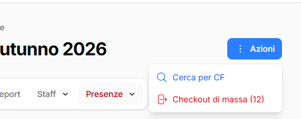
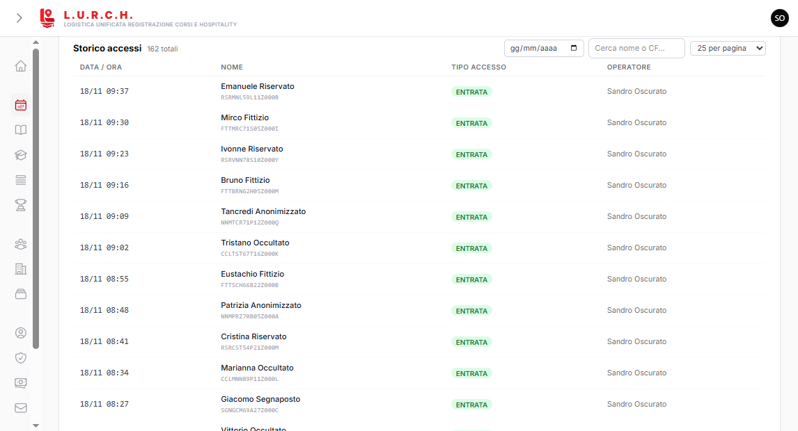

# Presenze live

> **A chi serve:** operatori e amministratori del pannello.

Durante l'evento questa pagina dice **chi è dentro in questo momento** e conserva lo storico di tutti gli ingressi e le uscite. Si apre dalla scheda **Presenze → Presenze live** della barra dell'evento.

Gli ingressi e le uscite si registrano scansionando il **codice QR del badge** con il telefono (vedi [Badge e check-in](../../../03-moduli-pubblici/06-badge-e-check-in.md) e, per i badge, [Partecipanti e badge](05-partecipanti-e-badge.md)). Al primo ingresso la persona compila o conferma i propri dati (pasti, pernottamenti, allergeni): sono le [risposte al check-in](07-risposte-checkin.md). Questa pagina non registra gli ingressi: li mostra, e permette di correggere o chiudere quelli sbagliati.

## Chi è in campo

<!-- screenshot: route=/admin/eventi/{id}/presenze-live · v1.85.38-dev · 2026-11-18 · dati di prova -->

In alto il numero di persone in campo, diviso in corsisti, staff e ospiti. Una persona è «in campo» se il suo ultimo passaggio registrato è un **ingresso**: il tipo si alterna da solo, ingresso poi uscita poi ingresso, senza bisogno di sceglierlo.

Sotto, l'elenco **Attualmente in campo**, con nome, codice fiscale, tipo (corsista, staff, corsista e staff, ospite) e ora di ingresso. Si può filtrare per tipo con i pulsanti **Tutti / Corsisti / Staff / Ospiti**, cercare per nome o codice fiscale e scegliere quante righe vedere per pagina.

Sul lato destro del riquadro in alto compare «aggiornamento automatico fermo» fuori dai giorni dell'evento: **nei giorni dell'evento la pagina si aggiorna da sola**, senza bisogno di ricaricarla, così si può lasciare aperta su uno schermo.

Ogni riga ha due icone:

- **Modifica dati** (matita) apre i dati di check-in della persona: pasti e pernottamenti confermati, allergeni, intolleranze, diete, esclusioni alimentari e note. Serve a correggere ciò che è stato scritto o scelto male al primo ingresso.
- **Registra uscita** (freccia verde) registra a mano l'uscita di quella persona, dopo una conferma. Utile quando qualcuno se n'è andato senza passare dal controllo.

## Azioni

<!-- screenshot: route=/admin/eventi/{id}/presenze-live · v1.85.38-dev · 2026-11-18 · menu Azioni -->

- **Cerca per CF** apre in una nuova scheda una pagina semplice, pensata per il telefono, dove si scrive il codice fiscale di una persona (la ricerca parte da sola dopo 6 caratteri) per aprire la sua scheda di check-in senza il badge. È il modo di registrare chi ha perso o dimenticato il badge, o un ospite aggiunto sul momento.

<!-- screenshot: route=/admin/eventi/{id}/checkin · v1.85.38-dev · 2026-11-18 -->

- **Checkout di massa (N)** registra l'uscita di tutte le persone ancora in campo, all'orario indicato. Si usa a fine giornata, per chiudere le presenze di chi se n'è andato senza far registrare l'uscita. Chiede conferma e **non si può annullare**. Compare solo se c'è almeno una persona in campo.

## Storico accessi

<!-- screenshot: route=/admin/eventi/{id}/presenze-live · v1.85.38-dev · 2026-11-18 -->

Tutti i passaggi dell'evento, dal più recente: data e ora, nome e codice fiscale, tipo (**Entrata** o **Uscita**) e l'**operatore** che l'ha registrato. Si può restringere a un giorno con la data, cercare per nome o codice fiscale e scegliere 25, 50 o 100 righe per pagina. Il totale è accanto al titolo.

Per sapere quanti pasti e pernottamenti sono stati davvero confermati, e non solo quanti passaggi, serve la pagina [Presenze effettive](08-presenze-effettive.md).
