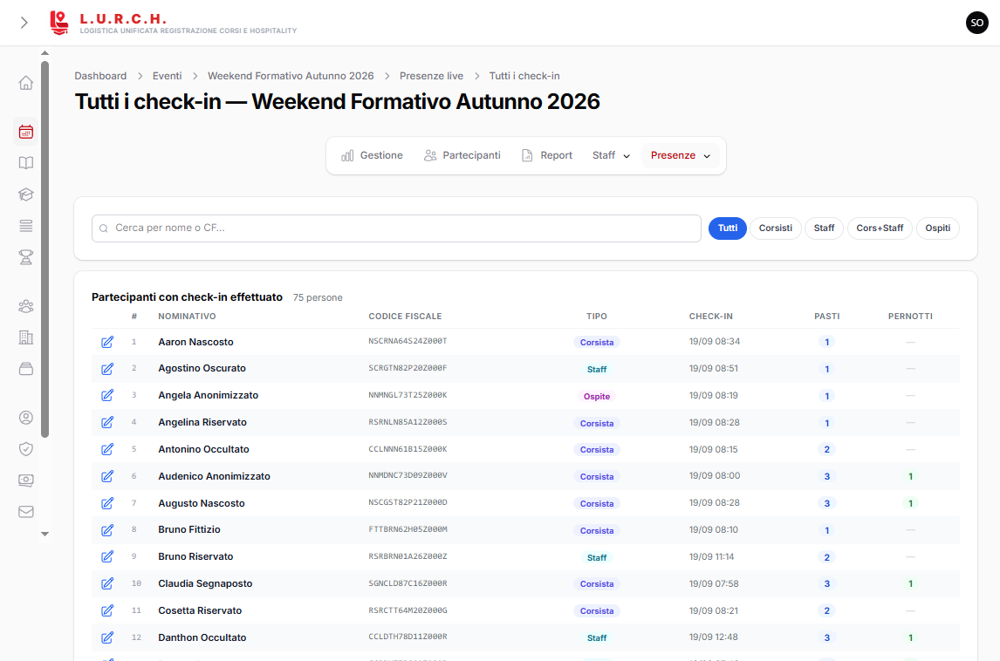
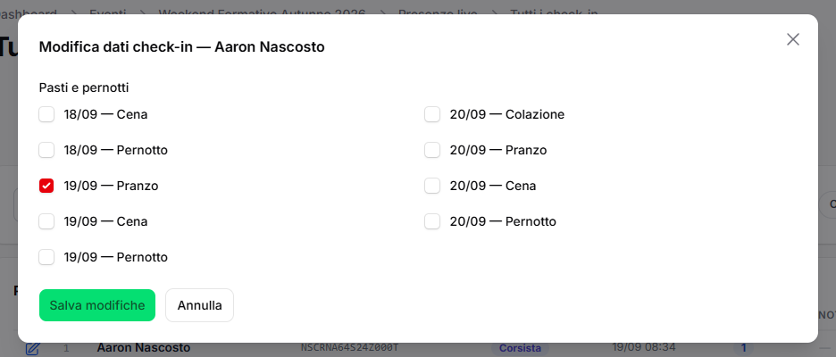

# Risposte al check-in

> **A chi serve:** operatori e amministratori del pannello.

L'elenco di **tutte le persone che hanno già fatto il check-in** all'evento, con ciò che hanno confermato al primo ingresso: quanti pasti e quanti pernottamenti. Si apre dalla scheda **Presenze → Risposte check-in** della barra dell'evento (il titolo della pagina è «Tutti i check-in»).

## Che cosa sono le risposte al check-in

Al **primo ingresso**, quando si scansiona il badge (vedi [Presenze live](06-presenze-live.md)), la persona vede una scheda già compilata con quanto aveva dichiarato nei moduli di preregistrazione: pasti, pernottamenti, allergeni, diete. Conferma o corregge, e queste sono le sue **risposte al check-in**. Si salvano una volta sola per persona, anche se è iscritta a più corsi o è anche nello staff.

Sono i dati **effettivi**, cioè quelli confermati sul posto. Restano distinti da quelli dichiarati in anticipo, che sono i «potenziali» di [Gestione dell'evento](02-gestione-evento.md): il check-in non cambia mai i dati della preregistrazione, e questi ultimi non cambiano le risposte al check-in.

## L'elenco

<!-- screenshot: route=/admin/eventi/{id}/checkin-risposte · v1.85.38-dev · 2026-11-18 -->

In alto una casella di ricerca per nome o codice fiscale e i pulsanti **Tutti / Corsisti / Staff / Cors+Staff / Ospiti** per restringere l'elenco; accanto al titolo il numero di persone con check-in. Chi non ha ancora fatto il check-in non compare.

| Colonna | Cosa mostra |
|---|---|
| Nominativo e codice fiscale | In ordine alfabetico |
| Tipo | Corsista, Staff, Corsista e staff oppure Ospite |
| Check-in | Data e ora del primo check-in |
| Pasti | Quanti pasti ha confermato |
| Pernotti | Quante notti ha confermato (un trattino se nessuna) |

## Correggere i dati

L'icona a matita a inizio riga apre **Modifica dati check-in**: le caselle dei pasti e dei pernottamenti dell'evento, giorno per giorno. Si spuntano o si tolgono e si preme **Salva modifiche**. È utile quando qualcuno comunica un cambio dopo il check-in, o quando i dati sono stati inseriti male.

<!-- screenshot: route=/admin/eventi/{id}/checkin-risposte · v1.85.38-dev · 2026-11-18 · finestra Modifica -->

La stessa correzione è disponibile dall'elenco **in campo** di Presenze live, dove la finestra comprende anche allergeni, intolleranze, diete ed esclusioni alimentari.

I numeri corretti qui alimentano subito le colonne «Effettivi» e i totali di [Presenze effettive](08-presenze-effettive.md) e di [Gestione dell'evento](02-gestione-evento.md).
