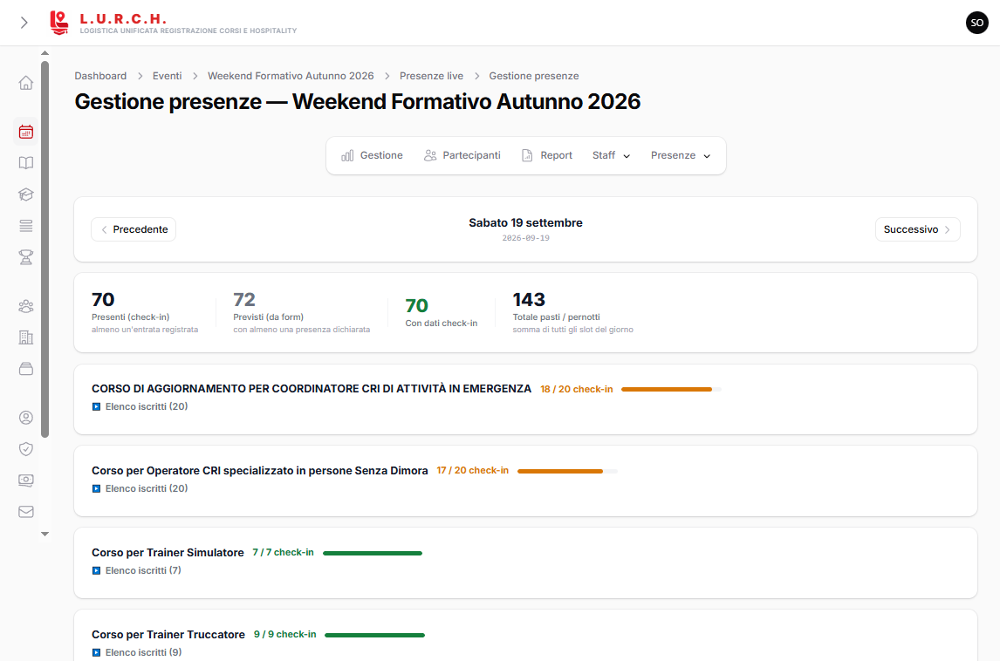
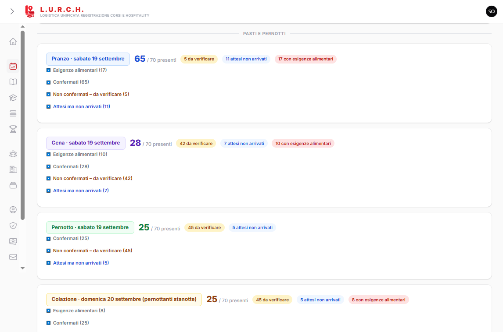
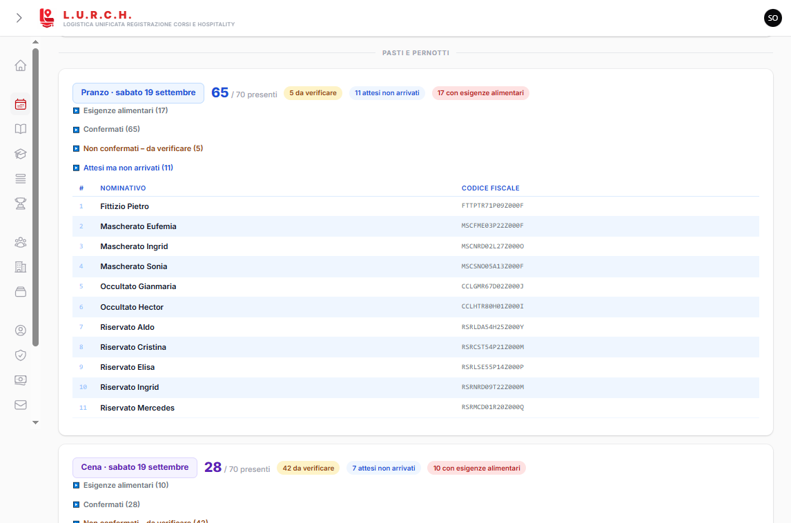

# Presenze effettive

> **A chi serve:** operatori e amministratori del pannello.

Giorno per giorno, **quante persone ci sono davvero** e quanti pasti e pernottamenti sono stati confermati, confrontati con quanto era stato dichiarato in anticipo. È la pagina da guardare durante l'evento per sapere quanti pranzi servire o quanti letti servono quella notte. Si apre dalla scheda **Presenze → Presenze effettive** della barra dell'evento (il titolo è «Gestione presenze»).

## Previsto ed effettivo

L'evento ha due serie di numeri, da non confondere:

- **Previsti** (o «potenziali»): ciò che le persone hanno dichiarato nei moduli di preregistrazione e nelle candidature, prima dell'evento. Servono alla logistica per organizzarsi.
- **Effettivi**: ciò che risulta sul posto, dagli ingressi registrati con il badge e dalle [risposte al check-in](07-risposte-checkin.md).

Questa pagina mostra gli effettivi e, accanto, quanti previsti non si sono visti. Il check-in non modifica mai le preregistrazioni: i due insiemi restano separati.

## Il giorno

<!-- screenshot: route=/admin/eventi/{id}/presenze-effettive?data=2026-09-19 · v1.85.38-dev · 2026-11-18 -->

In alto i pulsanti **Precedente** e **Successivo** cambiano giorno; si scorrono i giorni dell'evento, più quello prima e quello dopo se servono per arrivo o partenza. Quattro numeri riassumono la giornata:

| Numero | Significato |
|---|---|
| Presenti (check-in) | Persone con almeno un ingresso registrato e che quel giorno risultano ancora in campo (sono entrate quel giorno o prima, senza essere uscite) |
| Previsti (da form) | Persone che avevano dichiarato almeno una presenza quel giorno |
| Con dati check-in | Presenti che hanno già fatto il check-in con i propri dati; se sono meno dei presenti, l'avviso dice quanti vengono conteggiati dalla preregistrazione |
| Totale pasti / pernotti | Somma di tutti gli slot del giorno |

Sotto, un riquadro per ogni **corso attivo quel giorno**, con la barra «N / M check-in» (quanti iscritti sono già arrivati) e l'**Elenco iscritti**, che si apre. In fondo ai corsi c'è lo **Staff** presente, senza ripetere chi è già in un corso.

## Pasti e pernottamenti

<!-- screenshot: route=/admin/eventi/{id}/presenze-effettive?data=2026-09-19 · v1.85.38-dev · 2026-11-18 · pasti e pernotti -->

Una scheda per ogni pasto e per ogni notte del giorno (colazione, pranzo, cena, pernotto). Il numero grande è quanti hanno **confermato** quel pasto sul totale dei presenti, e le etichette accanto dicono:

- **da verificare**: presenti che non hanno confermato quel pasto al check-in;
- **attesi non arrivati**: persone che lo avevano dichiarato ma quel giorno non sono in campo;
- **con esigenze alimentari**: quante di quelle persone hanno allergeni, diete o note.

Le voci sotto ogni scheda si aprono per mostrare i nomi:

- **Esigenze alimentari**: chi ha esigenze, con allergeni, diete e note: è l'elenco per chi cucina;
- **Confermati**, **Non confermati – da verificare**, **Attesi ma non arrivati**: le persone di ciascun gruppo, con codice fiscale.

<!-- screenshot: route=/admin/eventi/{id}/presenze-effettive?data=2026-09-19 · v1.85.38-dev · 2026-11-18 · attesi non arrivati aperto -->

La **colazione** del giorno dopo si legge in fondo alla giornata precedente, come «colazione, pernottanti stanotte»: chi dorme lì stanotte fa colazione domani.

L'elenco «Attesi ma non arrivati» è solo informativo: non si modifica da qui, perché i dati dichiarati in anticipo non si correggono in base a chi si è presentato.

Per correggere ciò che una persona ha confermato al check-in si usa [Risposte al check-in](07-risposte-checkin.md); per vedere chi è in campo adesso, [Presenze live](06-presenze-live.md).
