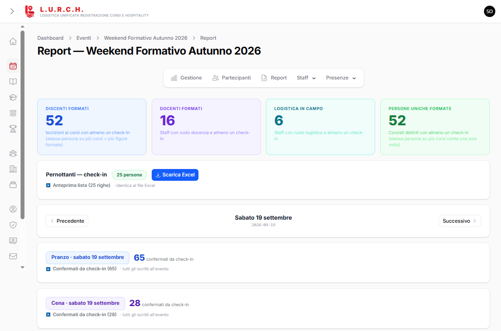
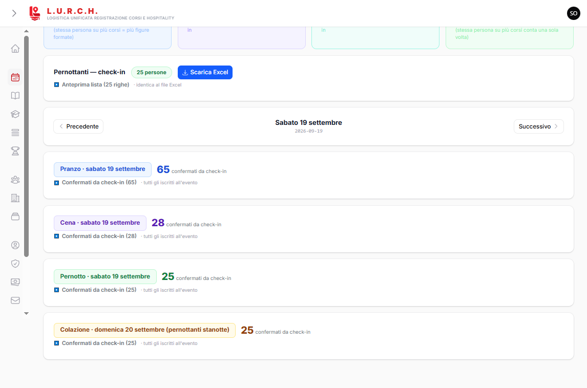

# Report

> **A chi serve:** operatori e amministratori del pannello.

Le **statistiche a consuntivo** dell'evento, pensate per la rendicontazione: quante persone sono state formate, quanti docenti e quanti addetti alla logistica hanno lavorato, chi ha pernottato e quanti pasti sono stati serviti ogni giorno. Si apre dalla scheda **Report** della barra dell'evento.

Tutti i numeri partono dal **check-in**: conta chi è stato davvero all'evento, non chi si era solo iscritto. Per seguire la giornata mentre si svolge servono invece [Presenze live](06-presenze-live.md) e [Presenze effettive](08-presenze-effettive.md).

<!-- screenshot: route=/admin/eventi/{id}/report?data=2026-09-19 · v1.85.38-dev · 2026-11-18 -->

## I quattro totali

| Totale | Cosa conta |
|---|---|
| Discenti formati | Le iscrizioni ai corsi dell'evento con almeno un check-in. Chi è iscritto a più corsi conta più volte, una per corso |
| Docenti formati | Staff con ruolo di docenza e almeno un check-in |
| Logistica in campo | Staff con ruolo di logistica e almeno un check-in |
| Persone uniche formate | I corsisti distinti con almeno un check-in: chi è in più corsi conta una volta sola |

La differenza tra «discenti formati» e «persone uniche formate» sta nel contare le iscrizioni o le persone: la prima serve per i corsi (quante «figure» sono state formate), la seconda per sapere quante persone diverse sono passate.

## Pernottanti

Il riquadro **Pernottanti — check-in** riporta quante persone hanno confermato almeno un pernottamento al check-in. **Scarica Excel** esporta l'elenco, utile per la struttura che ospita, e **Anteprima lista** mostra a video le stesse righe del file.

## Pasti e pernottamenti giorno per giorno

Con **Precedente** e **Successivo** si sceglie il giorno. Per ogni pasto e ogni notte, la scheda dice quante persone lo hanno **confermato al check-in**, e **Confermati da check-in** elenca i nomi (di tutti i partecipanti all'evento, corsisti e staff). La colazione del giorno dopo compare come «pernottanti stanotte».

<!-- screenshot: route=/admin/eventi/{id}/report?data=2026-09-19 · v1.85.38-dev · 2026-11-18 · schede dei pasti -->

A differenza di [Presenze effettive](08-presenze-effettive.md), qui non ci sono i previsti né i «da verificare»: solo il consuntivo di ciò che è stato confermato.

Se per un giorno nessuno ha fatto il check-in, la pagina lo segnala e invita a controllare che siano stati eseguiti.
