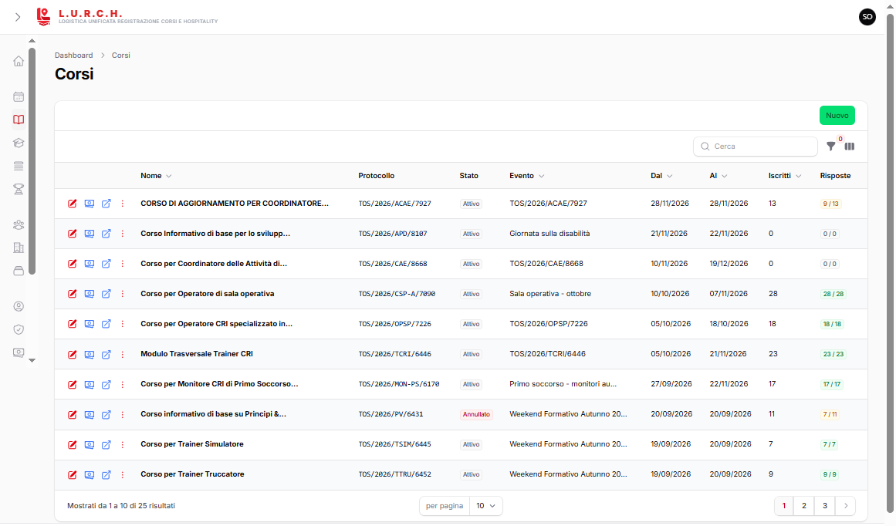
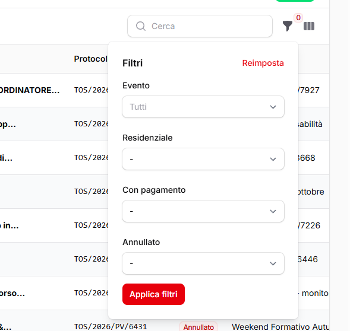
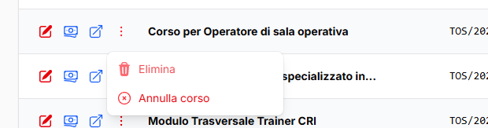

# Elenco dei corsi

> **A chi serve:** operatori e amministratori del pannello.

Da **Gestione operativa → Corsi** si vedono i corsi a cui si ha accesso e si può crearne di nuovi. Il corso è la parte **didattica e amministrativa** di un [evento](../01-eventi/01-elenco-e-creazione.md): iscritti, moduli di preregistrazione, quote, comunicazioni ai corsisti. Sede, pasti, pernottamenti, badge e presenze restano invece all'evento.

<!-- screenshot: route=/admin/corsi · v1.85.38-dev · 2026-11-18 · tabella ridotta al 68% per mostrare tutte le colonne -->

Ogni riga è un corso, dal più recente al più vecchio. **Un clic sulla riga apre la gestione del corso** ([Gestione del corso](03-gestione-corso.md)); le icone all'inizio della riga sono scorciatoie, descritte più sotto.

| Colonna | Cosa mostra |
|---|---|
| Nome | Il nome del corso; i nomi lunghi sono accorciati e passando il mouse si legge il nome intero insieme al protocollo |
| Protocollo | Il numero di protocollo di attivazione; un clic lo copia |
| Stato | **Attivo** oppure **Annullato** (vedi «Annullare un corso» più sotto) |
| Evento | L'evento che ospita il corso |
| Dal / Al | Primo e ultimo giorno del corso |
| Iscritti | Quanti iscritti attivi ha (i ritirati non sono contati) |
| Risposte | Quanti iscritti attivi hanno compilato il modulo di preregistrazione, su quanti sono: **grigio** se non c'è ancora nessuno, **arancione** se mancano delle compilazioni, **verde** se hanno compilato tutti |

Con l'icona a colonne accanto ai filtri si possono mostrare altre colonne, che per risparmiare spazio sono nascoste: **Direttore**, **Residenziale**, **Pagamento** (se il corso richiede una quota) e **Form** (se il modulo di preregistrazione è già stato generato). La scelta va confermata con **Applica colonne**; **Reimposta** torna alla vista iniziale.

> Su uno schermo non molto largo la tabella scorre in orizzontale: conviene chiudere il menu a sinistra con la freccia in alto.

## Cercare e filtrare

- La casella **Cerca** trova i corsi per nome, protocollo o evento.
- Il pulsante a imbuto apre i filtri, da confermare con **Applica filtri**:

<!-- screenshot: route=/admin/corsi · v1.85.38-dev · 2026-11-18 · pannello dei filtri -->

  - **Evento**: solo i corsi di un evento;
  - **Residenziale**: solo i corsi con o senza pernottamento;
  - **Con pagamento**: solo i corsi con o senza quota di iscrizione;
  - **Annullato**: solo i corsi annullati o solo quelli non annullati.
- Le intestazioni delle colonne ordinano la tabella.

## Le icone di riga

<!-- screenshot: route=/admin/corsi · v1.85.38-dev · 2026-11-18 · menu «Altre azioni» -->

| Icona | Cosa fa |
|---|---|
| Matita | **Modifica** i dati del corso ([Creare e modificare un corso](02-creare-e-modificare.md)) |
| Banconote | Apre la **Gestione quote** ([Quote e pagamenti](07-quote-e-pagamenti.md)); è grigia e spenta se il corso non richiede pagamento |
| Freccia verso l'esterno | **Apri su GAIA**: apre in una nuova scheda il corso su GAIA; è grigia e spenta se al corso non è stato collegato un link |
| Tre puntini | **Altre azioni**: Elimina, Annulla corso o Ripristina corso |

### Eliminare un corso

**Elimina** è spenta se il corso ha iscritti. Anche senza iscritti, un corso che ha già dati compilati (moduli di preregistrazione, consensi, check-in, email inviate) o un esame collegato non si elimina dal pannello: per eliminarlo davvero bisogna rivolgersi a un amministratore di sistema. Nella pratica si elimina solo un corso creato per errore e mai usato.

### Annullare un corso

**Annulla corso** serve quando un corso non parte (per esempio per troppi ritiri). Dopo la conferma il corso:

- compare con lo stato **Annullato**;
- **non è più conteggiato** nei pasti e nei pernottamenti previsti dell'evento;
- mantiene intatti iscrizioni, moduli compilati e pagamenti, e la Gestione quote continua a funzionare;
- non permette più l'invio di email agli iscritti (form, solleciti, comunicazione evento).

L'operazione è reversibile: nel menu dei tre puntini compare **Ripristina corso**, che lo riporta tra i corsi attivi.

## Chi vede quali corsi

- Il **superadmin** vede tutti i corsi.
- L'**amministratore regionale** vede i corsi degli eventi della sua regione.
- L'**amministratore locale** vede solo i corsi degli eventi del suo comitato locale.
- L'**operatore** vede i corsi degli eventi regionali a cui è stato assegnato, se ha il permesso di vedere i corsi (vedi [Ruoli e permessi](../../01-primi-passi/03-ruoli-e-permessi.md)); il pulsante **Nuovo** compare solo se ha anche il permesso di creare corsi.
- Chi è **direttore di un corso** (indicato come socio nel modulo del corso) vede sempre quel corso e la sua pagina di gestione, anche senza altri permessi: in sola consultazione, senza poter modificare iscritti e dati del corso.

Il pulsante verde **Nuovo**, sopra la tabella, apre il modulo di creazione ([Creare e modificare un corso](02-creare-e-modificare.md)).
