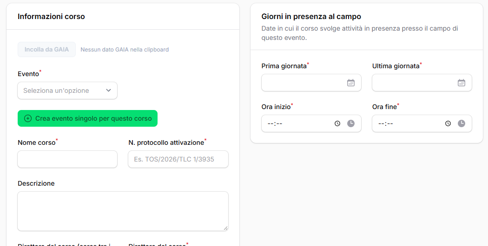
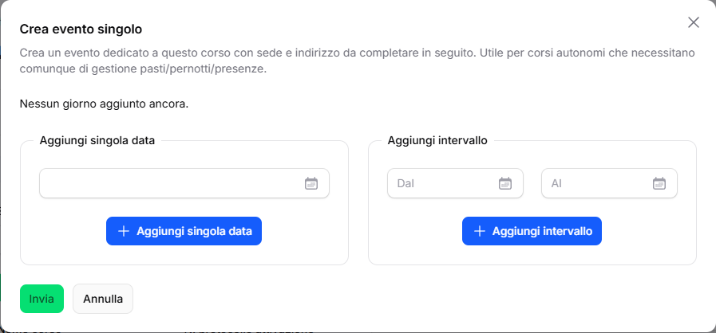
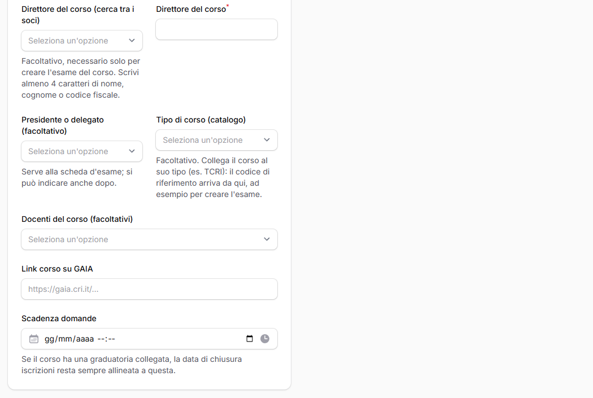
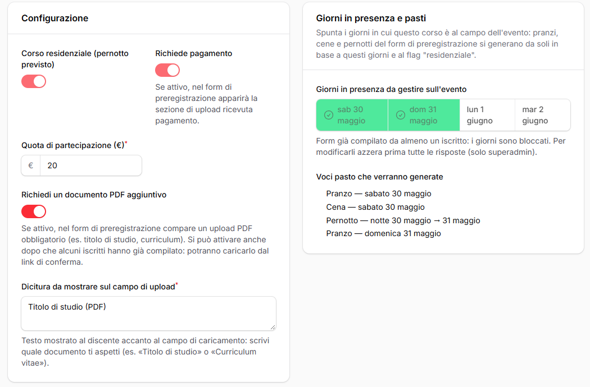
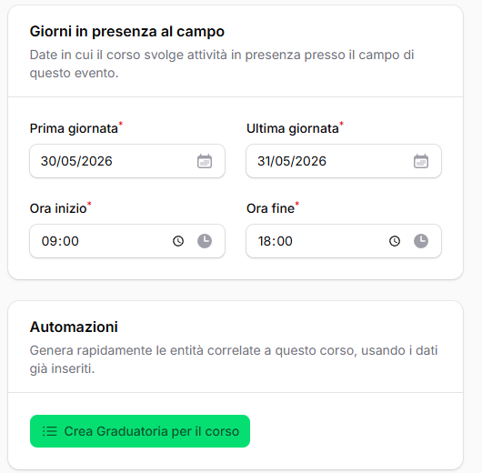
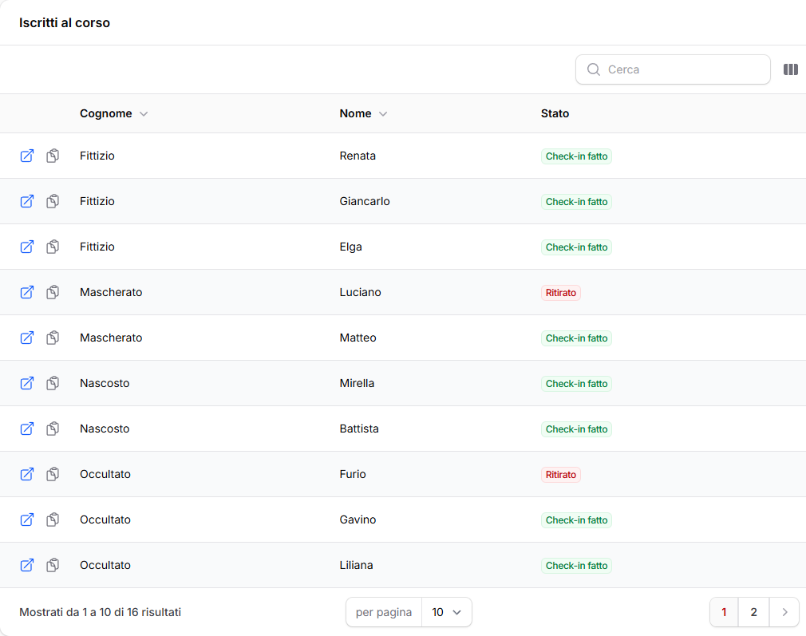

# Creare e modificare un corso

> **A chi serve:** operatori e amministratori del pannello.

Il modulo del corso si apre con il pulsante **Nuovo** dell'[elenco](01-elenco.md) e, per un corso esistente, con la matita sulla riga o con **Azioni → Modifica corso** nella [gestione del corso](03-gestione-corso.md). Può creare e modificare corsi chi ha il ruolo di amministratore (regionale o locale) o l'operatore con i permessi sui corsi, limitatamente ai corsi degli eventi di sua competenza.

Il modulo è diviso in sezioni; i campi con l'asterisco rosso sono obbligatori. I pulsanti in fondo sono **Salva**, **Salva & nuovo** (solo in creazione, per inserire subito un altro corso) e **Annulla**.

## Informazioni corso

<!-- screenshot: route=/admin/corsi/create · v1.85.38-dev · 2026-11-18 -->

- **Incolla da GAIA** (solo in creazione): se si è copiato un corso da GAIA con il pulsante «Copia per LURCH (JSON)» dello script GAIA Swissknife ([Un altro script: GAIA Swissknife](../../05-strumenti/01-userscript-bridge-gaia/README.md#un-altro-script-gaia-swissknife)), il pulsante diventa attivo e compila da solo nome, protocollo, direttore, link GAIA, eventuale quota, date e orari e scadenza delle domande. Accanto compare il nome del corso copiato; senza dati copiati il pulsante è spento e dice «Nessun dato GAIA nella clipboard». Dopo l'uso gli appunti vengono svuotati.
- **Evento**: l'evento che ospita il corso; si sceglie tra gli eventi di propria competenza (nome e data di inizio). Ogni corso appartiene a un evento ([Evento e corso](../01-eventi/01-elenco-e-creazione.md)).
- **Crea evento singolo per questo corso**: compare solo in creazione e finché non si è scelto un evento. È il modo rapido per un corso autonomo, che ha comunque bisogno di pasti, pernottamenti e presenze.

<!-- screenshot: route=/admin/corsi/create · v1.85.38-dev · 2026-11-18 · finestra «Crea evento singolo» -->

  La finestra chiede i **giorni** dell'evento (uno per uno con «Aggiungi singola data», oppure un periodo con «Aggiungi intervallo»; se si sono già inseriti i giorni del corso, l'intervallo è precompilato) e, per il solo superadmin, il comitato regionale. Con **Invia** viene creato un evento che ha come nome il protocollo del corso (o, in mancanza, il nome), con sede e indirizzo impostati su «Da definire»: vanno completati poi dalla pagina dell'evento ([Elenco e creazione degli eventi](../01-eventi/01-elenco-e-creazione.md)). L'evento nuovo viene scelto da solo nel modulo del corso, e tutti i suoi giorni sono segnati come giorni in presenza.
- **Nome corso** e **N. protocollo attivazione**: obbligatori. Se nel nome si scrive anche il protocollo in coda (nella forma `REGIONE/ANNO/CODICE/NUMERO`, per esempio `TOS/2026/TLC 1/3935`), viene separato da solo nel campo del protocollo.
- **Descrizione**: testo libero, facoltativo.

<!-- screenshot: route=/admin/corsi/create · v1.85.38-dev · 2026-11-18 · direttore, catalogo, docenti, link e scadenza -->

- **Direttore del corso (cerca tra i soci)** e **Direttore del corso**: il primo è una ricerca nell'archivio soci (scrivi almeno 4 caratteri di nome, cognome o codice fiscale); è facoltativo, ma è **necessario per creare l'esame** del corso. Scelto un socio, il campo «Direttore del corso» si compila da solo con il suo nome e non si scrive più a mano; senza un socio collegato il nome del direttore va scritto a mano ed è obbligatorio, perché un corso ha sempre un direttore. Il direttore collegato come socio vede il corso e la sua pagina di gestione anche senza permessi sui corsi, in sola consultazione.
- **Presidente o delegato**: facoltativo, serve alla scheda d'esame e si può indicare anche dopo.
- **Tipo di corso (catalogo)**: facoltativo; collega il corso al suo tipo (per esempio TCRI) nel [Catalogo corsi](../../03-archivi/04-catalogo-corsi.md). Il codice di riferimento che ne deriva serve, tra l'altro, a creare l'esame.
- **Docenti del corso**: facoltativi, più d'uno, scelti tra i soci. Un docente che ha già schede compilate o fa parte della commissione d'esame non si può togliere dal corso: il modulo lo segnala con un errore.
- **Link corso su GAIA**: l'indirizzo della pagina del corso su GAIA (un indirizzo web valido). In modifica compare sotto il campo il collegamento «Apri corso su GAIA», e il link è usato dall'icona «Apri su GAIA» dell'elenco e dal collegamento nell'intestazione della gestione.
- **Scadenza domande**: data e ora oltre le quali non si accettano più iscrizioni. Se il corso ha una graduatoria collegata, la data di chiusura della graduatoria resta sempre allineata a questa.

## Giorni in presenza al campo

Sono le date e gli orari in cui il corso svolge attività in presenza presso il campo dell'evento: **Prima giornata**, **Ultima giornata** (non può precedere la prima), **Ora inizio** e **Ora fine**, tutti obbligatori. Compaiono nella colonna «Dal / Al» dell'elenco, nell'intestazione della gestione e nelle comunicazioni.

## Configurazione

<!-- screenshot: route=/admin/corsi/{id}/edit · v1.85.38-dev · 2026-11-18 · configurazione e giorni in presenza e pasti -->

- **Corso residenziale (pernotto previsto)**: se è acceso, il modulo di preregistrazione propone cena e pernottamento; se è spento, solo pranzo. Il pernotto di un corso non residenziale può essere aggiunto a mano dagli amministratori ([Iscritti](04-iscritti.md)). Il corso residenziale compare con la spunta nella colonna «Residenziale» dell'elenco.
- **Richiede pagamento**: se è acceso, il modulo di preregistrazione chiede di caricare la ricevuta e compare la pagina **Gestione quote** ([Quote e pagamenti](07-quote-e-pagamenti.md)). Con il pagamento acceso diventa obbligatoria la **Quota di partecipazione (€)**.
- **Richiedi un documento PDF aggiuntivo**: se è acceso, nel modulo di preregistrazione compare un caricamento di un PDF obbligatorio (per esempio titolo di studio o curriculum). La **dicitura da mostrare sul campo di upload** è obbligatoria e dice al corsista quale documento caricare. A differenza degli altri due interruttori, questo si può attivare anche dopo che alcuni iscritti hanno già compilato: potranno caricare il documento dal link di conferma, oppure caricarlo l'operatore per loro ([Documenti da verificare](06-documenti-da-verificare.md)).

> «Corso residenziale» e «Richiede pagamento» si bloccano appena **un iscritto compila il modulo di preregistrazione**, perché cambierebbero ciò che ha già compilato.

## Giorni in presenza e pasti

Sono le pillole con i giorni dell'**evento**: si accendono (con la spunta verde) quelli in cui questo corso è al campo. Da questa scelta e dall'interruttore «residenziale» derivano da soli le voci del modulo di preregistrazione, che sono elencate sotto, in **Voci pasto che verranno generate** (nell'esempio: pranzo e cena del sabato, pernotto, pranzo della domenica). Finché nessuno ha compilato il modulo, le voci si ricalcolano a ogni salvataggio. Servono anche all'evento per i conteggi di pasti e pernottamenti.

> Appena un iscritto compila il modulo, i giorni si **bloccano**: le voci pasto già scelte dai corsisti non possono cambiare. Per modificarli bisogna azzerare le risposte, operazione riservata al superadmin: nel modulo compare il pulsante rosso **Azzera tutte le risposte**, che elimina definitivamente tutte le risposte al modulo, le ricevute, i nullaosta, i documenti aggiuntivi e le presenze registrate dal modulo; gli iscritti dovranno ricompilare da capo.

## Automazioni (solo in modifica)

<!-- screenshot: route=/admin/corsi/{id}/edit · v1.85.38-dev · 2026-11-18 · giorni in presenza e automazioni -->

**Crea Graduatoria per il corso** genera una graduatoria ([Graduatorie](../04-graduatorie/README.md)) già collegata al corso, con titolo, protocollo e comitato precompilati e apertura da subito. La chiusura è la scadenza delle domande del corso; in mancanza, la data di inizio del corso se è futura, altrimenti 30 giorni da oggi. Date, testo dell'email e operatori si completano poi dalla pagina della graduatoria. Se esiste già una graduatoria con lo stesso protocollo, il pulsante lo segnala e non crea nulla. Quando la graduatoria esiste, al posto del pulsante compare il collegamento **Vai alla graduatoria**.

## Gli altri elementi della pagina di modifica

- In alto a destra, **Anteprima form** (azzurro) apre in una nuova scheda il modulo di preregistrazione come lo vedrebbe un iscritto. Compare quando il corso ha almeno un iscritto e il modulo è stato generato.
- Sotto il titolo c'è la barra con **Gestione** e, se il corso richiede pagamento, **Gestione quote**.
- In fondo alla pagina, la tabella **Iscritti al corso** elenca gli iscritti con cognome, nome e stato (**In attesa**, **Form compilato**, **Check-in fatto**, **Ritirato**), con una casella di ricerca e, nel menu a colonne, anche codice fiscale, email, telefono e data di iscrizione. Ogni riga ha due icone: la prima **apre il modulo di preregistrazione** dell'iscritto in una nuova scheda, la seconda **ne copia il link**. È una vista rapida: per inviare il modulo, gestire i documenti e i ritiri si usa la [gestione del corso](04-iscritti.md).

<!-- screenshot: route=/admin/corsi/{id}/edit · v1.85.38-dev · 2026-11-18 · tabella iscritti in fondo alla pagina -->

