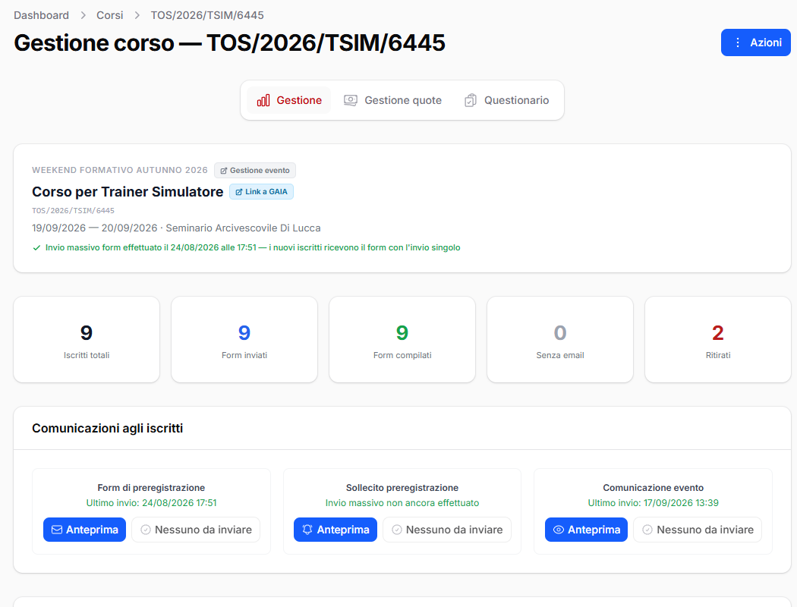
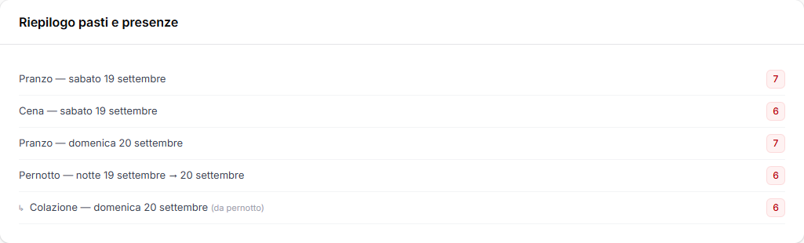
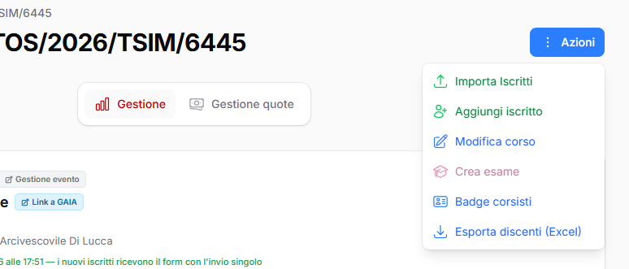
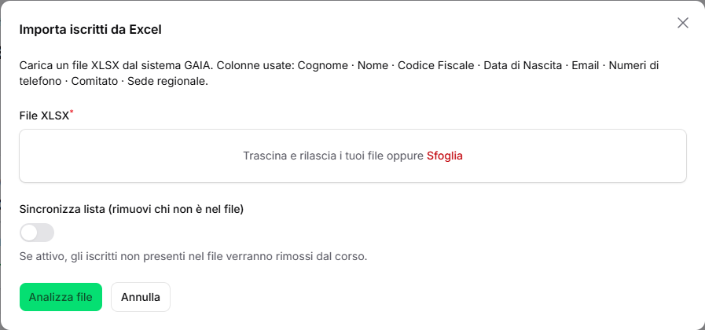
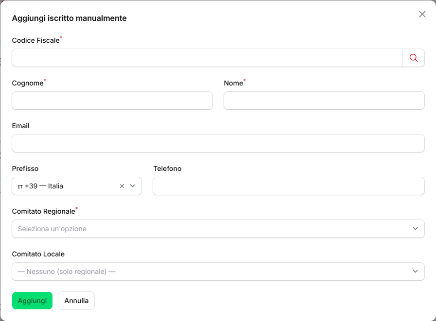

# Gestione del corso

> **A chi serve:** operatori e amministratori del pannello.

È la pagina che si apre con un clic su una riga dell'[elenco dei corsi](01-elenco.md) ed è il quadro d'insieme **didattico e amministrativo**: quanti sono gli iscritti, a che punto sono i moduli, quali comunicazioni sono partite. Sotto, la lista degli iscritti (vedi [Iscritti](04-iscritti.md)). Per la logistica (staff, badge, check-in, pasti dell'intero evento) si passa dalla [gestione dell'evento](../01-eventi/02-gestione-evento.md).

Si accede alla pagina per tutti i corsi che si vedono nell'elenco; chi arriva solo perché direttore del corso la vede in sola consultazione (può guardare anteprime e documenti, e creare l'esame, ma non modificare iscritti e dati).

<!-- screenshot: route=/admin/corsi/{id}/gestione · v1.86.4-dev · 2026-11-27 -->

## L'intestazione

In alto la scheda del corso riporta:

- il nome dell'**evento** che lo ospita, con il pulsante **Gestione evento** per passare alla pagina dell'evento;
- il nome del corso e, se è stato collegato, il pulsante **Link a GAIA**;
- il protocollo, le date e la sede dell'evento;
- una riga sull'**invio massivo del modulo di preregistrazione**: in verde se è già stato fatto (con data e ora; da quel momento i nuovi iscritti ricevono il modulo con l'invio singolo), in grigio se non è ancora stato fatto.

Sopra la scheda, sotto il titolo, la barra con **Gestione**, **Gestione quote** se il corso richiede pagamento ([Quote e pagamenti](07-quote-e-pagamenti.md)) e **Questionario**, visibile agli amministratori e al direttore del corso ([Questionario di gradimento](08-questionario.md)). In alto a destra c'è il pulsante **Azioni**, descritto più sotto.

## I numeri

Cinque riquadri:

- **Iscritti totali**: tutti gli iscritti, compresi i ritirati;
- **Form inviati**: a quanti è stato inviato il modulo di preregistrazione;
- **Form compilati**: quanti lo hanno compilato;
- **Senza email**: gli iscritti attivi a cui non si può scrivere (il numero è arancione se maggiore di zero: l'email va completata nell'archivio soci, oppure si invia il link a mano con «Copia link»);
- **Ritirati**: quanti si sono ritirati (in rosso se maggiore di zero).

## Comunicazioni agli iscritti

Tre riquadri con lo stato degli invii (modulo di preregistrazione, sollecito, comunicazione evento), ciascuno con **Anteprima** e **Invia a tutti**. Sono descritti nella pagina [Form e comunicazioni](05-form-e-comunicazioni.md).

## Riepilogo pasti e presenze

<!-- screenshot: route=/admin/corsi/{id}/gestione · v1.85.38-dev · 2026-11-18 -->

Compare quando il modulo di preregistrazione contiene voci di pasto. Una riga per ogni pasto e per ogni notte, con il numero di **iscritti attivi di questo corso** che lo hanno richiesto: le colazioni derivano dai pernottamenti (chi pernotta fa colazione il giorno dopo, e la riga lo indica con «da pernotto»). I numeri contano sia ciò che il corsista ha dichiarato nel modulo sia ciò che la segreteria ha aggiunto a mano con il pulsante **Presenze** ([Iscritti](04-iscritti.md)).

Sono i numeri del **solo corso**: il quadro dell'intero evento (che somma tutti i corsi e lo staff) sta in [Gestione dell'evento](../01-eventi/02-gestione-evento.md).

> Nei corsi più vecchi, creati prima che le voci di pasto si generassero da sole, il riepilogo può non comparire.

## Il menu Azioni

<!-- screenshot: route=/admin/corsi/{id}/gestione · v1.85.38-dev · 2026-11-18 · menu Azioni -->

| Voce | Cosa fa | Chi la vede |
|---|---|---|
| **Importa Iscritti** | Carica un file Excel esportato da GAIA e iscrive le persone che contiene | Amministratori e operatori con il permesso di importare gli iscritti |
| **Aggiungi iscritto** | Iscrive una persona a mano | Amministratori (superadmin, regionali, locali) |
| **Modifica corso** | Apre il [modulo del corso](02-creare-e-modificare.md) | Chi può modificare il corso |
| **Crea esame** / **Vai all'esame** | Crea l'esame del corso, o vi porta se esiste già | Vedi Esami; la voce è spenta (con la spiegazione al passaggio del mouse) se manca qualcosa, per esempio il direttore come socio o il tipo di corso |
| **Badge corsisti** | Apre in una nuova scheda il PDF con i badge | Tutti |
| **Esporta discenti (Excel)** | Scarica l'elenco dei discenti | Tutti |

### Importare gli iscritti da GAIA

<!-- screenshot: route=/admin/corsi/{id}/gestione · v1.85.38-dev · 2026-11-18 · finestra Importa iscritti -->

1. In GAIA si esporta l'elenco degli iscritti al corso in formato **XLSX**. Le colonne lette sono: Cognome, Nome, Codice Fiscale, Data di Nascita, Email, Numeri di telefono, Comitato, Sede regionale.
2. In **Importa Iscritti** si carica il file. L'interruttore **Sincronizza lista** (spento di norma) fa **rimuovere dal corso chi non è nel file**: si accende solo se il file è l'elenco completo e aggiornato.
3. **Analizza file** non scrive nulla: mostra una **anteprima** con un riepilogo e il dettaglio riga per riga. Le righe sono: **Nuovo socio** (non è in archivio e verrà creato e iscritto), **Nuovo iscritto** (è un socio già in archivio, verrà iscritto), **Aggiorna dati** (è già iscritto: si aggiornano email, telefono, data di nascita e comitato) e **Saltato** (con il motivo, per esempio un comitato che non è in archivio o un campo obbligatorio mancante). Con la sincronizzazione accesa compare anche l'elenco di chi verrebbe rimosso.
4. Dopo aver controllato, si conferma l'import o lo si annulla con i pulsanti sotto l'anteprima. A import concluso un avviso riporta quanti iscritti sono stati creati, aggiornati, rimossi e saltati; le righe saltate restano nelle notifiche del pannello.

Il socio si riconosce dal **codice fiscale**. Se l'email del file è diversa da quella in archivio, la modifica viene registrata.

### Aggiungere un iscritto a mano

<!-- screenshot: route=/admin/corsi/{id}/gestione · v1.85.38-dev · 2026-11-18 · finestra Aggiungi iscritto -->

Si inserisce il **codice fiscale** e si preme la lente **Cerca**: se la persona è già nell'archivio soci, nome, cognome, email, telefono e comitato si compilano da soli. Altrimenti si compilano a mano (cognome, nome, comitato regionale sono obbligatori; email e telefono sono facoltativi, ma senza email non si può inviare il modulo). Con **Aggiungi** la persona risulta iscritta con lo stato **In attesa** e ottiene il suo link personale al modulo. Se è già iscritta al corso, compare un avviso e non succede nulla. Se la persona esiste già nell'archivio, i dati inseriti a mano servono solo a completare email e telefono mancanti: non sovrascrivono quelli esistenti.

### Badge corsisti

Apre un PDF in formato A4 con **sei badge per pagina**, uno per ogni iscritto attivo (i ritirati sono esclusi), in ordine alfabetico. Ogni badge riporta nome, cognome, protocollo del corso e il codice QR che serve al check-in; sullo sfondo c'è l'immagine impostata per il badge dell'evento ([Partecipanti e badge](../01-eventi/05-partecipanti-e-badge.md)).

### Esporta discenti (Excel)

Scarica un file Excel con gli iscritti attivi in ordine alfabetico e queste colonne: Cognome, Nome, Codice Fiscale, Data di nascita, Età, Comitato, Tipo (tipo di socio), Telefono, Email.
