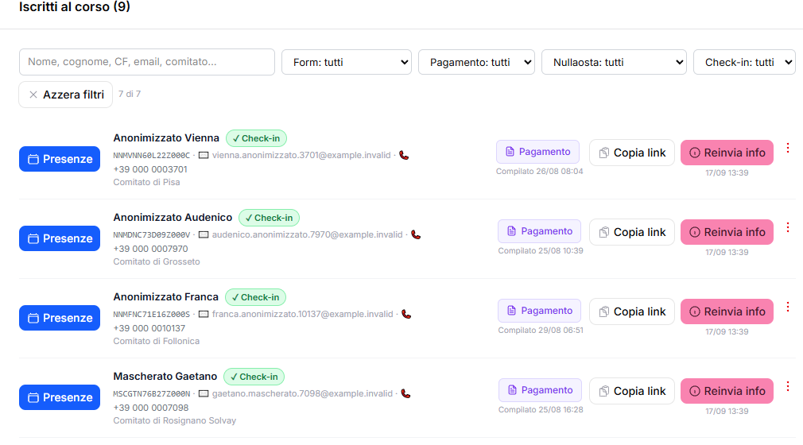
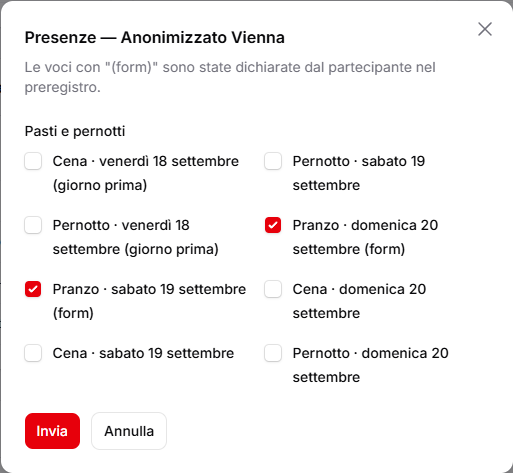
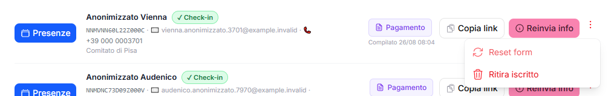
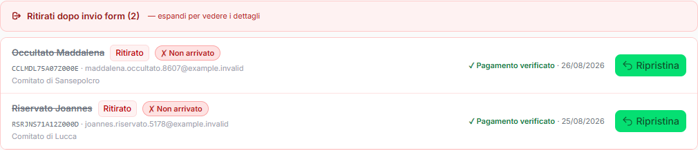

# Iscritti

> **A chi serve:** operatori e amministratori del pannello.

In fondo alla [gestione del corso](03-gestione-corso.md) c'è la lista **Iscritti al corso**, una riga per ogni iscritto attivo. È lo strumento di lavoro quotidiano della segreteria del corso: da qui si vede chi ha compilato il modulo, si inviano i messaggi, si controllano i documenti, si registrano pasti e pernottamenti, si ritira chi rinuncia.

## Gli stati di un'iscrizione

Un iscritto passa per questi stati (la tabella «Iscritti al corso» nel modulo di modifica li mostra come etichette):

| Stato | Significato |
|---|---|
| **In attesa** | È iscritto, ma non ha ancora compilato il modulo di preregistrazione |
| **Form compilato** | Ha compilato il modulo |
| **Check-in fatto** | È arrivato e ha fatto il check-in all'evento |
| **Ritirato** | Si è ritirato (vedi sotto); non è più conteggiato tra gli iscritti attivi |

## Filtrare e cercare

<!-- screenshot: route=/admin/corsi/{id}/gestione · v1.85.38-dev · 2026-11-18 · filtri e prime righe -->

Sopra la lista, la casella di ricerca trova per nome, cognome, codice fiscale, email o comitato. Le caselle a tendina filtrano per:

- **Form**: compilato o non compilato;
- **Pagamento** (solo se il corso richiede quota): ricevuta allegata o ricevuta mancante;
- **Nullaosta**: mancante, da verificare, verificato, non richiesto ([Documenti da verificare](06-documenti-da-verificare.md));
- **Documento aggiuntivo** (solo se il corso lo richiede): mancante, da verificare, verificato;
- **Check-in** (solo dal giorno di inizio dell'evento): arrivati o non arrivati.

Accanto compare quante righe sono mostrate («7 di 7»); **Azzera filtri** li toglie tutti.

## Cosa c'è in una riga

A sinistra il pulsante **Presenze** (spento finché all'iscritto non è stato inviato il modulo o non l'ha compilato). Al centro, i dati della persona:

- il **nome** e, dal giorno di inizio dell'evento, l'etichetta **✓ Check-in** o **✗ Non arrivato**;
- l'avviso **⚠ Sovrapposizione (N)** se l'iscritto è anche in un altro corso dello stesso evento con giorni in presenza in comune; passando il mouse si leggono i corsi e le date;
- codice fiscale, email e telefono: un clic su ciascuno lo **copia**; se manca l'email compare «— nessuna email —»;
- il comitato locale di appartenenza.

A destra, lo stato dei documenti e i pulsanti:

- **Pagamento** (se il corso richiede quota): il pulsante viola apre la ricevuta caricata dal corsista; se manca compare **Manca ricevuta**. La verifica del pagamento si fa nella pagina [Quote e pagamenti](07-quote-e-pagamenti.md). Sotto compare la data e l'ora di compilazione del modulo (o dell'invio, se non è ancora compilato). Se il corso non richiede pagamento, al suo posto compare **✓ Compilato** per chi ha compilato.
- **Nullaosta** e **Documento aggiuntivo**: vedi [Documenti da verificare](06-documenti-da-verificare.md).
- **Copia link**: copia negli appunti il link personale al modulo di preregistrazione, utile per inviarlo con altri mezzi (messaggio, WhatsApp).
- **Invia form**, **Invia sollecito**, **Invia info**: gli invii singoli, descritti in [Form e comunicazioni](05-form-e-comunicazioni.md).
- I **tre puntini rossi**: altre azioni, più delicate (vedi sotto).

## Presenze: pasti e pernottamenti

<!-- screenshot: route=/admin/corsi/{id}/gestione · v1.85.38-dev · 2026-11-18 · finestra Presenze -->

**Presenze** apre l'elenco dei pasti e dei pernottamenti dei giorni in presenza del corso. Le voci già dichiarate dal corsista nel modulo portano la scritta **(form)**; la segreteria può spuntarne o toglierne altre (per esempio per chi ha cambiato idea all'ultimo) e salvare con **Invia**. Le colazioni non si indicano: derivano dai pernottamenti.

Per i corsi non residenziali, il superadmin e gli amministratori regionali vedono nell'elenco anche cene e pernottamenti (compresi quelli del giorno prima, per chi arriva in anticipo), così da poter gestire i casi eccezionali; gli altri ruoli vedono solo i pranzi. Allo stesso modo, i [pasti non forniti dall'organizzazione](02-creare-e-modificare.md#pasti-non-forniti-dallorganizzazione) li vedono e li possono assegnare solo il superadmin e gli amministratori regionali. Le presenze inserite qui alimentano i riepiloghi del corso e dell'evento ([Presenze effettive](../01-eventi/08-presenze-effettive.md)).

## Le altre azioni: reset del form e ritiro

<!-- screenshot: route=/admin/corsi/{id}/gestione · v1.85.38-dev · 2026-11-18 · menu dei tre puntini -->

- **Ritira iscritto** (o **Rimuovi iscritto**, per chi non ha ancora compilato il modulo): chiede conferma e funziona in due modi, a seconda dei casi.
  - Se la persona **non ha compilato** il modulo, l'iscrizione viene **eliminata definitivamente**, con gli eventuali file.
  - Se la persona **ha compilato** il modulo, viene segnata come **Ritirato**: i suoi dati (modulo e pagamento) restano conservati, e restano solo le presenze registrate dalla segreteria; si cancellano invece quelle dichiarate nel modulo, che quindi non contano più nei pasti previsti.
- **Reset form**: compare solo per chi ha già compilato il modulo e lo possono usare il superadmin e gli amministratori regionali referenti dell'evento. Cancella tutto ciò che la persona ha compilato (comprese le presenze modificate dalla segreteria) e riporta l'iscrizione su **In attesa**: potrà ricompilare dal suo link originale. È **spento** se è già presente una ricevuta di pagamento (il passaggio non è consentito finché la ricevuta è allegata).

## Ritirati

<!-- screenshot: route=/admin/corsi/{id}/gestione · v1.85.38-dev · 2026-11-18 · sezione Ritirati aperta -->

Sotto la lista, la striscia rossa **Ritirati dopo invio form (N)** si apre per mostrare gli iscritti ritirati: nome barrato, etichetta **Ritirato**, check-in, e per i corsi con quota lo stato del pagamento (verificato, ricevuta allegata o mancante). Chi ha il ruolo di amministratore ha il pulsante verde **Ripristina**, che riporta la persona tra gli iscritti attivi: torna su **Form compilato** se aveva compilato il modulo, altrimenti su **In attesa**.

> I ritirati non sono contati nei riquadri «Iscritti» dell'elenco né nei pasti previsti dell'evento; restano nei numeri «Iscritti totali» e «Ritirati» della gestione.
