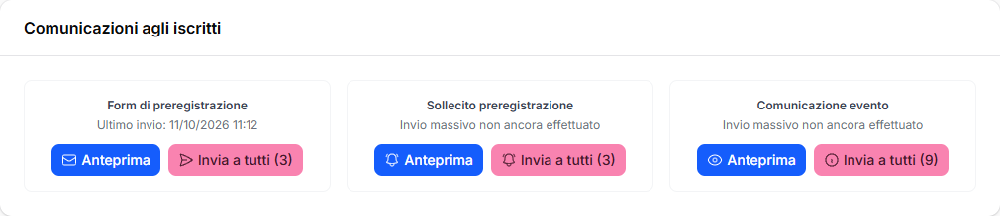
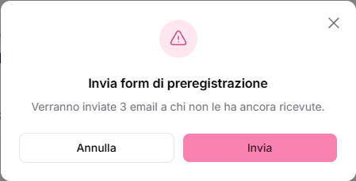
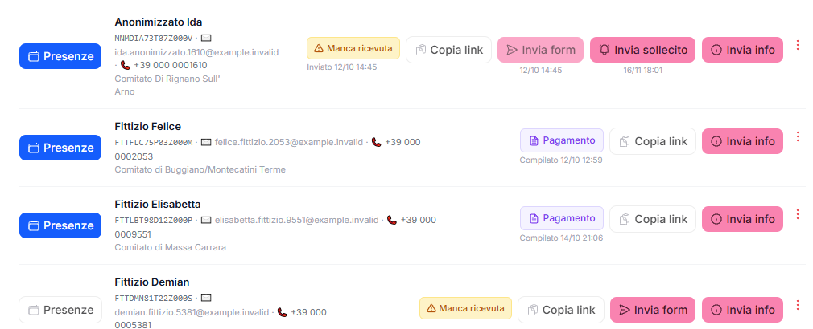

# Form e comunicazioni

> **A chi serve:** operatori e amministratori del pannello.

Dopo l'iscrizione, ogni corsista riceve un'email con il **link personale al modulo di preregistrazione**: è lì che dichiara pasti e pernottamenti, intolleranze, e carica la ricevuta del pagamento e gli eventuali documenti (come si presenta al corsista: [Preregistrazione corsista](../../../03-moduli-pubblici/01-preregistrazione-corsista.md)). Il link è unico per ogni iscritto e non richiede password.

La sezione **Comunicazioni agli iscritti** della [gestione del corso](03-gestione-corso.md) è il centro di controllo di questi invii.

<!-- screenshot: route=/admin/corsi/{id}/gestione · v1.85.38-dev · 2026-11-18 -->

## I tre invii

Ogni riquadro dice quando è stato fatto l'ultimo invio massivo («Invio massivo non ancora effettuato» finché non è mai partito) e ha due pulsanti: **Anteprima** e **Invia a tutti (N)**, dove N è il numero di persone a cui l'invio arriverebbe. Quando non c'è più nessuno da raggiungere, il pulsante diventa grigio e dice **Nessuno da inviare**.

| Invio | A chi arriva | Quando è disponibile |
|---|---|---|
| **Form di preregistrazione** | Agli iscritti attivi a cui il modulo non è ancora stato inviato | Subito, finché il corso non è concluso né annullato e il modulo è stato generato |
| **Sollecito preregistrazione** | Agli iscritti attivi che **non hanno ancora compilato** il modulo (anche a chi ha già ricevuto un sollecito) | Il riquadro compare solo **tre giorni dopo l'invio massivo del modulo**, per dare il tempo di compilarlo |
| **Comunicazione evento** | Agli iscritti attivi che **hanno compilato** il modulo e non hanno ancora ricevuto le informazioni | Solo se l'evento ha un testo o dei documenti da inviare |

Gli iscritti senza email vengono **saltati**: la finestra di conferma dice quante email partiranno e quante persone verranno saltate.

I pulsanti di invio sono **spenti** (con la spiegazione al passaggio del mouse) quando:

- il corso è **concluso** (la data dell'ultimo giorno è passata) o **annullato**;
- per il modulo e il sollecito: **non è stato generato il modulo** del corso (mancano i giorni in presenza: si completa dal [modulo del corso](02-creare-e-modificare.md));
- per la comunicazione dell'evento: l'evento **non ha contenuto** da inviare;
- non c'è nessuno da raggiungere.

### Cosa contiene ogni email

- **Form di preregistrazione**: la conferma dell'iscrizione al corso, le istruzioni per il pagamento della quota (se il corso la richiede, con le coordinate scritte in [Istruzioni di pagamento](../../04-impostazioni/03-istruzioni-pagamento.md)), il pulsante con il link personale al modulo e la scadenza entro cui compilarlo.
- **Sollecito**: un promemoria per chi non ha ancora compilato.
- **Comunicazione evento**: il testo e i documenti scritti nella sezione «Contenuti e documenti» dell'**evento** ([Elenco e creazione degli eventi](../01-eventi/01-elenco-e-creazione.md)) — programma, mappa, regolamento. Il testo si scrive una volta per l'evento e serve a tutti i corsi che lo ospitano.

I testi dei messaggi sono modelli per regione ([Template email](../../04-impostazioni/04-template-email.md)). Le email partono dall'account di posta del comitato regionale dell'evento ([Comitati regionali](../../03-archivi/02-comitati-regionali.md)).

### Anteprima

**Anteprima** apre la mail come arriverà, con il nome e le informazioni del corso già inseriti, e permette di controllarla prima dell'invio. Se per la regione non è stato scritto il modello, l'anteprima lo dice e rimanda alla pagina per crearlo.

### Conferma dell'invio

<!-- screenshot: route=/admin/corsi/{id}/gestione · v1.85.38-dev · 2026-11-18 · conferma dell'invio massivo -->

Ogni invio chiede conferma e dice a quante persone arriverà. Dopo l'invio, una notifica riporta quante email sono partite e quante persone sono state saltate perché senza email.

## Gli invii singoli

Il corso accoglie nuovi iscritti anche dopo l'invio massivo: a loro il modulo si manda dalla lista degli iscritti, riga per riga, e lo stesso vale per un sollecito o per un'informazione mirata.

<!-- screenshot: route=/admin/corsi/{id}/gestione · v1.85.38-dev · 2026-11-18 · pulsanti di invio singolo nelle righe -->

- **Invia form**: compare per gli iscritti con email che non hanno ancora compilato. Una volta inviato si spegne («Form già inviato — usa il sollecito per un nuovo promemoria») e sotto compare la data e l'ora dell'invio.
- **Invia sollecito**: compare per chi non ha compilato, ha ricevuto il modulo e quando il sollecito massivo è disponibile; sotto, data e ora dell'ultimo sollecito.
- **Invia info** (diventa **Reinvia info** dopo il primo invio): compare quando l'evento ha un contenuto da inviare, e si può usare in qualsiasi momento, anche per chi non ha ancora compilato il modulo.

Come per gli invii massivi, i pulsanti singoli sono spenti se il corso è concluso o annullato. Ogni invio singolo chiede conferma e riporta il nome e l'indirizzo del destinatario. Se la persona non ha email, l'invio non parte e un avviso lo dice; resta il pulsante **Copia link** per far arrivare il link con altri mezzi.

## Controllare il modulo prima di inviarlo

Dalla pagina di modifica del corso, il pulsante **Anteprima form** apre il modulo di preregistrazione come lo vedrebbe un iscritto, con le voci di pasto e pernottamento generate dai giorni del corso ([Creare e modificare un corso](02-creare-e-modificare.md)). È il controllo da fare prima dell'invio massivo.
