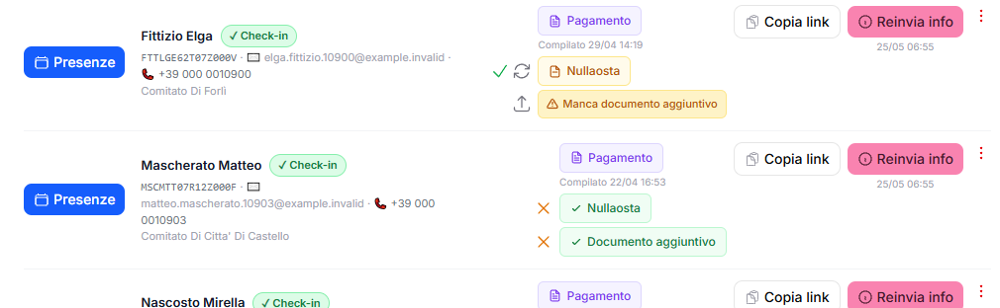
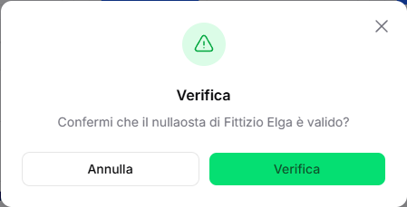
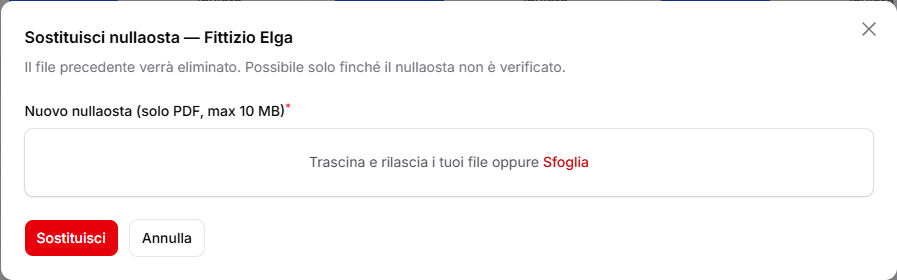

# Documenti da verificare

> **A chi serve:** operatori e amministratori del pannello.

Oltre alla ricevuta del pagamento (che si verifica in [Quote e pagamenti](07-quote-e-pagamenti.md)), il modulo di preregistrazione può raccogliere due documenti che la segreteria deve controllare:

- il **nullaosta** del comitato di appartenenza, per i corsisti che non sono della regione che organizza l'evento;
- un **documento PDF aggiuntivo**, se il corso lo richiede ([Creare e modificare un corso](02-creare-e-modificare.md)).

Entrambi si gestiscono nella colonna di destra di ogni riga degli [iscritti](04-iscritti.md), con lo stesso meccanismo: caricamento da parte del corsista, **visualizzazione**, **verifica** da parte della segreteria, **sostituzione** finché non è verificato.

<!-- screenshot: route=/admin/corsi/{id}/gestione · v1.85.38-dev · 2026-11-18 · nullaosta e documento aggiuntivo nelle righe -->

## Il nullaosta

Il nullaosta è richiesto agli iscritti che appartengono a una **regione diversa** da quella dell'evento (o di cui non si conosce la regione). Per gli altri la riga non mostra niente, e il filtro **Nullaosta** li considera «non richiesto».

Lo stato si legge dall'etichetta:

| Etichetta | Significato |
|---|---|
| **Manca nullaosta** (arancione) | Il corsista non l'ha ancora caricato |
| **Nullaosta** (arancione) | Caricato e **da verificare** |
| **✓ Nullaosta** (verde) | **Verificato**; passando il mouse si leggono la data e chi lo ha verificato |

Un clic sull'etichetta apre il documento (a destra, senza lasciare la pagina). Le icone a sinistra dell'etichetta dipendono dallo stato:

- **✓ Segna come verificato** (verde): dopo aver controllato il documento, chiede conferma («Confermi che il nullaosta di … è valido?»). Da quel momento il documento diventa di sola lettura.

<!-- screenshot: route=/admin/corsi/{id}/gestione · v1.85.38-dev · 2026-11-18 · conferma della verifica -->

- **↻ Sostituisci il file**: serve se il corsista ha caricato per errore il file sbagliato. Si carica il nuovo PDF (massimo 10 MB) e il precedente viene eliminato. È possibile **solo finché il nullaosta non è verificato**.

<!-- screenshot: route=/admin/corsi/{id}/gestione · v1.85.38-dev · 2026-11-18 · sostituzione del nullaosta -->

- **✗ Annulla verifica** (arancione, per i nullaosta già verificati): toglie la verifica e riporta il documento su «da verificare», dopo conferma.

## Il documento aggiuntivo

Compare per gli iscritti che **hanno già compilato** il modulo, se il corso lo richiede. L'etichetta porta il nome «Documento aggiuntivo» e la **dicitura scelta nel modulo del corso** (per esempio «Titolo di studio») si legge sopra il documento quando lo si apre. Gli stati sono gli stessi del nullaosta: **Manca documento aggiuntivo**, **Documento aggiuntivo** da verificare e **✓ Documento aggiuntivo** verificato.

Le icone sono le stesse, con una differenza: se il documento **manca**, il pulsante con la freccia verso l'alto lo **carica al posto dell'iscritto** (utile per chi aveva già compilato prima che il documento venisse richiesto: in alternativa il corsista può caricarlo dal link di conferma). Anche qui il file è un PDF di massimo 10 MB e si può sostituire solo finché non è verificato.

## Filtri

Dalla lista si possono isolare i casi da lavorare: i filtri **Nullaosta** e **Documento aggiuntivo** distinguono **mancante**, **da verificare** e **verificato**.

> Chi vede il corso solo come direttore può aprire e leggere i documenti, ma non verificarli né sostituirli.
