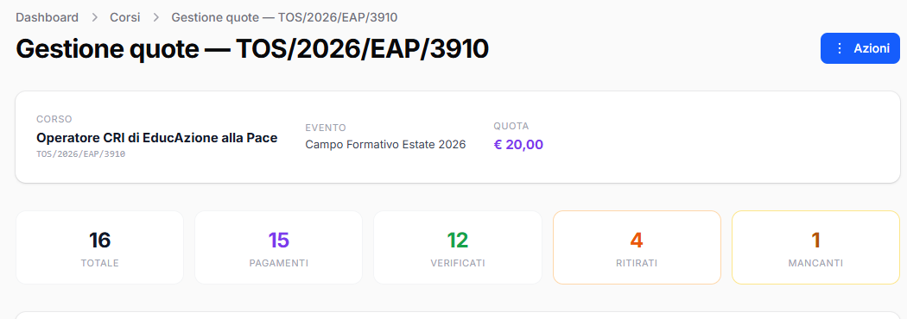
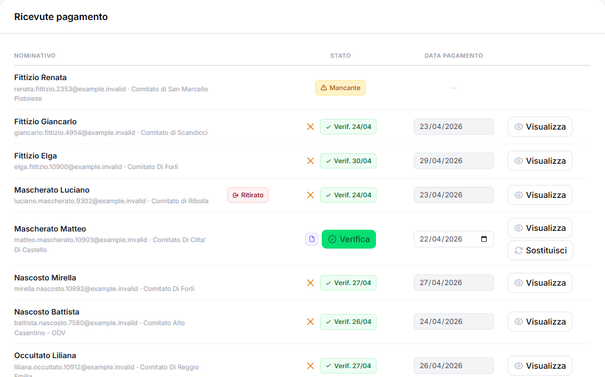
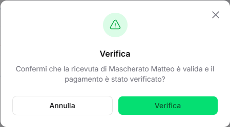
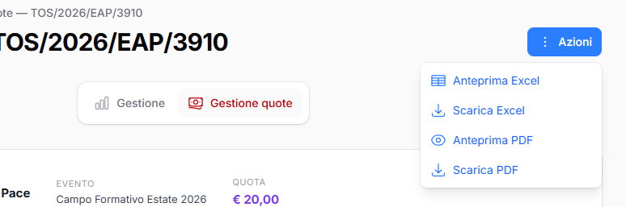

# Quote e pagamenti

> **A chi serve:** operatori e amministratori del pannello.

Se un corso prevede una quota di iscrizione (interruttore **Richiede pagamento** nel [modulo del corso](02-creare-e-modificare.md), con la quota in euro), il modulo di preregistrazione chiede al corsista di allegare la **ricevuta del pagamento**. La pagina **Gestione quote** serve alla segreteria per controllare le ricevute, annotare la data di pagamento e **verificare** i pagamenti. Le coordinate bancarie e le istruzioni che il corsista riceve sono scritte in [Istruzioni di pagamento](../../04-impostazioni/03-istruzioni-pagamento.md).

La pagina si raggiunge in tre modi: dalla scheda **Gestione quote** nella barra del corso, dall'icona delle banconote sulla riga dell'[elenco](01-elenco.md), oppure da **Gestione quote** nella pagina di modifica. Per un corso senza pagamento la scheda non compare, l'icona è grigia e spenta e l'indirizzo diretto non esiste.

<!-- screenshot: route=/admin/corsi/{id}/gestione-quote · v1.86.4-dev · 2026-11-27 · senza barra delle schede -->

## L'intestazione e i numeri

In alto: il corso (nome e protocollo), l'evento e la **quota** in euro. Sotto, cinque riquadri:

- **Totale**: tutti gli iscritti, compresi i ritirati;
- **Pagamenti**: quanti hanno allegato una ricevuta;
- **Verificati**: quanti pagamenti la segreteria ha già verificato;
- **Ritirati**: quanti iscritti si sono ritirati (i loro dati di pagamento restano conservati);
- **Mancanti**: gli iscritti **attivi** che non hanno ancora allegato la ricevuta (in arancione se maggiori di zero).

## La tabella delle ricevute

<!-- screenshot: route=/admin/corsi/{id}/gestione-quote · v1.85.38-dev · 2026-11-18 -->

Una riga per ogni iscritto, in ordine alfabetico: nome, email e comitato, e un'etichetta **Ritirato** per chi si è ritirato. Le colonne:

- **Stato**:
  - **Mancante** (arancione): la ricevuta non è stata allegata;
  - un'icona di documento e il pulsante verde **Verifica**: la ricevuta c'è ed è **da verificare**;
  - **Verif. gg/mm** (verde): il pagamento è **verificato** in quella data; passando il mouse si leggono data, ora e chi lo ha verificato. A sinistra, la ✗ arancione **annulla la verifica**.
- **Data pagamento**: la data in cui il corsista ha pagato (non può essere nel futuro), da riportare dalla ricevuta. Si compila solo se la ricevuta c'è e si **blocca dopo la verifica**: per correggerla si annulla prima la verifica.
- **Visualizza** apre la ricevuta (JPG, PNG o PDF) a destra, senza lasciare la pagina; **Sostituisci** permette di caricarne un'altra al posto di quella sbagliata (JPG, PNG o PDF, massimo 10 MB; il file precedente viene eliminato). La sostituzione è possibile **solo finché il pagamento non è verificato**.

### Verificare un pagamento

1. Aprire la ricevuta con **Visualizza** e controllare importo e causale.
2. Inserire la **data di pagamento**. Senza data la verifica non parte e compare l'avviso «Inserisci la data di pagamento prima di verificare».
3. Premere **Verifica** e confermare («Confermi che la ricevuta di … è valida e il pagamento è stato verificato?»).

<!-- screenshot: route=/admin/corsi/{id}/gestione-quote · v1.85.38-dev · 2026-11-18 · conferma della verifica -->

Se la verifica è stata fatta per errore, la ✗ accanto all'etichetta verde la annulla; da quel momento la data si può di nuovo modificare e la ricevuta sostituire.

## Esportare l'elenco

<!-- screenshot: route=/admin/corsi/{id}/gestione-quote · v1.85.38-dev · 2026-11-18 · menu Azioni -->

Il menu **Azioni** in alto a destra produce il riepilogo delle quote, utile per la rendicontazione amministrativa, in due formati. Per ciascuno c'è l'**anteprima** (si apre in una nuova scheda) e lo **scarico**:

- **Excel**: foglio con l'intestazione del corso (nome, evento, protocollo, quota), i totali (compreso il totale ricevuto) e, per ogni iscritto, nominativo, quota pagata, data del pagamento, comitato e stato (**Verificato**, **Non verificata**, **Ritirato**);
- **PDF**: lo stesso riepilogo in formato stampabile.

Per un corso annullato l'esportazione riporta in testa la dicitura «CORSO ANNULLATO».

## Chi può usarla

Vale la stessa regola della [gestione del corso](03-gestione-corso.md): vi accede chi vede il corso nell'elenco.
