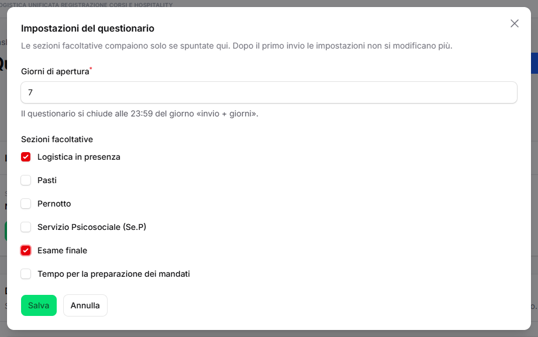
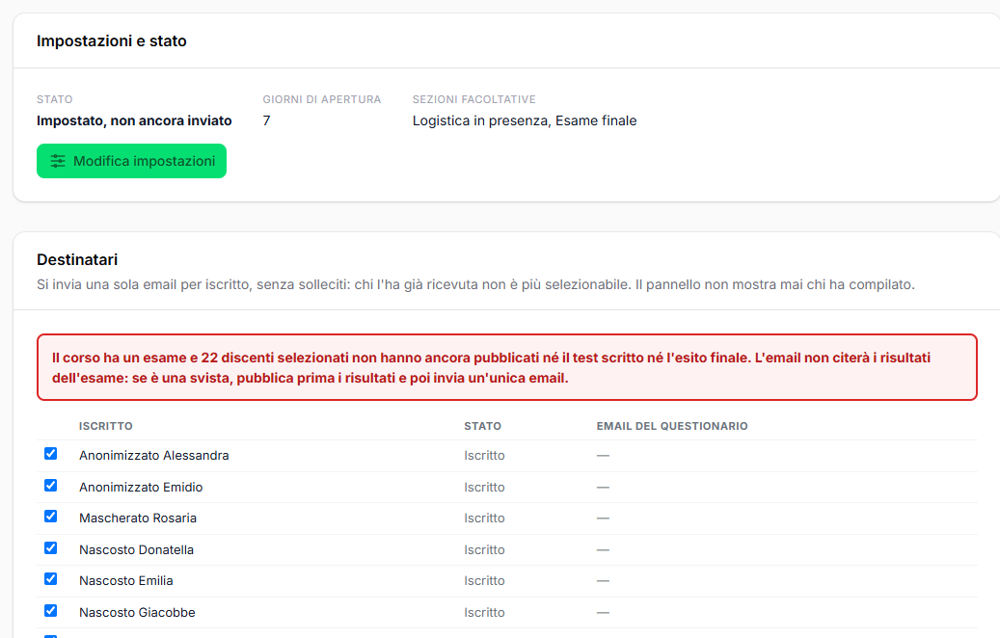
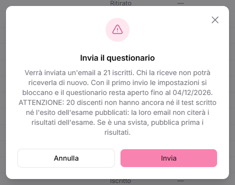
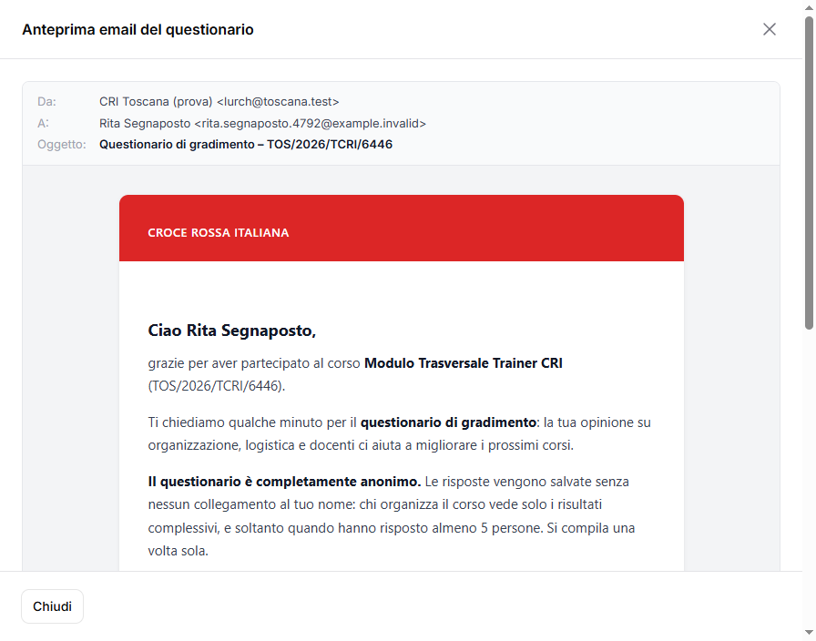
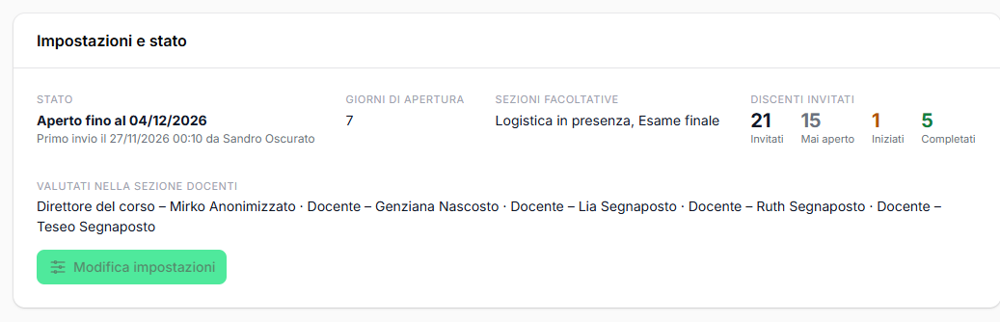
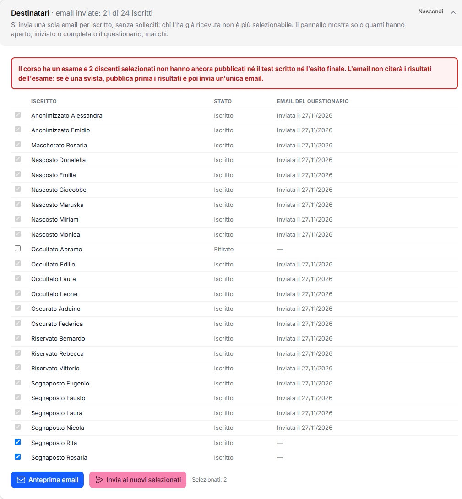
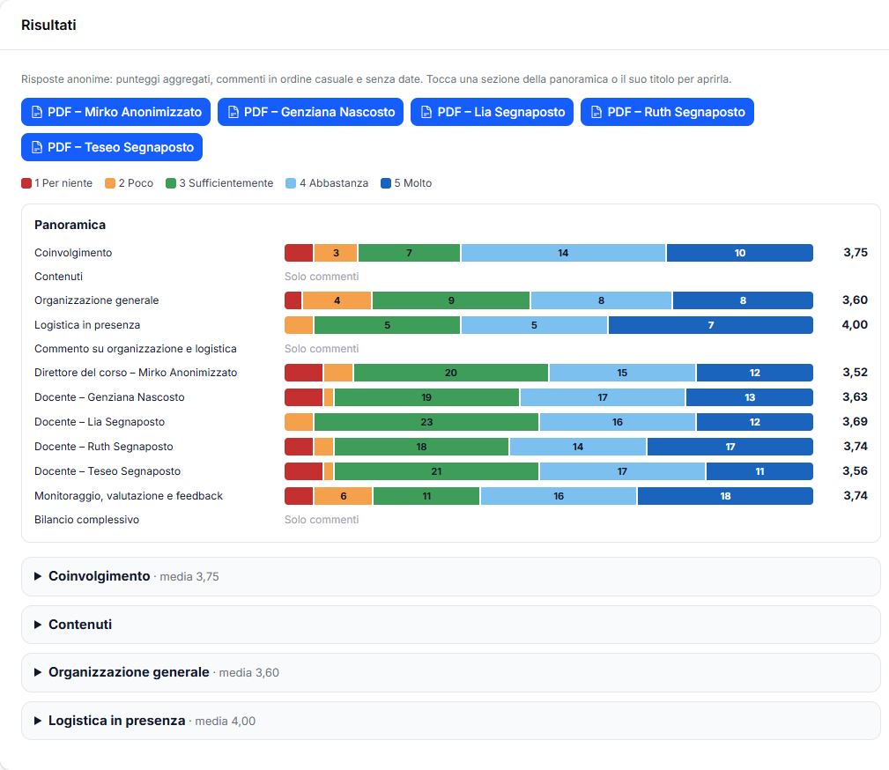
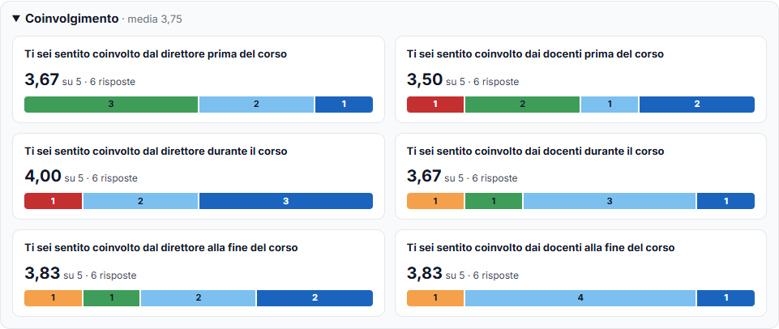
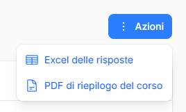

# Questionario di gradimento

> **A chi serve:** amministratori regionali e locali e direttori dei corsi.

Al termine di un corso i discenti possono valutare in forma **anonima** l'organizzazione, la logistica, il direttore e i docenti. Il questionario si prepara e si invia dalla pagina **Questionario** del corso; i discenti lo compilano nell'[app dei soci](../../../02-app-soci/06-questionario.md), dopo l'accesso, e i risultati tornano qui in forma aggregata.

La scheda **Questionario** nella barra del corso ([Gestione del corso](03-gestione-corso.md)) la vedono soltanto:

- gli **amministratori regionali**, per i corsi della propria regione;
- gli **amministratori locali**, per i corsi degli eventi del proprio comitato;
- il **direttore del corso**, qualunque sia il suo ruolo nel pannello, purché il suo profilo sia collegato al socio indicato come direttore.

Gli **operatori** non la vedono mai, nemmeno se sono assegnati all'evento: con l'indirizzo diretto ricevono un errore di accesso negato.

## Come funziona

- Le **domande sono fisse** e uguali per tutti i corsi: non si scrivono né si modificano dal pannello. Alcune sezioni sono sempre presenti (coinvolgimento, contenuti, organizzazione generale, monitoraggio e valutazione, bilancio complessivo); altre si aggiungono a mano solo se servono.
- C'è una **sezione per il direttore e una per ogni docente** del corso, con le stesse domande. Il direttore è sempre incluso, anche se non è tra i docenti; se lo è, compare una volta sola.
- **Un invio, una email per discente:** chi l'ha già ricevuta non può riceverla di nuovo e non ci sono solleciti. Per ricordare il questionario a chi non l'ha ancora compilato basta dirgli di aprire l'app: lo trova nella pagina iniziale.
- **Bozza:** mentre il discente compila, le risposte si salvano da sole, temporaneamente e cifrate, così non perde il lavoro se chiude l'app o cade la connessione. Il pannello non mostra mai le bozze; alla chiusura del questionario quelle non inviate vengono cancellate.
- **Anonimato:** il questionario inviato viene salvato in forma completamente anonima, senza nessun collegamento al discente. Il pannello mostra *quanti* hanno aperto, iniziato o completato il questionario, mai *chi*; i risultati compaiono solo da **5 compilazioni** in su, così le prime risposte non sono riconoscibili.

## Impostare il questionario

Prima dell'invio si scelgono le impostazioni con **Imposta il questionario**:

<!-- screenshot: route=/admin/corsi/{id}/questionario · v1.86.4-dev · 2026-11-27 -->

- **Giorni di apertura**: quanti giorni il questionario resta compilabile dopo il primo invio. Si chiude alle 23:59 dell'ultimo giorno.
- **Sezioni facoltative**: **Logistica in presenza**, **Pasti**, **Pernotto**, **Servizio Psicosociale (Se.P)**, **Esame finale** e **Tempo per la preparazione dei mandati**. Compaiono nel questionario solo se spuntate qui: non vengono dedotte dai dati del corso. La sezione **Esame finale** chiede ai discenti un giudizio sull'esame e non dipende dagli esami gestiti in L.U.R.C.H.

Le impostazioni si possono cambiare fino al primo invio; dopo il pulsante diventa **Modifica impostazioni**, grigio e spento.

## Scegliere i destinatari e inviare

<!-- screenshot: route=/admin/corsi/{id}/questionario · v1.86.4-dev · 2026-11-27 -->

Il riquadro **Destinatari** elenca tutti gli iscritti al corso. Sono già spuntati quelli non ritirati, compresi i non ammessi all'esame; i ritirati si possono aggiungere a mano. Chi non ha un indirizzo email non è selezionabile.

Il pulsante **Invia il questionario**, in fondo all'elenco, resta spento, con il motivo scritto sopra l'elenco, finché:

- il corso non è finito: l'invio si apre il giorno dopo la data di fine del corso;
- il direttore del corso non è collegato a un socio ([modifica del corso](02-creare-e-modificare.md));
- le impostazioni non sono state salvate.

**Avviso sull'esame.** Se il corso ha un esame in L.U.R.C.H., l'email di ogni discente aggiunge in automatico una frase su ciò che di suo è già pubblicato: i risultati del test scritto, l'esito finale o tutti e due, da consultare nell'app. Chi non ha nulla di pubblicato riceve solo l'invito al questionario, come i ritirati e i non ammessi (a loro la frase non arriva mai). Se tra i selezionati ci sono discenti ammessi senza risultati pubblicati, sopra l'elenco compare un riquadro rosso che dice quanti sono. Si può inviare lo stesso; se è una svista conviene pubblicare prima i risultati e mandare un'unica email.

Alla pressione del pulsante una finestra riassume l'invio e ripete l'avviso:

<!-- screenshot: route=/admin/corsi/{id}/questionario · v1.86.4-dev · 2026-11-27 -->

L'email spiega che il questionario è anonimo, indica la data di chiusura e porta all'app dei soci.

**Anteprima email**, accanto al pulsante d'invio, mostra l'email esattamente come arriva, senza inviare nulla: mittente, destinatario, oggetto e testo. L'esempio usa il primo dei selezionati (se nessuno è selezionato, il primo iscritto con email); la data di chiusura è quella che risulterebbe inviando in quel momento. Se il corso ha un esame, sotto l'email una nota dice quale frase sui risultati dell'esame compare nell'esempio e a quanti dei selezionati arriverà una frase. L'anteprima resta disponibile anche dopo l'invio.

<!-- screenshot: route=/admin/corsi/{id}/questionario · v1.87.0-dev · 2026-11-27 -->

## Dopo l'invio

<!-- screenshot: route=/admin/corsi/{id}/questionario · v1.86.4-dev · 2026-11-27 -->

Il riquadro in alto mostra fino a quando il questionario è aperto, chi ha fatto il primo invio, le impostazioni (ormai bloccate) e le persone valutate nella sezione docenti, fissate al momento del primo invio: un docente aggiunto al corso più tardi non entra nel questionario già inviato. I quattro numeri sotto **Discenti invitati** dicono:

- **Invitati**: quanti hanno ricevuto l'email;
- **Mai aperto**: quanti non hanno ancora aperto il questionario nell'app;
- **Iniziati**: quanti hanno almeno una risposta salvata in bozza ma non hanno ancora inviato;
- **Completati**: quanti hanno inviato il questionario.

Sono solo numeri: non c'è modo di sapere chi è in quale gruppo. Per un sollecito fuori dal pannello basta ricordare a tutti di aprire l'app.

Nell'elenco dei destinatari chi ha ricevuto l'email ha la casella grigia e la data dell'invio. Gli altri si possono ancora selezionare: **Invia ai nuovi selezionati** manda l'email solo a loro, finché il questionario è aperto, con la stessa data di chiusura.

<!-- screenshot: route=/admin/corsi/{id}/questionario · v1.86.4-dev · 2026-11-27 -->

## Risultati

Da 5 compilazioni in su compare il riquadro **Risultati**, anche con il questionario ancora aperto.

In alto la **Panoramica** ha una riga per sezione e per ogni docente valutato: una barra con quante risposte hanno dato ciascun valore della scala e, a destra, la media. I colori sono quelli delle valutazioni d'esame: rosso e arancione per i voti bassi (1 e 2), verde per il 3 (sufficiente), azzurro e blu per i voti alti (4 e 5); la legenda è sopra la panoramica e i numeri sono scritti dentro la barra. Le sezioni con soli commenti riportano «Solo commenti».

<!-- screenshot: route=/admin/corsi/{id}/questionario · v1.86.4-dev · 2026-11-27 · risposte di prova -->

Sotto la panoramica le sezioni sono chiuse, con la media accanto al titolo: si aprono toccando il titolo o la riga della panoramica. Dentro una sezione ogni domanda ha la sua scheda, affiancata alle altre sugli schermi larghi:

- a scala da 1 a 5: la **media** e la barra con le risposte per ciascun valore;
- a scelta: quante volte è stata scelta ciascuna opzione, con la percentuale e i testi scritti in «Altro»;
- a testo libero: tutti i testi, in **ordine casuale** e senza date.

<!-- screenshot: route=/admin/corsi/{id}/questionario · v1.86.4-dev · 2026-11-27 · risposte di prova -->

I pulsanti **PDF –** seguiti dal nome scaricano la sola sezione di quella persona, da consegnare al docente o al direttore. Il menu **Azioni** in alto a destra ha l'**Excel delle risposte** (una riga per risposta anonima, una colonna per domanda; per la sezione docenti una colonna per ogni persona e domanda) e il **PDF di riepilogo del corso** con tutte le sezioni. Sotto le 5 compilazioni le due voci sono spente.

<!-- screenshot: route=/admin/corsi/{id}/questionario · v1.86.4-dev · 2026-11-27 -->

Ogni docente, e il direttore, vede anche da solo i risultati della propria sezione nell'app dei soci, con la stessa soglia delle 5 compilazioni ([Questionario di gradimento nell'app](../../../02-app-soci/06-questionario.md)).
