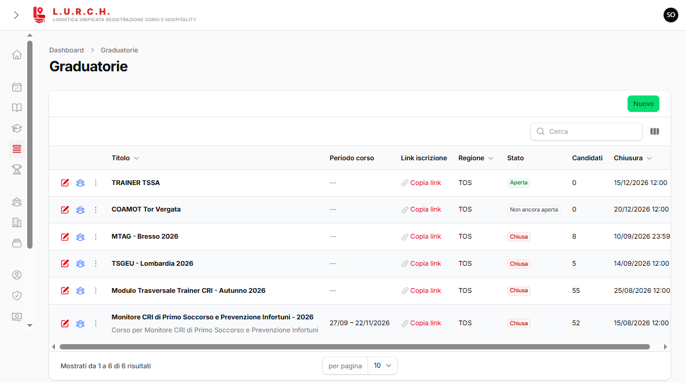
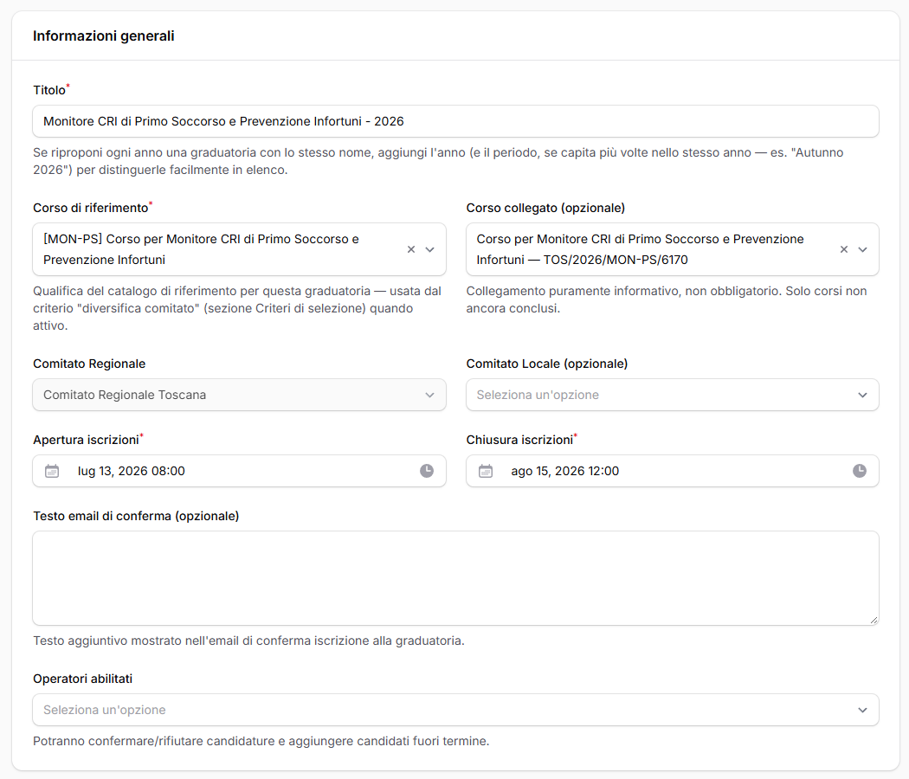

# Elenco e creazione

> **A chi serve:** operatori e amministratori del pannello.

Da **Gestione operativa → Graduatorie** si vedono le graduatorie a cui si ha accesso e se ne creano di nuove.

<!-- screenshot: route=/admin/graduatorie · v1.85.38-dev · 2026-11-18 · tabella ridotta all'80% -->

Le graduatorie sono in ordine di creazione, dalla più recente.

| Colonna | Cosa mostra |
|---|---|
| Titolo | Il titolo della graduatoria e, sotto, il nome del corso collegato (se c'è) |
| Periodo corso | Le date del corso collegato |
| Link iscrizione | **Copia link** copia negli appunti l'indirizzo pubblico a cui i volontari si candidano; passando il mouse si legge l'indirizzo intero |
| Regione | La sigla della regione (TOS, CAM…); il nome intero compare al passaggio del mouse |
| Stato | **Non ancora aperta**, **Aperta** o **Chiusa**, secondo le date di apertura e chiusura delle iscrizioni |
| Candidati | Quante candidature ha ricevuto |
| Chiusura | Data e ora di chiusura delle iscrizioni |

Con l'icona a colonne si possono mostrare anche **Comitato Locale** (vuoto per le graduatorie regionali) e **Creata il**.

Le icone all'inizio della riga:

- la **matita** modifica la graduatoria (il modulo descritto sotto e i [criteri di selezione](02-criteri-di-selezione.md));
- l'icona con le **persone** apre la gestione dei candidati ([Candidati](03-candidati.md));
- i **tre puntini** contengono **Elimina**, solo per gli amministratori e spento se la graduatoria ha già candidati.

La casella **Cerca** trova per titolo e regione; il superadmin ha anche il filtro **Regione**.

## Chi vede quali graduatorie

- Il **superadmin** vede tutte le graduatorie.
- L'**amministratore regionale** vede quelle della sua regione.
- L'**amministratore locale** vede quelle del suo comitato locale.
- L'**operatore** vede solo le graduatorie in cui è indicato tra gli **operatori abilitati** (vedi sotto) e solo se ha il permesso di gestire le graduatorie ([Ruoli e permessi](../../01-primi-passi/03-ruoli-e-permessi.md)).

Creare ed eliminare graduatorie spetta agli amministratori; gli operatori abilitati le gestiscono (candidati, classifica) ma non le creano.

## Creare una graduatoria

Il pulsante verde **Nuovo** apre il modulo. Si può anche partire dal corso: nella pagina di modifica di un corso, **Crea Graduatoria per il corso** genera una graduatoria già collegata, con titolo, protocollo e comitato compilati ([Creare e modificare un corso](../02-corsi/02-creare-e-modificare.md)).

<!-- screenshot: route=/admin/graduatorie/{id}/edit · v1.85.38-dev · 2026-11-18 · informazioni generali -->

- **Incolla da GAIA** (solo in creazione): come nel modulo del corso, se si è copiato un corso da GAIA con lo script GAIA Swissknife, compila il titolo ([Un altro script: GAIA Swissknife](../../05-strumenti/01-userscript-bridge-gaia/README.md#un-altro-script-gaia-swissknife)).
- **Titolo**: obbligatorio. Per le graduatorie che si ripetono ogni anno conviene aggiungere l'anno (e il periodo, se capita più volte nello stesso anno, per esempio «Autunno 2026»); se il titolo esiste già, il pannello lo segnala dopo il salvataggio.
- **Corso di riferimento**: obbligatorio, il tipo di corso del [Catalogo corsi](../../03-archivi/04-catalogo-corsi.md) (nella forma «[codice] nome»). Indica la qualifica a cui la graduatoria porta e serve al criterio «preferenza a chi non ha altri soci in comitato con la stessa qualifica» ([Criteri di selezione](02-criteri-di-selezione.md)).
- **Corso collegato**: facoltativo, uno dei corsi non ancora conclusi. È solo un collegamento informativo: mostra il nome del corso in elenco e le sue date in «Periodo corso». Quando si modifica la scadenza delle domande del corso collegato, la chiusura della graduatoria si allinea da sola.
- **Comitato Regionale**: già impostato sulla propria regione per gli amministratori.
- **Comitato Locale**: vuoto per una graduatoria regionale. Se si sceglie un comitato, la graduatoria è locale e la vede l'amministratore di quel comitato.
- **Apertura iscrizioni** e **Chiusura iscrizioni**: obbligatorie; fuori da queste date il link pubblico mostra una pagina «candidature chiuse». La chiusura non può precedere l'apertura.
- **Testo email di conferma**: facoltativo, un testo aggiunto all'email che il candidato riceve quando la candidatura è confermata. Il resto dell'email viene dal modello della regione ([Template email](../../04-impostazioni/04-template-email.md)).
- **Operatori abilitati**: gli operatori che potranno gestire i candidati di questa graduatoria (confermare, escludere, aggiungere fuori termine, calcolare la classifica).

Sotto c'è la sezione richiusa **Criteri di selezione**, descritta nella pagina successiva. **Salva** registra la graduatoria; da quel momento ha il suo link pubblico, che non cambia più anche se si modificano titolo o corso.
