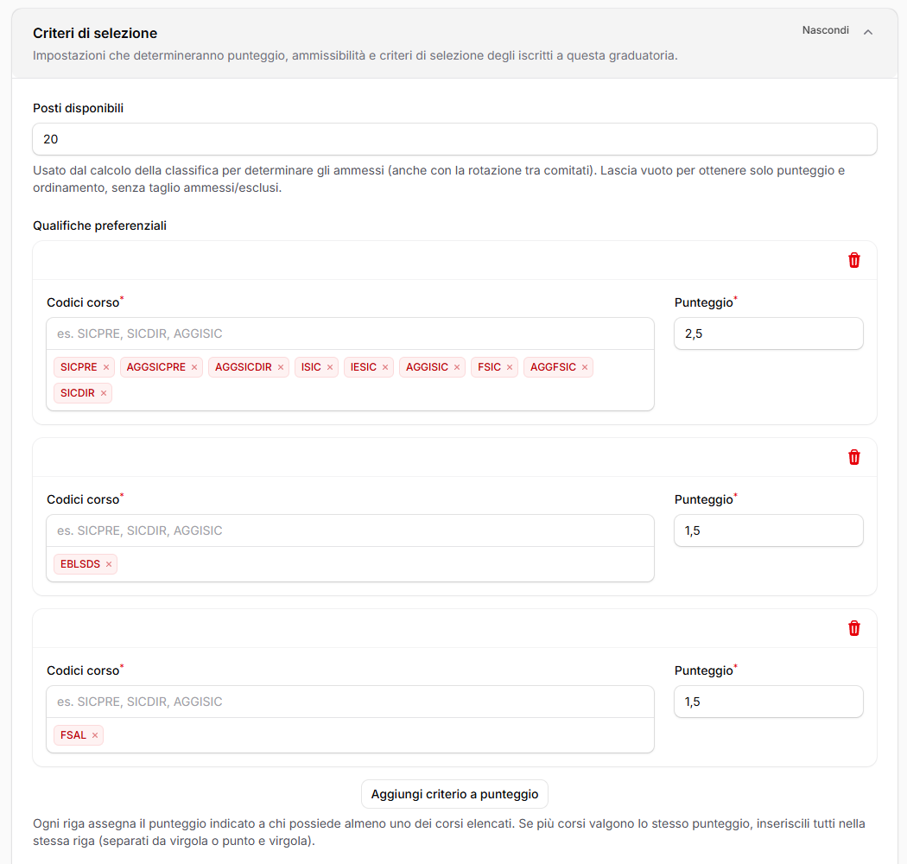
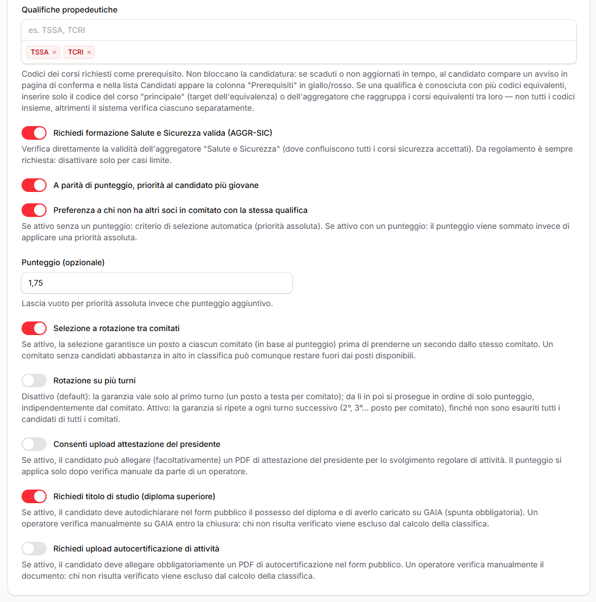

# Criteri di selezione

> **A chi serve:** operatori e amministratori del pannello.

Nel modulo della graduatoria, la sezione richiusa **Criteri di selezione** (si apre con **Mostra**) stabilisce chi può essere ammesso, quanti punti vale ciascun titolo e come si ordina la classifica. I criteri si applicano quando si preme **Calcola punteggi** ([Classifica ed esclusi](04-classifica-ed-esclusi.md)): si possono cambiare anche dopo che sono arrivate le candidature, e il calcolo successivo ne tiene conto.

Il calcolo si basa sulle **qualifiche dei soci registrate in L.U.R.C.H.**, importate da GAIA ([Qualifiche](../05-qualifiche/README.md)): conviene aggiornarle prima della chiusura (la gestione dei candidati lo ricorda con un riquadro giallo).

<!-- screenshot: route=/admin/graduatorie/{id}/edit · v1.85.38-dev · 2026-11-18 · criteri di selezione, prima parte -->

## Posti e punteggi

- **Posti disponibili**: quanti candidati vengono ammessi (30 se non si cambia). I primi in classifica fino a questo numero risultano **Ammessi**, gli altri ammissibili restano in **Lista d'attesa**. Se si lascia vuoto, il calcolo produce solo punteggi e ordine, senza separare ammessi e lista d'attesa.
- **Qualifiche preferenziali**: ogni riga assegna il **punteggio** indicato a chi possiede **almeno uno** dei corsi elencati. I corsi che valgono lo stesso punteggio vanno nella stessa riga: si scrivono i codici del catalogo uno dopo l'altro, o si incollano separati da virgola o punto e virgola; un codice che non esiste nel catalogo viene rifiutato. Una riga conta una volta sola anche se il candidato ha più corsi di quella riga. **Aggiungi criterio a punteggio** aggiunge una riga, il cestino la toglie.

<!-- screenshot: route=/admin/graduatorie/{id}/edit · v1.85.38-dev · 2026-11-18 · criteri di selezione, seconda parte -->

## Requisiti obbligatori

Chi non li soddisfa al momento del calcolo **non è ammissibile** e finisce tra i [candidati esclusi](04-classifica-ed-esclusi.md). Al momento della candidatura non bloccano nulla: il candidato vede solo un avviso.

- **Qualifiche propedeutiche**: i codici dei corsi richiesti come prerequisito (per esempio TSSA, TCRI), che devono essere validi. Se una qualifica è conosciuta con più codici equivalenti, si indica solo il codice del corso «principale» o dell'aggregatore che li raggruppa, non tutti i codici: altrimenti ciascuno viene verificato separatamente.
- **Richiedi formazione Salute e Sicurezza valida (AGGR-SIC)**: acceso di norma, perché da regolamento è sempre richiesta; verifica l'aggregatore in cui confluiscono tutti i corsi sulla sicurezza accettati. Si spegne solo per casi particolari.
- **Richiedi titolo di studio (diploma superiore)**: il candidato deve dichiarare nel modulo pubblico di avere il diploma e di averlo caricato su GAIA. Un operatore lo verifica su GAIA e lo conferma dalla lista dei candidati ([Candidati](03-candidati.md)): chi non è verificato alla chiusura è escluso dal calcolo. La verifica resta registrata sul socio e non va ripetuta nelle graduatorie successive.
- **Richiedi upload autocertificazione di attività**: il candidato deve allegare un PDF di autocertificazione; la **dicitura** scritta qui gli dice che cosa autocertificare. Un operatore verifica il documento: chi non è verificato è escluso dal calcolo.

## Preferenze e ordine

- **A parità di punteggio, priorità al candidato più giovane**.
- **Preferenza a chi non ha altri soci in comitato con la stessa qualifica**: favorisce chi viene da un comitato che non ha ancora nessuno con la qualifica del **corso di riferimento** (contano i soci che appartengono direttamente a quel comitato locale). Senza **Punteggio** è una priorità assoluta: questi candidati passano davanti a tutti; con un punteggio, invece, quel punteggio si somma agli altri.
- **Selezione a rotazione tra comitati**: garantisce un posto a ciascun comitato, nell'ordine di punteggio, prima di prendere un secondo candidato dallo stesso comitato. Un comitato senza candidati abbastanza in alto può comunque restare fuori dai posti disponibili.
  - **Rotazione su più turni** (compare solo con la rotazione accesa): se è spenta, la garanzia vale solo al primo giro, poi si procede per solo punteggio; se è accesa, si ripete a ogni giro (secondo, terzo posto per comitato…) finché ci sono candidati.
- **Consenti upload attestazione del presidente**: il candidato può allegare, se vuole, un'attestazione del presidente del suo comitato sull'attività svolta. Il **punteggio se verificata** si aggiunge solo dopo che un operatore l'ha verificata.

## Punteggi manuali

Oltre ai criteri, a ogni candidato si possono assegnare **punteggi manuali**, positivi o negativi e sempre con un motivo, per elementi che il pannello non può verificare da solo (per esempio un webinar seguito). Si inseriscono dalla finestra **Dettagli** del candidato ([Candidati](03-candidati.md)) e valgono a ogni nuovo calcolo finché non vengono tolti.
