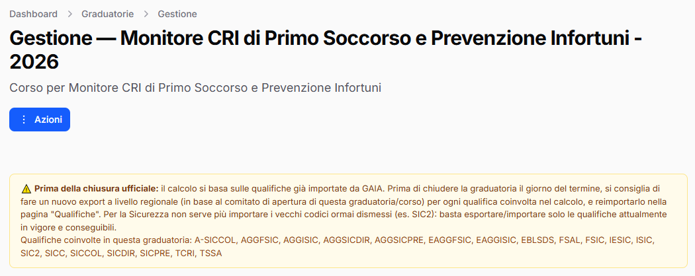
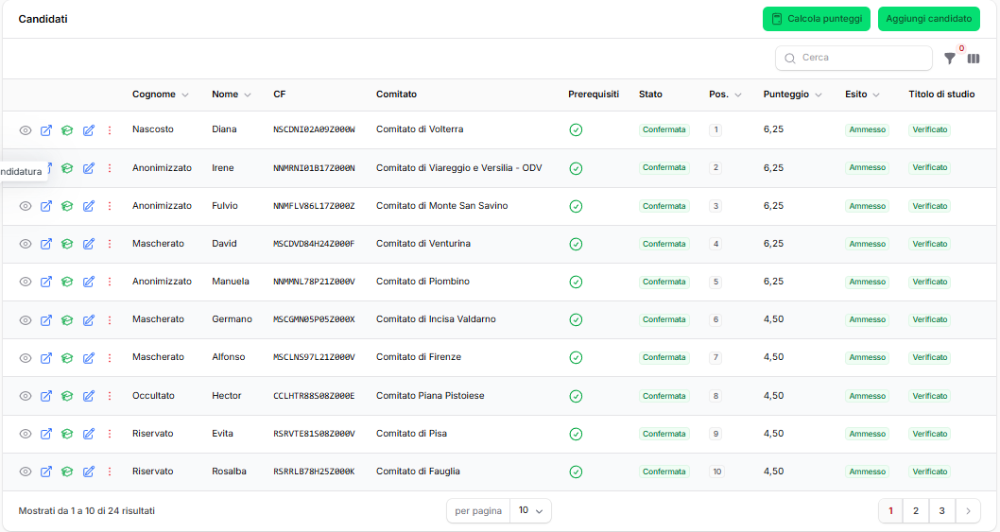
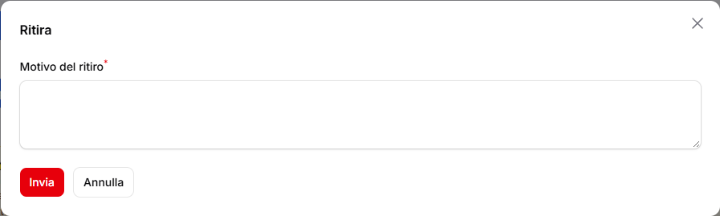
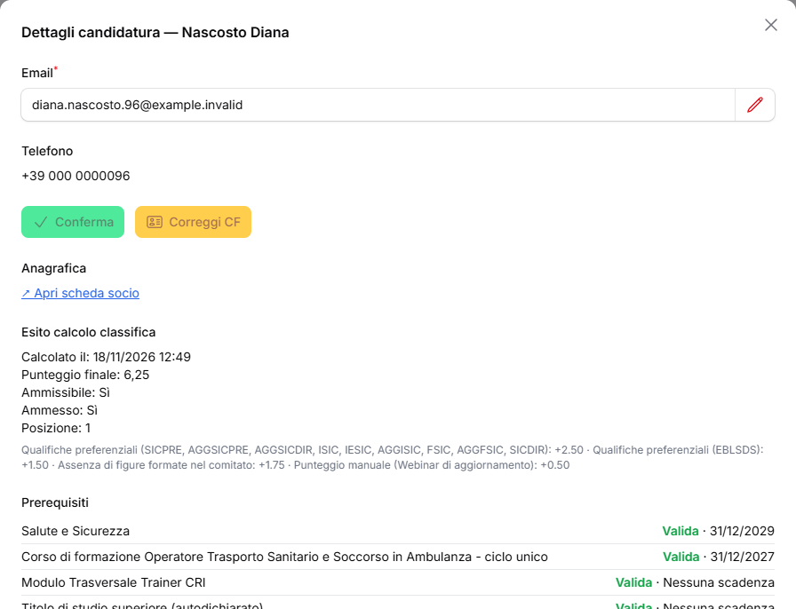
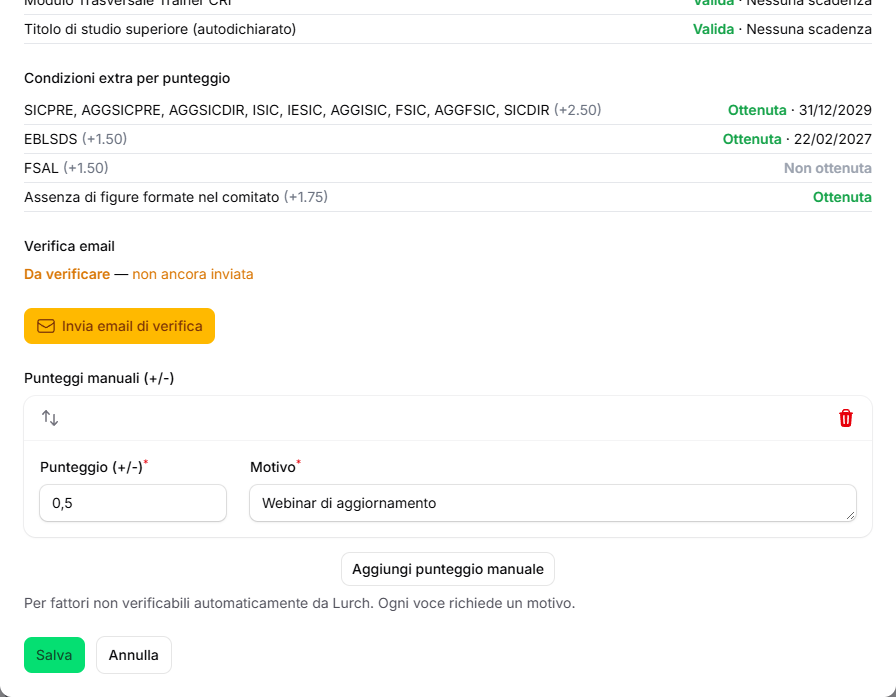
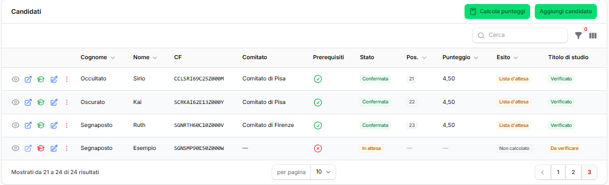
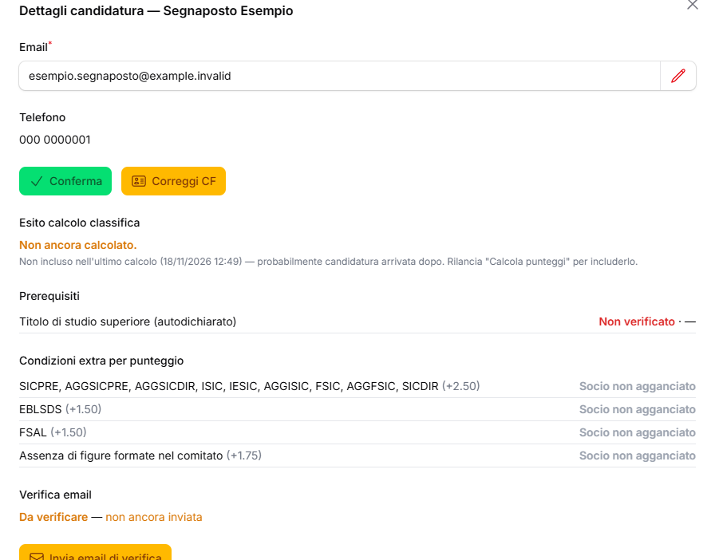
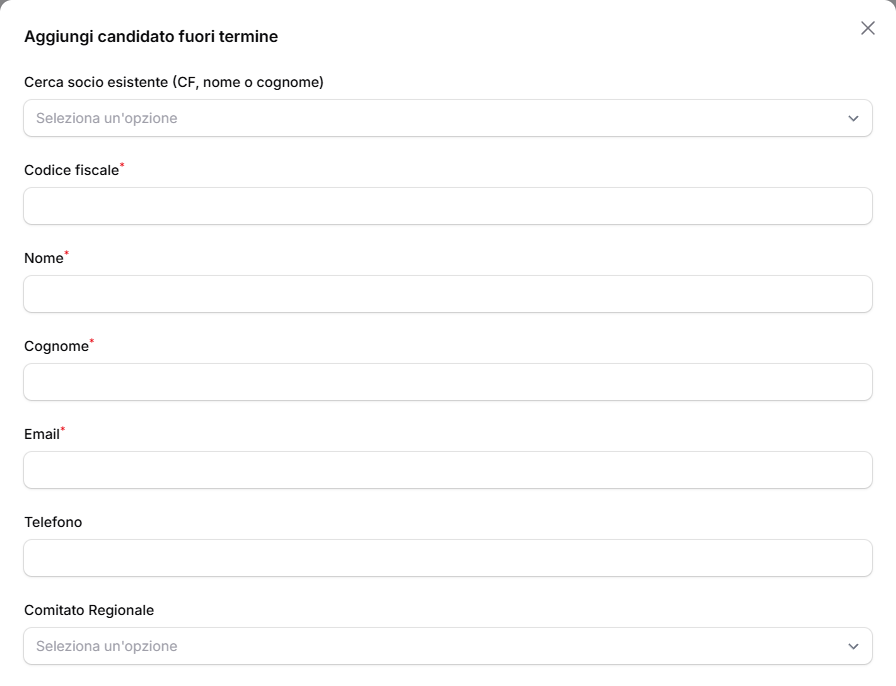

# Candidati

> **A chi serve:** operatori e amministratori del pannello.

La pagina **Gestione** di una graduatoria si apre con l'icona delle persone nell'[elenco](01-elenco-e-creazione.md). Raccoglie le candidature arrivate dal link pubblico, permette di controllarle e di completarle, e alla chiusura di calcolare la classifica ([Classifica ed esclusi](04-classifica-ed-esclusi.md)).

## Come arrivano le candidature

Il volontario apre il link pubblico, scrive il suo codice fiscale e completa il modulo ([Candidatura a graduatoria](../../../03-moduli-pubblici/03-candidatura-graduatoria.md)). Poi:

- se il codice fiscale è **nell'archivio soci**, la candidatura è **confermata subito**, i contatti inseriti aggiornano la scheda del socio e parte l'email di conferma;
- se il codice fiscale **non è in archivio**, la candidatura resta **In attesa**: i dati restano solo sulla candidatura finché un operatore non la conferma (vedi «Candidature in attesa» più sotto); solo allora parte l'email.

Ogni persona può candidarsi una sola volta alla stessa graduatoria.

## L'intestazione

<!-- screenshot: route=/admin/graduatorie/{id}/candidati · v1.85.38-dev · 2026-11-18 · senza il pulsante dello userscript -->

Sotto il titolo compare il nome del corso collegato. Il pulsante **Azioni** contiene:

<!-- screenshot: route=/admin/graduatorie/{id}/candidati · v1.85.38-dev · 2026-11-18 · menu Azioni -->

- **Modifica graduatoria**: apre il [modulo](01-elenco-e-creazione.md) e i [criteri](02-criteri-di-selezione.md);
- **Copia link iscrizione**: copia l'indirizzo pubblico da inviare ai volontari;
- **Anteprima email di conferma**: mostra l'email che ricevono i candidati confermati;
- **Anteprima Excel** e **Scarica Excel**: la classifica ([Classifica ed esclusi](04-classifica-ed-esclusi.md)).

Accanto c'è il pulsante dello **userscript GAIA** (Installa, Aggiorna, oppure, se è già installato, i pulsanti che cercano gli ID GAIA dei candidati e ne importano le qualifiche): vedi [Userscript bridge GAIA](../../05-strumenti/01-userscript-bridge-gaia/README.md).

Il riquadro giallo **Prima della chiusura ufficiale** ricorda che la classifica si calcola sulle qualifiche già importate da GAIA: il giorno della chiusura conviene esportare da GAIA le qualifiche coinvolte (elencate in fondo al riquadro) e reimportarle nella pagina [Qualifiche](../05-qualifiche/README.md).

## La lista dei candidati

<!-- screenshot: route=/admin/graduatorie/{id}/candidati · v1.85.38-dev · 2026-11-18 · tabella ridotta al 70% -->

La lista mostra i candidati attivi in ordine di classifica (chi non è ancora stato calcolato va in fondo, in ordine alfabetico). I candidati ritirati o non ammissibili sono nella lista separata dei **candidati esclusi**, sotto ([Classifica ed esclusi](04-classifica-ed-esclusi.md)).

| Colonna | Cosa mostra |
|---|---|
| Cognome, Nome | Il candidato |
| CF | Il codice fiscale; un clic lo copia |
| Comitato | Il comitato del socio collegato (o quello dichiarato nella candidatura, se il socio non c'è) |
| Prerequisiti | Spunta verde se i requisiti obbligatori sono a posto, triangolo giallo o croce rossa se c'è qualcosa in scadenza o che manca; passando il mouse si legge cosa |
| Stato | **Candidatura ricevuta** finché le iscrizioni sono aperte, **Confermata** dopo la chiusura; **In attesa** per chi non è ancora collegato a un socio; **Escluso** per chi è stato rifiutato |
| Pos., Punteggio, Esito | Posizione, punteggio ed esito (**Ammesso**, **Lista d'attesa**, **Non calcolato**) dell'ultimo calcolo; passando il mouse sull'esito si legge come è composto il punteggio |
| Titolo di studio, Attestazione, Autocertificazione | Compaiono solo se la graduatoria li richiede: **Verificato/Verificata** o **Da verificare** |

Dal selettore delle colonne si possono mostrare anche **Ruolo** (volontario o dipendente), **Anagrafica** (se la candidatura è collegata a un socio in archivio), **Iscritto il** (la data della candidatura, in arancione per chi è stato aggiunto fuori termine), **Email** (verificata o da verificare) e **Note** dell'operatore.

La casella **Cerca** trova per cognome, nome o codice fiscale; il filtro a imbuto seleziona per stato.

## Le azioni di riga

Ogni riga ha queste icone, con la spiegazione al passaggio del mouse:

- **occhio**: i **Dettagli** della candidatura (vedi sotto);
- **freccia verso l'esterno**: apre il curriculum del socio **su GAIA**, se il socio ha un ID GAIA collegato (lo trova lo userscript); altrimenti è spenta;
- **tocco** (solo se la graduatoria richiede il diploma): rosso se il titolo di studio non è ancora verificato, verde se lo è. Dopo aver controllato su GAIA, un clic **conferma la verifica**; sull'icona verde, un clic la **annulla**. La verifica resta registrata sul socio;
- **matita**: modifica **email**, **telefono** e **note dell'operatore** (per esempio come e quando il candidato è stato ricontattato). Se cambia l'email, al nuovo indirizzo parte un'email di verifica prima che sostituisca quella del socio;
- **tre puntini rossi**: **Ritira** (chiede il motivo, obbligatorio, e sposta il candidato tra gli esclusi) e, per le candidature in attesa, **Rifiuta** (la candidatura diventa **Escluso**).

<!-- screenshot: route=/admin/graduatorie/{id}/candidati · v1.85.38-dev · 2026-11-18 · finestra Ritira -->

Un ritiro si può annullare dalla lista degli esclusi con **Ripristina** ([Classifica ed esclusi](04-classifica-ed-esclusi.md)); ritiri e ripristini restano nello storico della candidatura.

## I dettagli della candidatura

<!-- screenshot: route=/admin/graduatorie/{id}/candidati · v1.85.38-dev · 2026-11-18 · finestra Dettagli, prima parte -->

La finestra **Dettagli** raccoglie tutto ciò che riguarda il candidato:

- **Email** (si modifica con la matita a destra) e **Telefono**;
- **Conferma** e **Correggi CF**, attivi solo per le candidature in attesa (vedi sotto);
- **Apri scheda socio**, se la candidatura è collegata a un socio;
- **Esito calcolo classifica**: data dell'ultimo calcolo, punteggio, ammissibilità, ammissione, posizione e voci che compongono il punteggio;
- **Prerequisiti**: ogni requisito obbligatorio con il suo stato (**Valida**, **In scadenza**, **Scaduta**, **Non verificato**) e la scadenza.

<!-- screenshot: route=/admin/graduatorie/{id}/candidati · v1.85.38-dev · 2026-11-18 · finestra Dettagli, seconda parte -->

- **Condizioni extra per punteggio**: ogni qualifica preferenziale e preferenza, con **Ottenuta** o **Non ottenuta**;
- **Verifica email**: se l'indirizzo non è ancora verificato, quando è stata inviata l'ultima richiesta e il pulsante **Invia** (o **Reinvia**) **email di verifica**;
- **Punteggi manuali (+/-)**: i punteggi aggiunti a mano, ciascuno con il suo motivo ([Criteri di selezione](02-criteri-di-selezione.md)); **Aggiungi punteggio manuale** ne aggiunge uno;
- se la graduatoria li prevede, l'**attestazione del presidente** e l'**autocertificazione**: il collegamento per aprire il PDF, il caricamento di un nuovo file (che sostituisce il precedente) e l'interruttore **Documento verificato**. Una volta verificato, il documento non si può più sostituire finché non si toglie la verifica;
- lo **storico dei ritiri e ripristini**, se ce ne sono stati.

**Salva** registra le modifiche (email, punteggi manuali, documenti); **Annulla** chiude senza salvare.

## Candidature in attesa

<!-- screenshot: route=/admin/graduatorie/{id}/candidati · v1.85.38-dev · 2026-11-18 · ultima pagina: lista d'attesa e candidatura in attesa -->

Una candidatura **In attesa** non è collegata a nessun socio: di solito il codice fiscale è stato scritto male, oppure la persona non è ancora nell'archivio. Non entra nel calcolo della classifica e blocca lo scarico dell'Excel finché non viene sistemata. Dalla finestra **Dettagli**:

<!-- screenshot: route=/admin/graduatorie/{id}/candidati · v1.85.38-dev · 2026-11-18 · dettagli di una candidatura in attesa -->

- **Correggi CF**: si scrive il codice fiscale giusto. Se corrisponde a un socio, la candidatura viene collegata e confermata (come avrebbe fatto il modulo pubblico) e parte l'email di conferma. Se non lo trova, il codice viene comunque corretto e la candidatura resta in attesa. Se il codice giusto appartiene a un'altra candidatura già confermata della stessa graduatoria (la persona si è ricandidata da sola), questa viene segnata come doppione e ritirata.
- **Conferma**: si controllano i dati (nome, cognome, email, telefono, comitato) e si conferma; se il socio non esiste in archivio viene creato. Parte l'email di conferma.

In alternativa, una candidatura in attesa si può **rifiutare** dal menu dei tre puntini.

## Aggiungere un candidato fuori termine

<!-- screenshot: route=/admin/graduatorie/{id}/candidati · v1.85.38-dev · 2026-11-18 · finestra Aggiungi candidato -->

**Aggiungi candidato**, in alto sopra la lista, inserisce una candidatura a mano, anche fuori dalle date di apertura e chiusura. Si cerca il socio per codice fiscale, nome o cognome (i dati si compilano da soli) oppure si scrivono a mano codice fiscale, nome, cognome, email, telefono e comitato. La candidatura è subito confermata, porta il segno «fuori termine» (la data «Iscritto il» in arancione) e il candidato riceve l'email di conferma.
