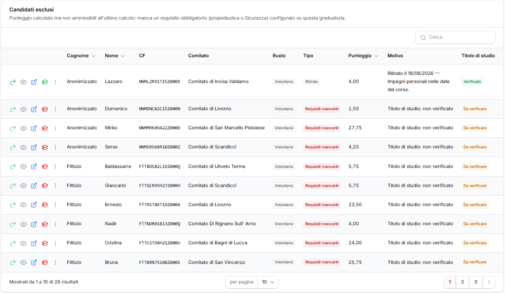

# Classifica ed esclusi

> **A chi serve:** operatori e amministratori del pannello.

La classifica non si aggiorna da sola: si calcola quando serve, con il pulsante **Calcola punteggi** della pagina [Candidati](03-candidati.md), secondo i [criteri di selezione](02-criteri-di-selezione.md) della graduatoria. Si può ricalcolare quante volte si vuole: per esempio a metà raccolta, per avere un'idea, e poi alla chiusura, dopo aver aggiornato le qualifiche da GAIA.

## Calcolare la classifica

<!-- screenshot: route=/admin/graduatorie/{id}/candidati · v1.85.38-dev · 2026-11-18 · conferma del calcolo -->

**Calcola punteggi** (in alto sopra la lista dei candidati) chiede conferma e poi, per tutti i candidati **confermati e non ritirati**:

1. controlla i **requisiti obbligatori** (qualifiche propedeutiche, Salute e Sicurezza, titolo di studio e autocertificazione verificati, se richiesti): chi non li soddisfa diventa **non ammissibile**;
2. calcola il **punteggio** (qualifiche preferenziali, preferenza per comitato, attestazione verificata, punteggi manuali), anche per i non ammissibili, così il loro punteggio resta visibile;
3. ordina gli ammissibili (priorità assoluta, punteggio, età se richiesto, rotazione tra comitati se attiva) e assegna la **posizione**;
4. segna **Ammesso** i primi fino ai **posti disponibili** e **Lista d'attesa** gli altri ammissibili.

Il calcolo sostituisce quello precedente. Alla fine una notifica riporta quanti sono gli ammissibili, quanti gli ammessi e quanti gli esclusi per requisiti. Le candidature in attesa (non collegate a un socio) non entrano nel calcolo e restano **Non calcolato**, come quelle arrivate dopo l'ultimo calcolo: basta ricalcolare per includerle.

Nella lista dei candidati, dopo il calcolo, si leggono **Pos.**, **Punteggio** ed **Esito**; passando il mouse sull'esito si vede da quali voci è composto il punteggio. Le stesse informazioni, più in dettaglio, sono nella finestra **Dettagli** del candidato.

> Finché le iscrizioni sono aperte, lo stato dei candidati confermati è «Candidatura ricevuta»: la conferma riguarda solo il fatto che il codice fiscale è stato riconosciuto, non l'esito della selezione, che dipende dal calcolo.

## I candidati esclusi

<!-- screenshot: route=/admin/graduatorie/{id}/candidati · v1.85.38-dev · 2026-11-18 · lista dei candidati esclusi, ridotta al 70% -->

Sotto la lista dei candidati, **Candidati esclusi** raccoglie:

- chi all'ultimo calcolo è risultato **non ammissibile** (tipo **Requisiti mancanti**): la colonna **Motivo** dice quale requisito manca (per esempio «Titolo di studio: non verificato» o una qualifica scaduta);
- chi si è **ritirato** (tipo **Ritirato**): il motivo riporta la data e il motivo del ritiro.

Le icone di riga:

- **freccia verde, Ripristina**: solo per i ritirati; chiede il motivo del ripristino e riporta la candidatura tra quelle attive. Per un escluso per requisiti è spenta: bisogna sistemare ciò che manca (qualifica, verifica del titolo di studio o del documento) e ricalcolare;
- **occhio, Dettagli**: la stessa finestra dei candidati, in sola consultazione per i dati, con il motivo dell'esclusione o del ritiro; i punteggi manuali e i documenti si possono comunque aggiornare;
- **Apri su GAIA** e la verifica del **titolo di studio**, come nella lista principale: verificare il diploma di un escluso e ricalcolare lo riporta in classifica;
- **tre puntini, Elimina**: solo per una candidatura ritirata e mai collegata a un socio (tipicamente un codice fiscale scritto male poi corretto con una nuova candidatura). Le candidature collegate a un socio non si eliminano: si ripristinano.

## Esportare la classifica

Dal menu **Azioni** della pagina:

- **Anteprima Excel** apre in una nuova scheda la classifica e, sotto, gli esclusi;
- **Scarica Excel** scarica un file con due fogli: **Graduatoria** (posizione, cognome, nome, codice fiscale, comitato, tipo, email, telefono, punteggio, con gli ammessi evidenziati in verde) ed **Esclusi** (gli stessi dati con il motivo dell'esclusione).

**Scarica Excel** è spento finché c'è almeno una candidatura non collegata a un socio: prima vanno sistemate le candidature in attesa ([Candidati](03-candidati.md)), così l'elenco non contiene righe non verificate.
