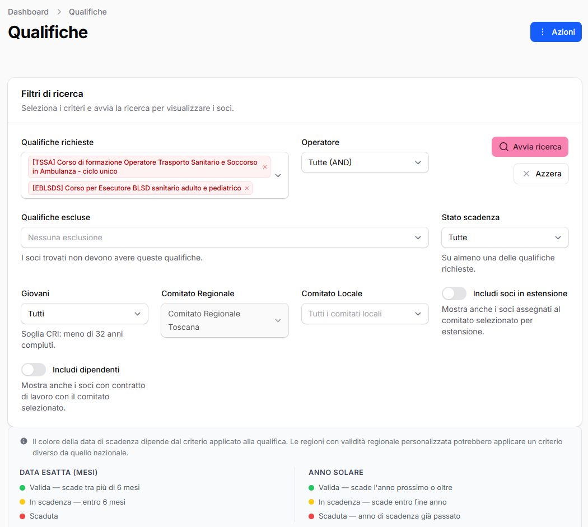
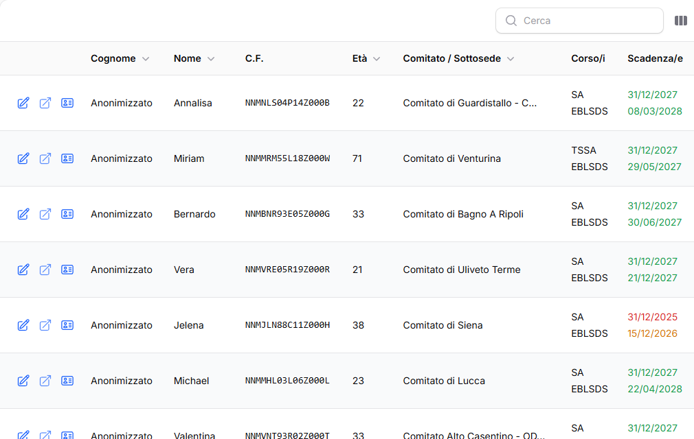
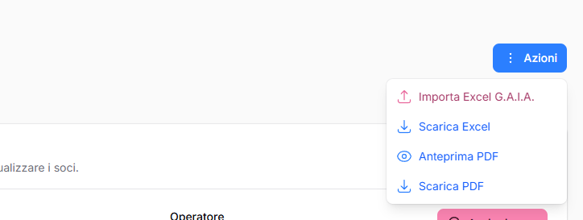

# Ricerca ed export

> **A chi serve:** operatori e amministratori del pannello.

**Gestione operativa → Qualifiche** è una ricerca: si scelgono le qualifiche e gli altri criteri, si preme **Avvia ricerca** e compare l'elenco dei soci che corrispondono, esportabile in Excel o PDF. Serve per esempio a trovare chi ha un corso valido per un servizio, chi deve rinnovarlo, chi non ha ancora un corso propedeutico.

## I filtri

<!-- screenshot: route=/admin/qualifiche-soci · v1.85.38-dev · 2026-11-18 -->

- **Qualifiche richieste**: una o più qualifiche, cercando per codice o per nome. L'**Operatore** accanto decide se il socio deve averle **tutte** (AND) o **almeno una** (OR).
- **Qualifiche escluse**: i soci trovati **non** devono avere queste qualifiche (per esempio: chi ha il corso base ma non ancora l'aggiornamento).
- **Stato scadenza**: **Solo valide** (comprese quelle in scadenza) o **Solo scadute**, riferito alle qualifiche richieste; si attiva quando se ne è scelta almeno una.
- **Giovani**: con la soglia CRI di meno di 32 anni compiuti, **Solo giovani** (età di oggi) oppure **Solo entrati come giovani** (età alla data di ingresso). I soci senza data di nascita (o di ingresso) sono esclusi da questo filtro.
- **Comitato Regionale** e **Comitato Locale**: dove cercare. La regione è fissata sulla propria per tutti tranne il superadmin; il comitato locale è fissato per l'amministratore locale e per l'operatore che ha un comitato locale.
- **Includi soci in estensione**: aggiunge i soci che appartengono al comitato scelto per estensione.
- **Includi dipendenti**: aggiunge chi ha un contratto di lavoro con il comitato scelto.

**Avvia ricerca** chiede almeno una qualifica richiesta o esclusa. **Azzera** riporta i filtri all'inizio. L'indirizzo della pagina conserva i filtri: una ricerca usata spesso si può salvare tra i preferiti del browser.

Sotto i filtri, una legenda ricorda come si leggono i colori delle scadenze (vedi [Qualifiche](README.md)).

> **Equivalenze.** Cercando una qualifica si trovano anche i soci che hanno un corso **equivalente** indicato nel catalogo: nell'esempio, cercando TSSA compaiono anche soci con SA. La colonna «Corso/i» dice quale corso ha effettivamente ciascuno.

## I risultati

<!-- screenshot: route=/admin/qualifiche-soci · v1.85.38-dev · 2026-11-18 · risultati di una ricerca -->

| Colonna | Cosa mostra |
|---|---|
| Cognome, Nome | Il socio |
| C.F. | Il codice fiscale; un clic lo copia |
| Età | L'età di oggi |
| Comitato / Sottosede | Il comitato del socio (accorciato; passando il mouse si legge il nome intero) |
| Tipo relazione | Solo se si è scelto un comitato locale: **Volontario**, **Dipendente** o **In estensione** |
| Corso/i | Per ogni qualifica richiesta, il codice del corso che il socio ha (anche equivalente) |
| Scadenza/e | Le scadenze corrispondenti, colorate secondo lo stato |

Dal selettore delle colonne si possono mostrare anche **Nascita** e **Ingresso** (data di ingresso nella CRI). Con una sola qualifica richiesta si può ordinare per scadenza. La casella **Cerca** sopra la tabella filtra ulteriormente per nome, codice fiscale o comitato. I risultati sono 25 per pagina (o 50, 100).

Le icone all'inizio di ogni riga:

- **matita**: apre le [qualifiche del socio](03-qualifiche-del-socio.md), dove si aggiungono o correggono;
- **freccia verso l'esterno**: apre il curriculum del socio **su GAIA** (spenta se il socio non ha un ID GAIA collegato);
- **tessera**: apre la scheda del socio in una nuova scheda ([Soci](../../03-archivi/01-soci/README.md)).

## Esportare

<!-- screenshot: route=/admin/qualifiche-soci · v1.85.38-dev · 2026-11-18 · menu Azioni dopo una ricerca -->

Dopo una ricerca, il menu **Azioni** offre **Scarica Excel**, **Anteprima PDF** e **Scarica PDF**: esportano esattamente i risultati della ricerca, con gli stessi filtri e lo stesso ordinamento. Il file riporta numero, cognome, nome, codice fiscale, comitato, tipo di relazione, nascita, età, ingresso e, per ogni qualifica richiesta, il corso, la scadenza e lo stato; solo l'Excel contiene anche l'email.

La prima voce, **Importa Excel G.A.I.A.**, è descritta in [Importare da GAIA](02-importare-da-gaia.md).

## Chi può usarla

- Il **superadmin** cerca in tutte le regioni.
- L'**amministratore regionale** e l'**operatore** senza comitato locale cercano nella propria regione.
- L'**amministratore locale** e l'**operatore** con un comitato locale cercano nel proprio comitato (compresi dipendenti ed estensioni, se si accendono gli interruttori).

L'operatore ha bisogno del permesso di vedere le qualifiche, oppure di quello di gestirle ([Ruoli e permessi](../../01-primi-passi/03-ruoli-e-permessi.md)).
