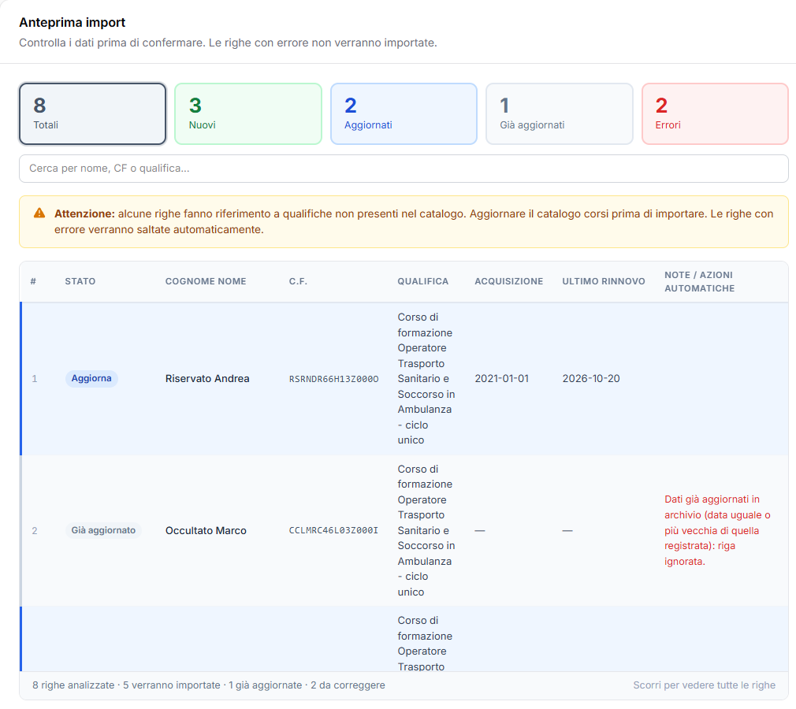

# Importare da GAIA

> **A chi serve:** amministratori (superadmin, regionali e locali).

Le qualifiche dei soci si caricano da GAIA in due modi:

- con l'**export Excel** di GAIA, un corso alla volta, da questa pagina (descritto qui sotto);
- con lo **userscript GAIA**, che legge direttamente il curriculum dei soci su GAIA: per un singolo socio dalla sua scheda, per un intero comitato con il pulsante **Importa qualifiche GAIA (comitato)** che compare nella ricerca quando si sceglie un comitato locale, per i candidati di una graduatoria dalla sua pagina di gestione ([Userscript bridge GAIA](../../05-strumenti/01-userscript-bridge-gaia/README.md)).

Le due strade scrivono le stesse qualifiche con le stesse regole.

## Le regole dell'import

- Il socio si riconosce dal **codice fiscale**: deve essere già nell'archivio soci ([Soci](../../03-archivi/01-soci/README.md)).
- Il corso si riconosce dal **nome**, che deve corrispondere a quello di un corso del [Catalogo corsi](../../03-archivi/04-catalogo-corsi.md) (o a uno dei suoi nomi alternativi, per i corsi che su GAIA hanno cambiato nome).
- L'import **non torna mai indietro**: se il file ha una data più vecchia di quella già registrata, la riga viene ignorata. Per questo i file si possono caricare in qualunque ordine, anche uno vecchio dopo uno nuovo.
- Le date nel futuro vengono scartate (sono errori di inserimento su GAIA).
- I corsi di **aggiornamento** aggiornano il corso base: importare un aggiornamento (per esempio AGGTSSA) sposta la data di ultimo rinnovo del corso base (TSSA) e quindi la sua scadenza. Se il catalogo lo prevede, il corso base viene creato quando il socio non lo ha ancora.

## Caricare il file

<!-- screenshot: route=/admin/qualifiche-soci · v1.85.38-dev · 2026-11-18 · finestra di import -->

1. Su GAIA si esporta l'elenco dei soci con un corso (export per singolo corso). Le colonne usate sono Cognome, Nome, Codice Fiscale e quella dei titoli («Titoli/Operatività/Data ottenimento»).
2. Nel pannello, **Azioni → Importa Excel G.A.I.A.**, si sceglie il file **XLSX** e si preme **Analizza file**. L'analisi **non scrive nulla**.

## L'anteprima

<!-- screenshot: route=/admin/qualifiche-soci · v1.85.38-dev · 2026-11-18 · anteprima di un import di prova -->

In cima alla pagina compare l'**Anteprima import**. I riquadri in alto contano le righe e, con un clic, mostrano solo quelle di un tipo:

| Riquadro | Significato |
|---|---|
| **Totali** | Tutte le righe del file |
| **Nuovi** | Qualifiche che il socio non aveva: verranno inserite |
| **Aggiornati** | Qualifiche già presenti con una data più recente nel file: verranno aggiornate |
| **Già aggiornati** | Il pannello ha già una data uguale o più recente: la riga non cambia nulla |
| **Errori** | Righe che non verranno importate: codice fiscale non trovato in archivio, corso non presente nel catalogo, riga saltata (per esempio per una data nel futuro); la colonna «Note» dice il motivo |
| **Qualifiche base da creare** | Compare se l'import di un aggiornamento creerà anche il corso base mancante |

La casella di ricerca filtra per nome, codice fiscale o qualifica. Se ci sono corsi che il catalogo non conosce, un riquadro giallo lo segnala: conviene aggiungerli al catalogo (o indicarli come nome alternativo di un corso esistente) e ripetere l'analisi.

In fondo all'anteprima:

- **Conferma import (N righe)**, dopo una conferma, scrive le righe «Nuovi» e «Aggiornati». Alla fine una notifica riporta quante qualifiche sono state inserite, aggiornate e ricalcolate, e gli eventuali errori. L'operazione non si annulla da qui.
- **Annulla** chiude l'anteprima senza scrivere nulla.

> Dopo l'import, ricerche, graduatorie ed esami vedono subito le nuove scadenze. Prima della chiusura di una graduatoria conviene ripetere l'import delle qualifiche che la riguardano ([Candidati](../04-graduatorie/03-candidati.md)).
