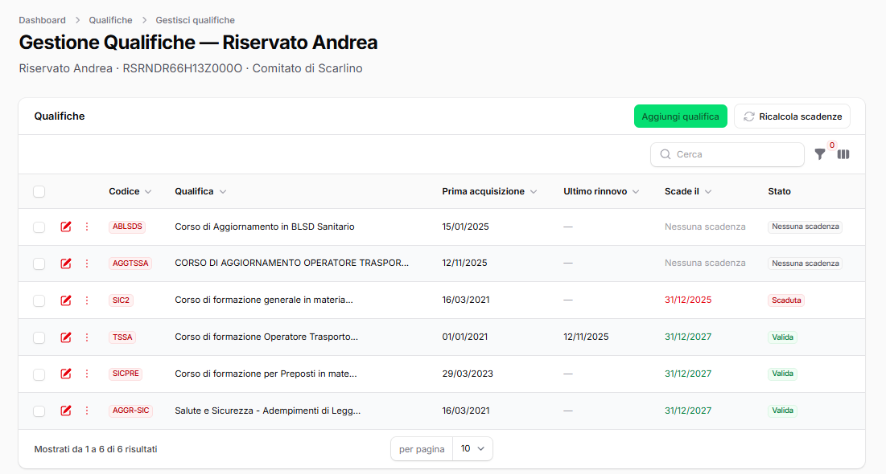
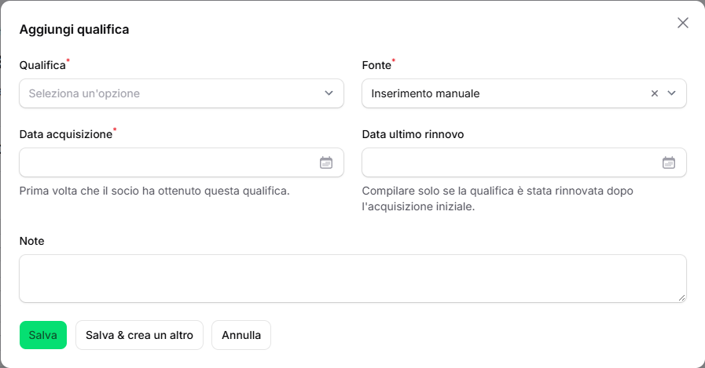

# Qualifiche del socio

> **A chi serve:** operatori e amministratori del pannello.

La pagina **Gestione Qualifiche** di un socio si apre con la matita nei risultati della [ricerca](01-ricerca-ed-export.md). La stessa tabella compare anche nella scheda del socio in **Archivi → Soci** ([Soci](../../03-archivi/01-soci/README.md)).

<!-- screenshot: route=/admin/qualifiche-soci/{id}/gestisci · v1.85.38-dev · 2026-11-18 · ridotta all'80% -->

Sotto il titolo: nome, codice fiscale e comitato del socio.

## La tabella

| Colonna | Cosa mostra |
|---|---|
| Codice | Il codice del corso nel catalogo |
| Qualifica | Il nome del corso (accorciato; passando il mouse si legge intero) |
| Prima acquisizione | La prima volta che il socio l'ha ottenuta |
| Ultimo rinnovo | L'ultimo rinnovo o aggiornamento, se c'è |
| Scade il | La scadenza calcolata, colorata secondo lo stato, oppure «Nessuna scadenza» |
| Stato | **Valida**, **In scadenza**, **Scaduta** o **Nessuna scadenza** (vedi [Qualifiche](README.md)) |

Dal selettore delle colonne si può mostrare la **Fonte**, cioè da dove viene la riga: **Manuale**, **Import Excel**, **Import GAIA**, **Cascata aggiornamento** (corso base creato dall'import di un aggiornamento) o **Calcolato** (le qualifiche «aggregatore», come AGGR-SIC per Salute e Sicurezza, che il pannello ricava da sole dai corsi del gruppo). Il filtro a imbuto seleziona per fonte; la casella **Cerca** trova per codice o nome.

La scadenza **non si scrive a mano**: il pannello la calcola dalla data di acquisizione o dell'ultimo rinnovo e dalle regole del corso nel [Catalogo corsi](../../03-archivi/04-catalogo-corsi.md) (durata, anno solare o data esatta, validità diversa per regione, scadenza ereditata da corsi superiori).

## Aggiungere e correggere

<!-- screenshot: route=/admin/qualifiche-soci/{id}/gestisci · v1.85.38-dev · 2026-11-18 · finestra Aggiungi qualifica -->

- **Aggiungi qualifica** apre la finestra: **Qualifica** (si cerca per codice o nome), **Fonte** (di norma «Inserimento manuale»), **Data acquisizione** (obbligatoria), **Data ultimo rinnovo** (solo se rinnovata dopo l'acquisizione) e **Note**. **Salva & crea un altro** permette di inserirne più di una di seguito. La scadenza si calcola al salvataggio.
- La **matita** su una riga modifica date, fonte e note; il corso non si cambia (per un corso sbagliato si elimina la riga e se ne aggiunge una nuova).
- **Ricalcola scadenze** ricalcola tutte le scadenze del socio con le regole attuali del catalogo: serve quando le regole di un corso sono cambiate dopo che la qualifica è stata registrata.

> Una qualifica inserita a mano viene «presa in carico» dal successivo import da GAIA, se GAIA riporta lo stesso corso: le date più recenti vincono sempre.

## Eliminare

**Elimina** sta nel menu dei tre puntini rossi della riga:

- il **superadmin** e l'**amministratore regionale** possono eliminare qualsiasi qualifica, anche più di una insieme selezionando le caselle a sinistra;
- l'**amministratore locale** può eliminare solo le qualifiche inserite a mano (quelle importate da GAIA o da Excel sono dati ufficiali);
- l'**operatore** non può eliminare.

## Chi può modificare

Aggiungere, modificare e ricalcolare spetta agli amministratori e all'operatore con il permesso di gestire le qualifiche ([Ruoli e permessi](../../01-primi-passi/03-ruoli-e-permessi.md)); chi ha solo il permesso di vederle consulta senza modificare.

La pagina si apre solo per i soci del proprio territorio, con la stessa regola della [ricerca](01-ricerca-ed-export.md), compresi i soci in estensione al proprio comitato o alla propria regione: un socio di un altro territorio non si apre nemmeno con l'indirizzo diretto.
