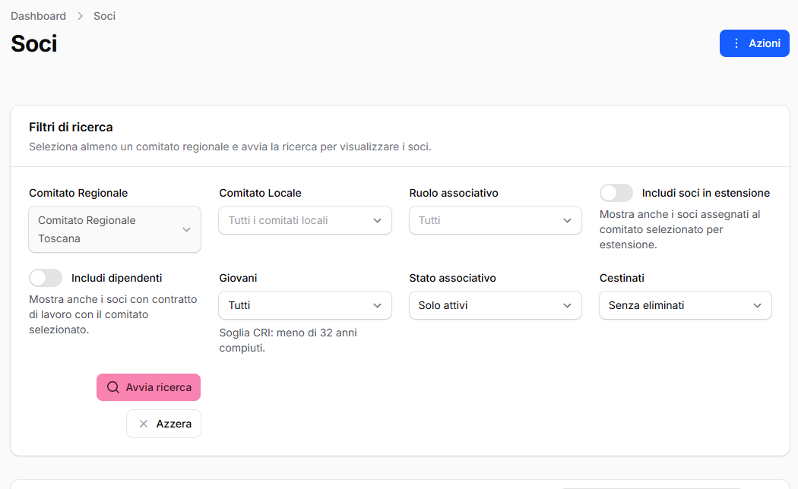
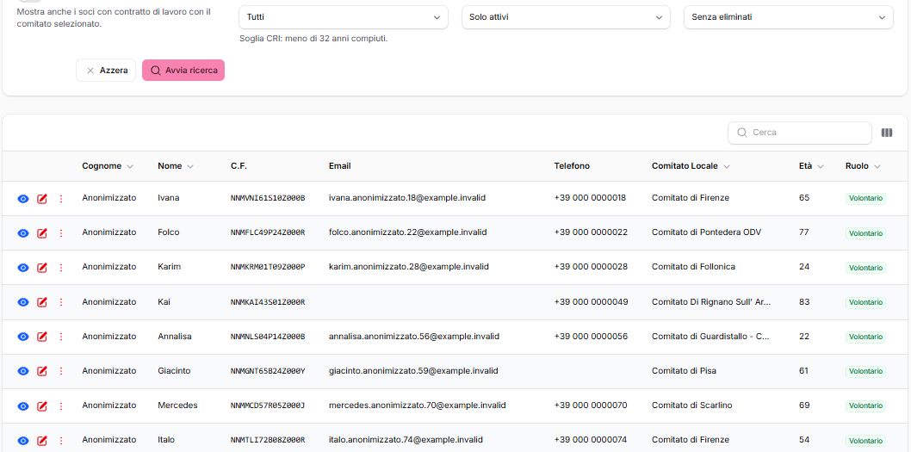
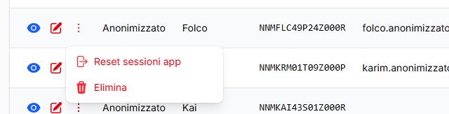
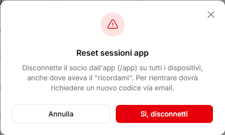
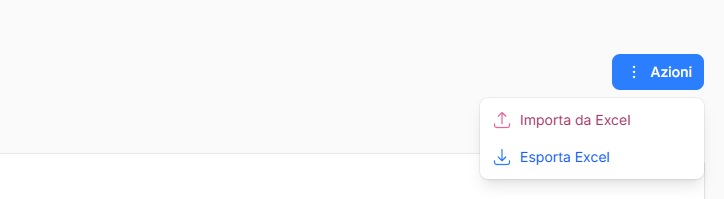

# Ricerca ed elenco

> **A chi serve:** operatori e amministratori del pannello.

**Archivi → Soci** si apre con i filtri di ricerca: l'elenco compare dopo **Avvia ricerca**, perché l'archivio contiene decine di migliaia di persone.

## I filtri

<!-- screenshot: route=/admin/soci · v1.85.38-dev · 2026-11-18 -->

- **Comitato Regionale**: obbligatorio; per chi non è superadmin è già impostato sulla propria regione e non si cambia.
- **Comitato Locale**: per restringere a un comitato; è fissato per l'amministratore locale e per l'operatore che ha un comitato locale.
- **Ruolo associativo**: Volontario, Dipendente, Infermiere Volontarie CRI, Corpo Militare Volontario CRI.
- **Includi soci in estensione** e **Includi dipendenti**: aggiungono, per il comitato scelto, i soci in estensione e chi ci lavora.
- **Giovani**: meno di 32 anni compiuti, oggi o al momento dell'ingresso (come nella [ricerca qualifiche](../../02-gestione-operativa/05-qualifiche/01-ricerca-ed-export.md)).
- **Stato associativo**: di norma **solo attivi**; si possono vedere **solo i dimessi** o **attivi e dimessi** (vedi [Import da GAIA e soci dimessi](03-import-da-gaia.md)).
- **Cestinati**: di norma esclusi; si possono includere o vedere da soli i soci eliminati.

**Avvia ricerca** mostra l'elenco; **Azzera** riporta i filtri all'inizio. L'indirizzo della pagina conserva i filtri, quindi una ricerca si può salvare tra i preferiti.

## L'elenco

<!-- screenshot: route=/admin/soci · v1.85.38-dev · 2026-11-18 · tabella ridotta al 70% -->

Le colonne di base sono cognome, nome, codice fiscale, email, telefono (con l'indicazione «+1 altro» se ci sono altri numeri), comitato locale (accorciato; passando il mouse si legge il nome intero), età e ruolo. Il superadmin vede anche la regione. Dal selettore delle colonne si attivano **Estensione**, **Comitato Lavoro**, **Data di nascita**, **Volontario dal**, **Dimesso il**, **Eliminato il** e **Ultima attività app** (l'ultima volta che il socio ha usato l'[app dei soci](../../../02-app-soci/README.md); «Mai» se non l'ha mai aperta). La casella **Cerca** filtra per nome, codice fiscale, email, telefono o comitato.

Le icone di riga:

- **occhio**: apre la [scheda del socio](02-scheda-del-socio.md);
- **matita**: modifica i dati (solo per chi ne ha il permesso);
- **tre puntini rossi**: **Reset sessioni app**, **Elimina** e, per i soci eliminati, **Ripristina**.

<!-- screenshot: route=/admin/soci · v1.85.38-dev · 2026-11-18 · menu dei tre puntini -->

### Reset sessioni app

<!-- screenshot: route=/admin/soci · v1.85.38-dev · 2026-11-18 · conferma del reset sessioni -->

Disconnette il socio dall'app su **tutti i dispositivi**, compresi quelli dove aveva scelto «ricordami»: per rientrare dovrà chiedere un nuovo codice. Serve per esempio se il socio ha perso il telefono o teme che qualcuno usi il suo accesso.

### Eliminare

**Elimina** toglie il socio dall'archivio dopo una conferma, ma i dati collegati (iscrizioni, qualifiche, presenze) restano. Un socio eliminato si ritrova con il filtro **Cestinati** e si recupera con **Ripristina**. Per chi semplicemente non è più volontario non si elimina nulla: viene segnato come **dimesso** dall'import ([Import da GAIA e soci dimessi](03-import-da-gaia.md)).

## Esportare

Dopo una ricerca, **Azioni → Esporta Excel** scarica i risultati, con gli stessi filtri e lo stesso ordinamento: numero, cognome, nome, codice fiscale, email, telefono, comitato, estensione, comitato di lavoro, ruolo, nascita, età, volontario dal e dimesso il.

<!-- screenshot: route=/admin/soci · v1.85.38-dev · 2026-11-18 · menu Azioni -->

## Chi vede e chi modifica

- Il **superadmin** vede tutti i soci; è l'unico che ha il pulsante **Nuovo** per inserire un socio a mano (di norma i soci arrivano dall'import di GAIA).
- L'**amministratore regionale** vede i soci della sua regione e quelli che vi lavorano come dipendenti, e li può modificare, eliminare e disconnettere dall'app.
- L'**amministratore locale** fa lo stesso per il suo comitato locale.
- L'**operatore** vede i soci della sua regione se ha uno dei permessi sui soci; li modifica solo con il permesso di modifica ([Ruoli e permessi](../../01-primi-passi/03-ruoli-e-permessi.md)).
