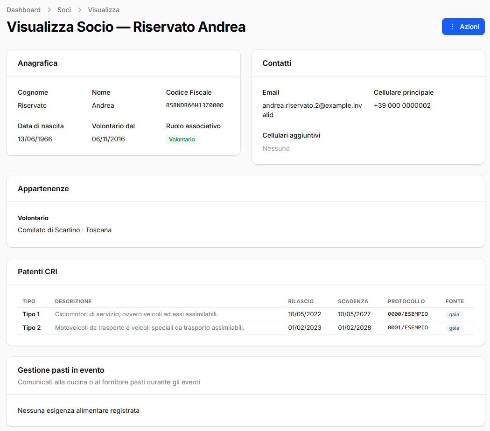
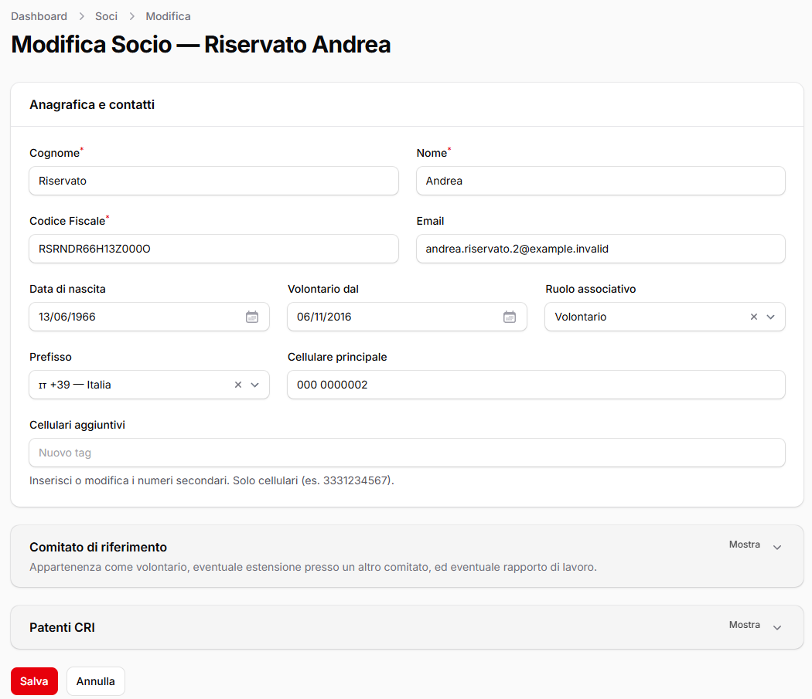
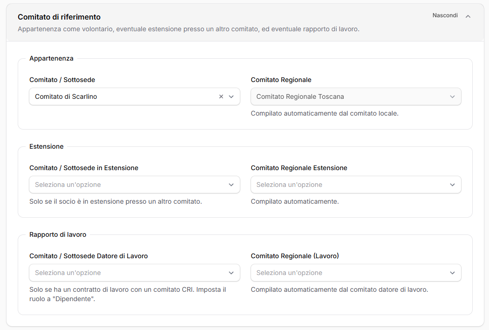

# La scheda del socio

> **A chi serve:** operatori e amministratori del pannello.

La scheda si apre con l'occhio nell'[elenco dei soci](01-ricerca-ed-elenco.md) (e dalla ricerca qualifiche, con l'icona della tessera). Raccoglie in sola lettura tutto ciò che il pannello sa del socio.

<!-- screenshot: route=/admin/soci/{id} · v1.85.38-dev · 2026-11-18 · senza i pulsanti dello userscript -->

- **Anagrafica**: cognome, nome, codice fiscale, data di nascita, data di ingresso come volontario, ruolo associativo.
- **Contatti**: email, cellulare principale e cellulari aggiuntivi.
- **Appartenenze**: il comitato (o la sottosede) di appartenenza come volontario e, se ci sono, l'estensione presso un altro comitato e il rapporto di lavoro come dipendente.
- **Patenti CRI**: le patenti di guida CRI del socio, con rilascio, scadenza, protocollo e fonte (di norma importate dal curriculum GAIA; vedi [Patenti CRI](../05-patenti-cri.md)).
- **Gestione pasti in evento**: allergie, intolleranze, diete ed esigenze alimentari comunicate dal socio nei moduli, quelle che vengono passate alla cucina durante gli eventi. È un dato sensibile: la vedono solo il superadmin, gli amministratori regionali e gli operatori con il permesso per i dati sensibili.

Sotto, due schede:

- **Qualifiche**: la stessa tabella della pagina [Qualifiche del socio](../../02-gestione-operativa/05-qualifiche/03-qualifiche-del-socio.md), per aggiungere, modificare e ricalcolare le qualifiche;
- **Ritiri/Ripristini**: lo storico dei ritiri e dei ripristini del socio nelle [graduatorie](../../02-gestione-operativa/04-graduatorie/03-candidati.md), con data, corso, motivo e chi l'ha eseguito.

In alto a destra, il menu **Azioni** contiene **Modifica** (per chi può modificare il socio) e **Apri curriculum GAIA** (se il socio ha un ID GAIA collegato). Accanto, per chi usa lo userscript, ci sono i pulsanti che cercano l'ID GAIA del socio e ne importano il curriculum (qualifiche e patenti): vedi [Userscript bridge GAIA](../../05-strumenti/01-userscript-bridge-gaia/README.md).

## Modificare i dati

<!-- screenshot: route=/admin/soci/{id}/edit · v1.85.38-dev · 2026-11-18 -->

La pagina **Modifica** ha tre sezioni:

- **Anagrafica e contatti**: cognome, nome, codice fiscale, email, data di nascita, data di ingresso, ruolo associativo, prefisso e cellulare principale, cellulari aggiuntivi (solo numeri di cellulare, uno per voce).
- **Comitato di riferimento** (si apre con **Mostra**):

<!-- screenshot: route=/admin/soci/{id}/edit · v1.85.38-dev · 2026-11-18 · comitato di riferimento aperto -->

  - **Appartenenza**: il comitato o la sottosede del socio come volontario (si sceglie da un elenco unico «Comitato» e «Comitato: Sottosede»); il comitato regionale si imposta da solo.
  - **Estensione**: il comitato o la sottosede presso cui il socio presta servizio in estensione, anche di un'altra regione.
  - **Rapporto di lavoro**: il comitato datore di lavoro, per i dipendenti.
- **Patenti CRI** (si apre con **Mostra**): le patenti del socio da spuntare. Di norma arrivano dal curriculum GAIA: qui si correggono a mano solo se serve.

> I dati arrivano da GAIA e vengono riscritti a ogni import: una correzione fatta a mano qui dura finché GAIA non riporta un valore diverso. Le correzioni stabili vanno fatte su GAIA.
