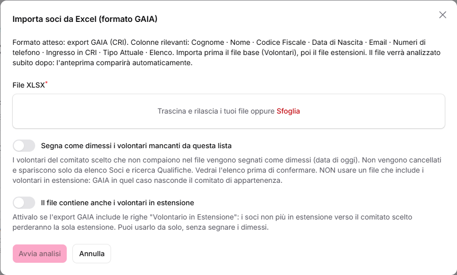

# Import da GAIA e soci dimessi

> **A chi serve:** amministratori (superadmin, regionali e locali) e operatori con il permesso di importare i soci.

L'archivio soci si aggiorna caricando l'**export dei soci di GAIA** in formato Excel. L'import crea i soci nuovi, aggiorna quelli esistenti (riconosciuti dal codice fiscale) e, se lo si chiede, segna come **dimessi** i volontari che non compaiono più.

## Caricare il file

<!-- screenshot: route=/admin/soci · v1.85.38-dev · 2026-11-18 · finestra di import -->

1. Su GAIA si esporta l'elenco dei soci in Excel. Le colonne usate sono Cognome, Nome, Codice Fiscale, Data di Nascita, Email, Numeri di telefono, Ingresso in CRI, Tipo Attuale ed Elenco (il comitato o la sottosede).
2. Nel pannello, **Archivi → Soci → Azioni → Importa da Excel**, si sceglie il file. **Avvia analisi** si attiva quando il file è caricato.
3. L'analisi legge il file a blocchi, senza scrivere nulla, e mostra l'avanzamento; alla fine compare l'anteprima con quanti soci saranno creati e aggiornati e le eventuali righe con errori (per esempio un comitato che non esiste nell'archivio dei [comitati locali](../03-comitati-locali.md)).
4. **Conferma** scrive i dati, sempre a blocchi. Durante l'analisi e l'import la scheda del browser deve restare aperta: chiudendola il lavoro si ferma.

Il **Tipo Attuale** di ogni riga decide cosa si aggiorna:

- **Volontario**: è il comitato di appartenenza del socio;
- **Volontario in Estensione**: aggiunge l'estensione a un socio **già presente**. Per questo si importa prima il file dei volontari dei comitati di appartenenza e poi quello con le estensioni;
- **Dipendente**: registra il rapporto di lavoro con il comitato indicato.

## Segnare i dimessi e pulire le estensioni

Due interruttori nella finestra di import confrontano il file con l'archivio:

- **Segna come dimessi i volontari mancanti da questa lista**: i volontari del comitato scelto che **non compaiono nel file** vengono segnati come **dimessi** con la data di oggi.
- **Il file contiene anche i volontari in estensione**: i soci che non risultano più in estensione verso il comitato scelto perdono l'estensione (solo quella). Si può usare anche da solo.

Con uno dei due accesi si sceglie l'**ambito** del confronto: un comitato locale o l'intero comitato regionale (l'amministratore locale confronta sempre il proprio comitato). Dopo l'import compare l'elenco delle modifiche proposte (dimessi, estensioni da togliere, soci che rientrano) e le si conferma a parte.

> **Attenzione:** un file regionale che contiene anche le estensioni nasconde, per i volontari in estensione, il loro comitato di appartenenza. Per questo, con ambito regionale ed estensioni, il pannello non segna i dimessi: si fanno due import, uno senza estensioni (per i dimessi) e uno con (per le estensioni).

## Che cosa vuol dire «dimesso»

Un socio dimesso **non viene cancellato**: resta in archivio con la data di dimissione e sparisce solo dall'elenco dei soci (salvo il filtro «Stato associativo») e dalla [ricerca qualifiche](../../02-gestione-operativa/05-qualifiche/01-ricerca-ed-export.md). Eventi, corsi, iscrizioni, check-in e badge continuano a vederlo. Torna attivo da solo se ricompare come volontario in un import successivo, o se cambia comitato (per esempio iscrivendosi a un corso con un nuovo comitato o con una modifica dal pannello).

Il rapporto di lavoro dei dipendenti non viene mai tolto dall'import: la fine di un rapporto di lavoro si registra a mano dalla [scheda del socio](02-scheda-del-socio.md).
