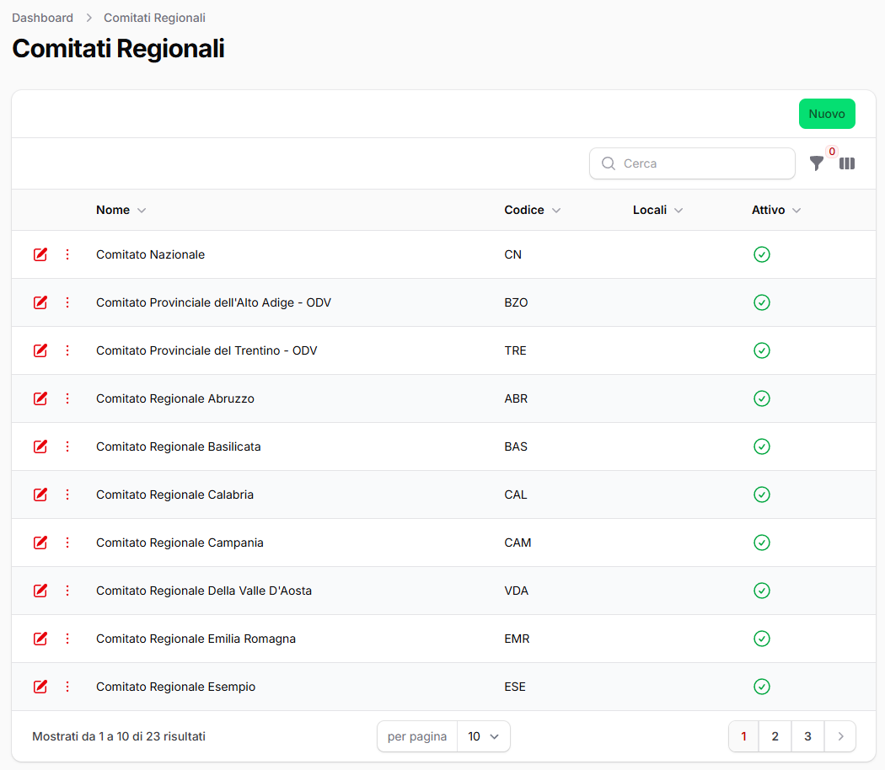
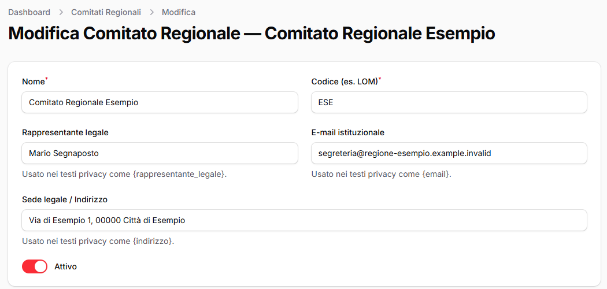
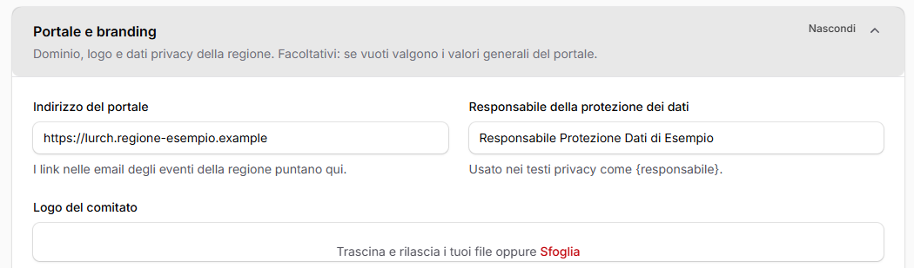
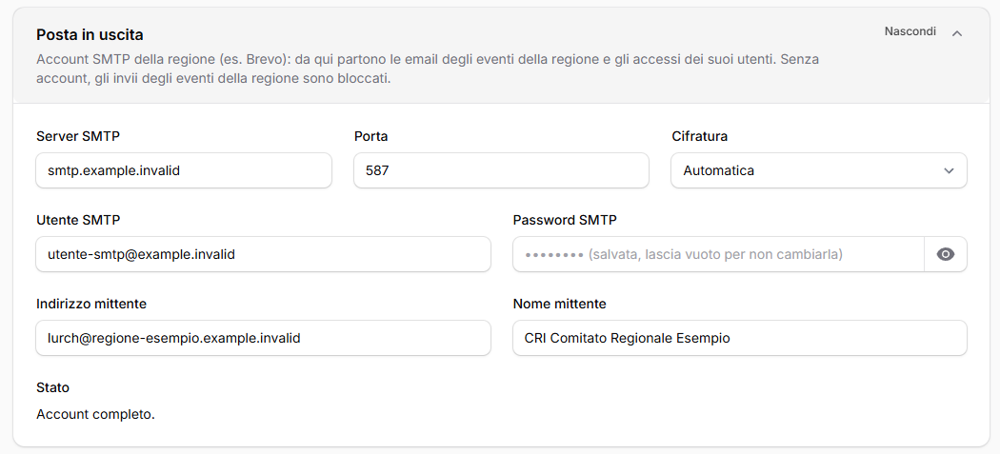

# Comitati regionali

> **A chi serve:** superadmin. Gli altri ruoli non vedono questa voce.

L'elenco dei comitati regionali (e provinciali autonomi) a cui appartengono eventi, corsi, graduatorie, soci e utenti. Una sola installazione di L.U.R.C.H. può servire più regioni: per ciascuna, qui si impostano anche l'indirizzo del portale, il logo, i dati per i testi della privacy e l'account di posta da cui partono le email.

<!-- screenshot: route=/admin/comitati-regionali · v1.85.38-dev · 2026-11-18 -->

L'elenco mostra nome, codice, numero di comitati locali e stato (attivo o no); il filtro **Stato** mostra gli attivi o i non attivi. La matita apre il modulo; il menu dei tre puntini contiene **Elimina**.

## Dati del comitato

<!-- screenshot: route=/admin/comitati-regionali/{id}/edit · v1.85.38-dev · 2026-11-18 · comitato di esempio -->

- **Nome** e **Codice** (la sigla, per esempio TOS o LOM): obbligatori. La sigla compare negli elenchi al posto del nome intero.
- **Rappresentante legale**, **E-mail istituzionale** e **Sede legale / Indirizzo**: entrano nei testi della privacy della regione al posto dei segnaposto `{rappresentante_legale}`, `{email}` e `{indirizzo}` ([Template privacy](../04-impostazioni/02-template-privacy.md)).
- **Attivo**.

## Portale e branding

<!-- screenshot: route=/admin/comitati-regionali/{id}/edit · v1.85.38-dev · 2026-11-18 · portale e branding -->

Facoltativi: se restano vuoti valgono i valori generali del portale.

- **Indirizzo del portale**: il dominio della regione (per esempio `https://lurch.comitato.example`). I link nelle email degli eventi della regione (moduli, badge, app) puntano qui, e chi apre il portale da questo indirizzo vede il logo e i dati della regione.
- **Responsabile della protezione dei dati**: entra nei testi della privacy come `{responsabile}`.
- **Logo del comitato**: l'immagine mostrata nelle pagine pubbliche e nei documenti della regione. Si carica qui; se c'è già, sopra compare il logo attuale.

## Posta in uscita

<!-- screenshot: route=/admin/comitati-regionali/{id}/edit · v1.85.38-dev · 2026-11-18 · posta in uscita, dati finti -->

L'account SMTP della regione (per esempio un account Brevo): da qui partono le email degli eventi, dei corsi e delle graduatorie della regione, e i codici di accesso dei suoi utenti e dei suoi soci.

- **Server SMTP**, **Porta**, **Cifratura** (di norma «Automatica»), **Utente SMTP** e **Password SMTP**. La password non si rilegge: una volta salvata compare solo come puntini, e per non cambiarla si lascia il campo vuoto.
- **Indirizzo mittente** e **Nome mittente**: come appaiono le email a chi le riceve.
- **Stato**: dice se l'account è completo.

> **Senza un account completo, gli invii degli eventi della regione sono bloccati**: i pulsanti di invio del pannello avvisano dell'errore invece di spedire.
