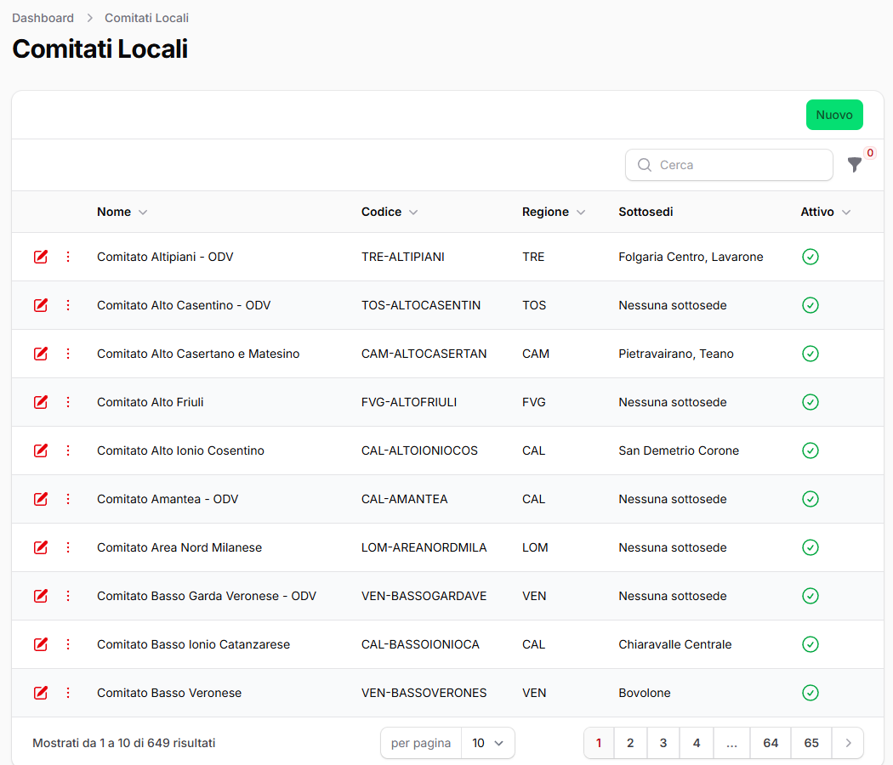
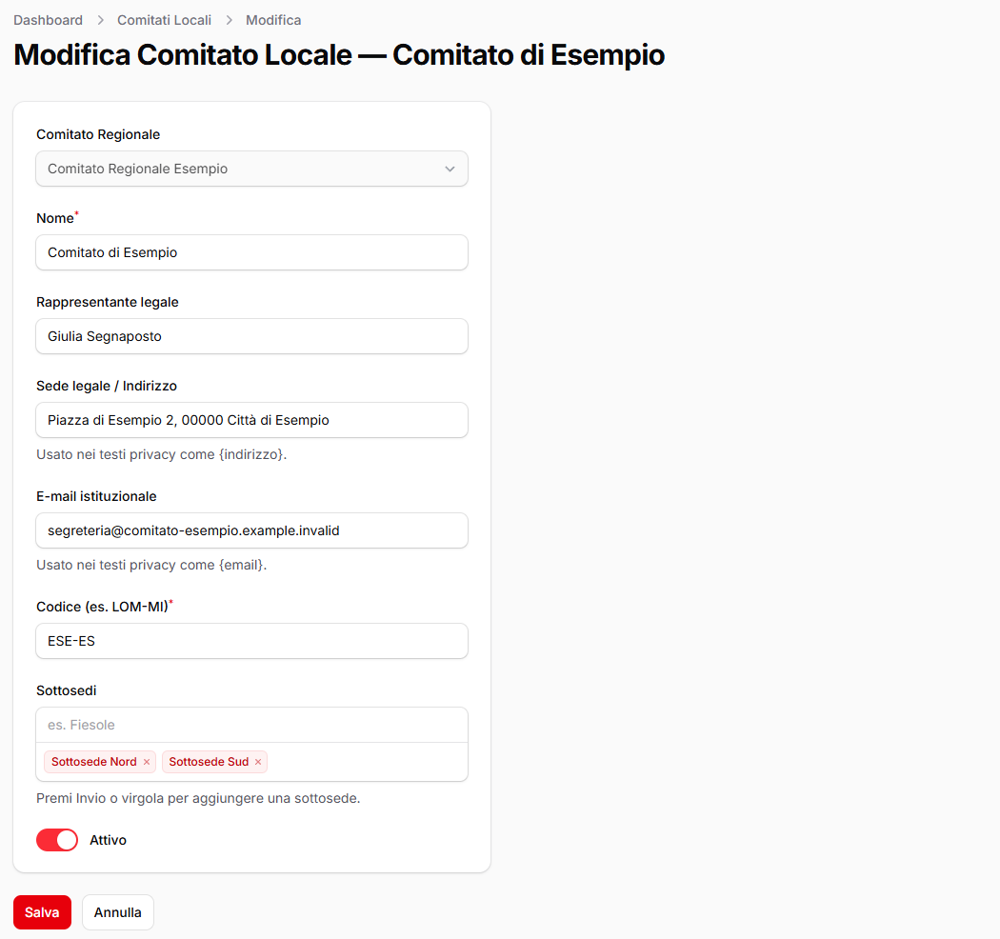

# Comitati locali

> **A chi serve:** superadmin e amministratori regionali.

L'elenco dei comitati locali di ogni regione, con le loro **sottosedi**. È il riferimento con cui gli import da GAIA riconoscono il comitato di ogni socio e iscritto, e da cui si scelgono i comitati nei moduli del pannello.

<!-- screenshot: route=/admin/comitati-locali · v1.85.38-dev · 2026-11-18 · vista del superadmin -->

L'elenco mostra nome, codice, regione (la sigla; il nome intero al passaggio del mouse), sottosedi e stato. L'amministratore regionale vede solo i comitati della sua regione; il superadmin li vede tutti e ha anche il filtro **Regione**. Gli altri filtri mostrano i comitati attivi o non attivi e quelli eliminati. Il pulsante **Nuovo** aggiunge un comitato; la matita lo modifica; il menu dei tre puntini contiene **Elimina** (e **Ripristina** per quelli eliminati).

## Il modulo

<!-- screenshot: route=/admin/comitati-locali/{id}/edit · v1.85.38-dev · 2026-11-18 · comitato di esempio -->

- **Comitato Regionale**: per l'amministratore regionale è la sua regione e non si cambia.
- **Nome**: obbligatorio. Deve corrispondere a come il comitato è scritto su GAIA, perché gli import lo riconoscono dal nome.
- **Rappresentante legale**, **Sede legale / Indirizzo** ed **E-mail istituzionale**: entrano nei testi della privacy degli eventi locali al posto dei segnaposto `{indirizzo}` ed `{email}` ([Template privacy](../04-impostazioni/02-template-privacy.md)).
- **Codice**: obbligatorio, nella forma regione-comitato (per esempio `LOM-MI`).
- **Sottosedi**: si scrivono una alla volta, confermando con Invio o con la virgola. Su GAIA un socio di una sottosede compare come «Comitato: Sottosede»: il pannello lo collega al comitato e alla sottosede giusti.
- **Attivo**.

> Un comitato che manca in questo elenco (o è scritto diversamente da GAIA) fa saltare le righe corrispondenti negli import dei soci e degli iscritti: è il motivo più comune di una riga «saltata».
