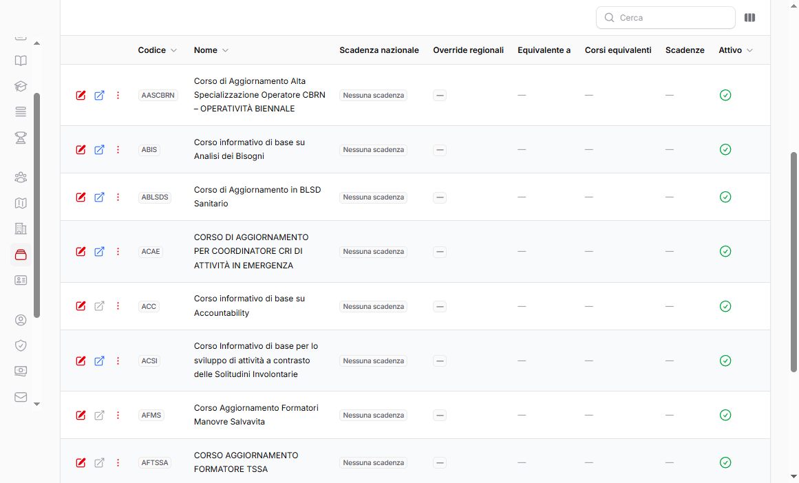
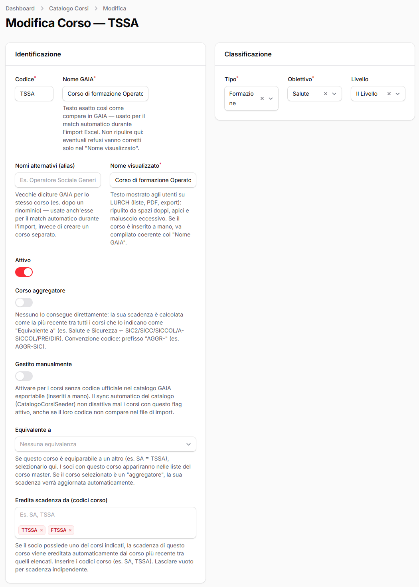
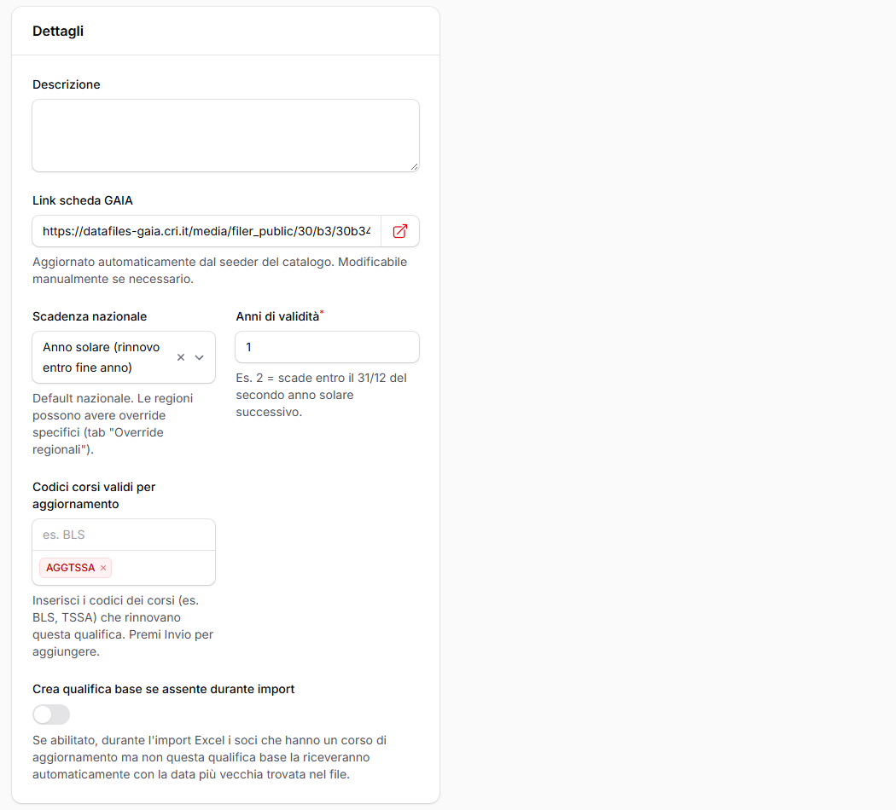
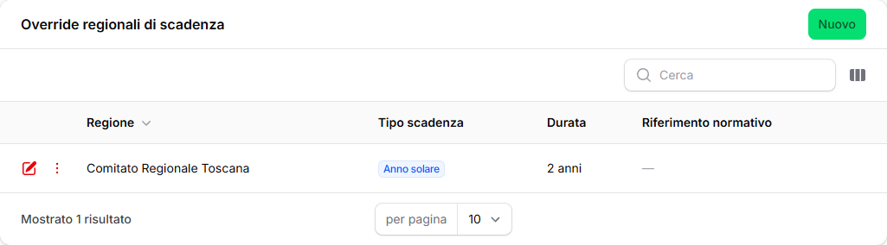

# Catalogo corsi

> **A chi serve:** consultazione per gli amministratori; modifica riservata al superadmin.

Il **catalogo** è l'elenco dei corsi CRI riconosciuti da L.U.R.C.H., allineato al catalogo nazionale di GAIA. Ogni qualifica dei soci è un corso del catalogo, e qui si stabiliscono le regole che il pannello usa per calcolarne la **scadenza** e per collegare i corsi tra loro: equivalenze, aggiornamenti, scadenze ereditate, corsi «aggregatore». Graduatorie, ricerche qualifiche ed esami si basano su queste regole.

## L'elenco

<!-- screenshot: route=/admin/catalogo-corsi · v1.85.38-dev · 2026-11-18 · ridotto all'85% -->

| Colonna | Cosa mostra |
|---|---|
| Codice, Nome | Il codice del corso (per esempio TSSA) e il nome mostrato agli utenti |
| Scadenza nazionale | Nessuna scadenza, a mesi esatti o ad anno solare, con la durata |
| Override regionali | Quante regioni hanno una scadenza diversa da quella nazionale |
| Equivalente a | Il corso a cui questo è equiparato |
| Corsi equivalenti | I corsi equiparati a questo |
| Scadenze | I corsi collegati alla scadenza: in verde quelli che la **rinnovano** (aggiornamenti), in verde con «≡» quelli che compongono un **aggregatore**, in blu quelli da cui la scadenza è **ereditata** |
| Attivo, Manuale | Se il corso è in uso, e se è stato inserito a mano (non viene dal catalogo GAIA) |

Sopra la tabella ci sono i filtri per **tipo**, **obiettivo**, **livello**, **stato** e corsi eliminati. La casella **Cerca** trova anche per codice nelle colonne delle equivalenze e delle scadenze: scrivendo un codice si vedono tutti i corsi in cui è usato. Sulla riga, l'icona con la freccia apre la **scheda del corso su GAIA** (spenta se manca).

## La scheda di un corso (superadmin)

<!-- screenshot: route=/admin/catalogo-corsi/{id}/edit · v1.85.38-dev · 2026-11-18 · identificazione e classificazione -->

**Identificazione**

- **Codice**: il codice ufficiale del corso.
- **Nome GAIA**: il testo esatto con cui il corso compare su GAIA. Serve a riconoscere il corso negli import ([Importare da GAIA](../02-gestione-operativa/05-qualifiche/02-importare-da-gaia.md)): non va «ripulito».
- **Nomi alternativi**: vecchie diciture GAIA dello stesso corso (dopo un cambio di nome), riconosciute anch'esse negli import.
- **Nome visualizzato**: il nome ripulito mostrato su L.U.R.C.H. (elenchi, PDF, export).
- **Attivo**, **Corso aggregatore**, **Gestito manualmente** (per i corsi inseriti a mano, che l'aggiornamento automatico del catalogo non disattiva).
- **Equivalente a**: se questo corso è equiparato a un altro (per esempio SA ≡ TSSA). Cercando il corso principale si trovano anche i soci con il corso equiparato.
- **Eredita scadenza da**: codici di corsi «superiori». Se il socio ne ha uno, la scadenza di questo corso è la più recente tra la sua e quella del corso superiore; se il corso superiore non scade mai, nemmeno questo scade.

**Classificazione**: tipo, obiettivo e livello, come nel catalogo GAIA.

<!-- screenshot: route=/admin/catalogo-corsi/{id}/edit · v1.85.38-dev · 2026-11-18 · dettagli e scadenze -->

**Dettagli**

- **Descrizione** e **Link scheda GAIA** (aggiornato dal catalogo GAIA, modificabile).
- **Scadenza nazionale**: **a mesi esatti dalla data di acquisizione** (con i mesi di validità) o **anno solare** (con gli anni: per esempio 2 = scade il 31/12 del secondo anno successivo). Se si cambia, le scadenze di tutti i soci con quel corso vengono ricalcolate in automatico.
- **Codici corsi validi per aggiornamento**: i corsi che **rinnovano** questa qualifica (per esempio AGGTSSA per TSSA). Importando uno di questi, la data di ultimo rinnovo del corso base si aggiorna.
- **Crea qualifica base se assente durante import**: se il socio ha l'aggiornamento ma non il corso base, l'import lo crea con la data più vecchia trovata.

### I corsi aggregatore

Alcuni requisiti si soddisfano con uno qualsiasi di più corsi diversi: per esempio «Salute e Sicurezza» vale per chi ha uno tra diversi corsi sulla sicurezza. Per questi casi si crea un corso **aggregatore** (per convenzione con il codice che inizia per `AGGR-`, come `AGGR-SIC`), che nessuno consegue direttamente: i corsi del gruppo lo indicano in **Equivalente a**, e il pannello assegna da solo a ogni socio l'aggregatore con la scadenza più recente tra i corsi del gruppo che possiede.

## Override regionali di scadenza

<!-- screenshot: route=/admin/catalogo-corsi/{id}/edit · v1.85.38-dev · 2026-11-18 · override regionali -->

In fondo alla scheda, una tabella elenca le regioni che applicano al corso una scadenza diversa da quella nazionale: per ciascuna, il tipo di scadenza (anche **Nessuna**, che annulla la scadenza nazionale per quella regione), la durata e il riferimento normativo. **Nuovo** aggiunge una regione; la matita la modifica, il menu dei tre puntini la elimina. Le scadenze delle qualifiche dei soci di quella regione seguono l'override.
