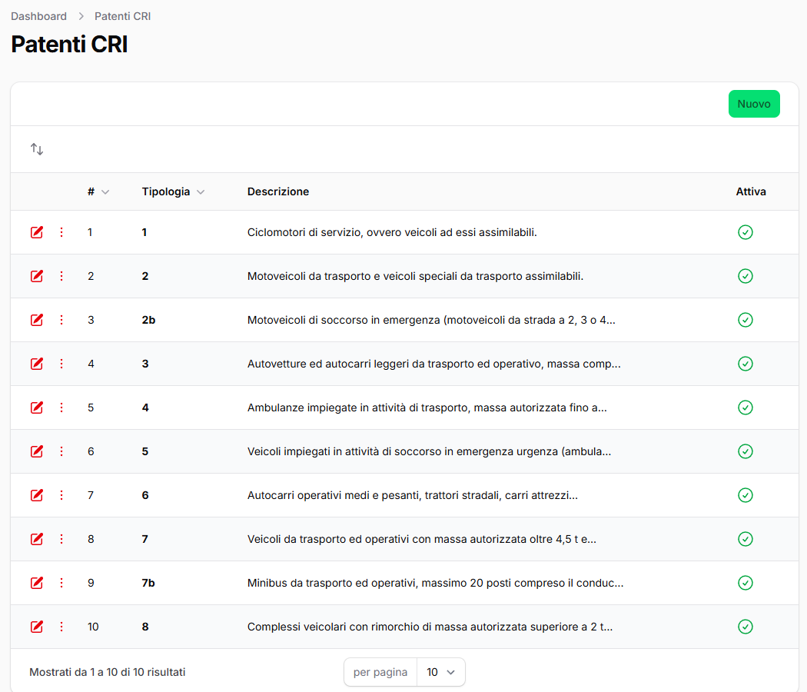

# Patenti CRI

> **A chi serve:** superadmin. Gli altri ruoli non vedono questa voce.

L'elenco delle **tipologie di patente di guida CRI** (tipo 1, 2, 2b, 3, 4…) con la loro descrizione. Le patenti dei singoli soci si importano dal curriculum GAIA con lo userscript ([Userscript bridge GAIA](../05-strumenti/01-userscript-bridge-gaia/README.md)) e compaiono nella [scheda del socio](01-soci/02-scheda-del-socio.md), con rilascio, scadenza e protocollo; questo elenco serve a riconoscerle e a mostrarle con la descrizione giusta.

<!-- screenshot: route=/admin/patenti-cri · v1.85.38-dev · 2026-11-18 -->

Le colonne sono l'ordine di presentazione (#), la **tipologia**, la **descrizione** (accorciata) e lo stato. Il pulsante **Nuovo** aggiunge una tipologia; la matita la modifica; il menu dei tre puntini contiene **Elimina**.

Il modulo ha quattro campi: **Tipologia** (come la scrive la normativa, per esempio `1`, `4m`, `5b`), **Ordine** (la posizione negli elenchi), **Descrizione** e **Attiva**. Una tipologia non attiva non viene più proposta quando si modificano le patenti di un socio.
