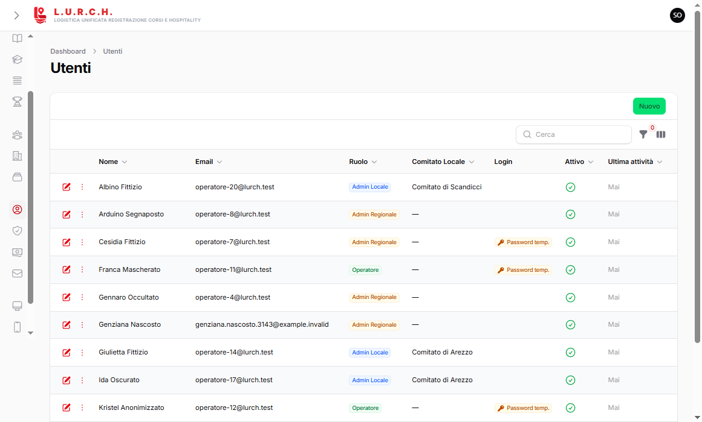
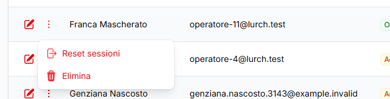
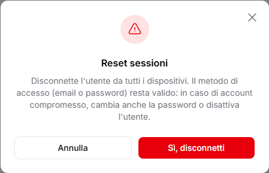
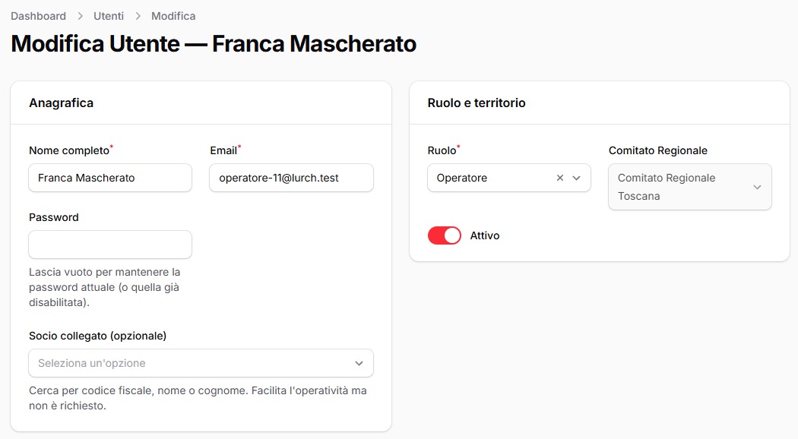
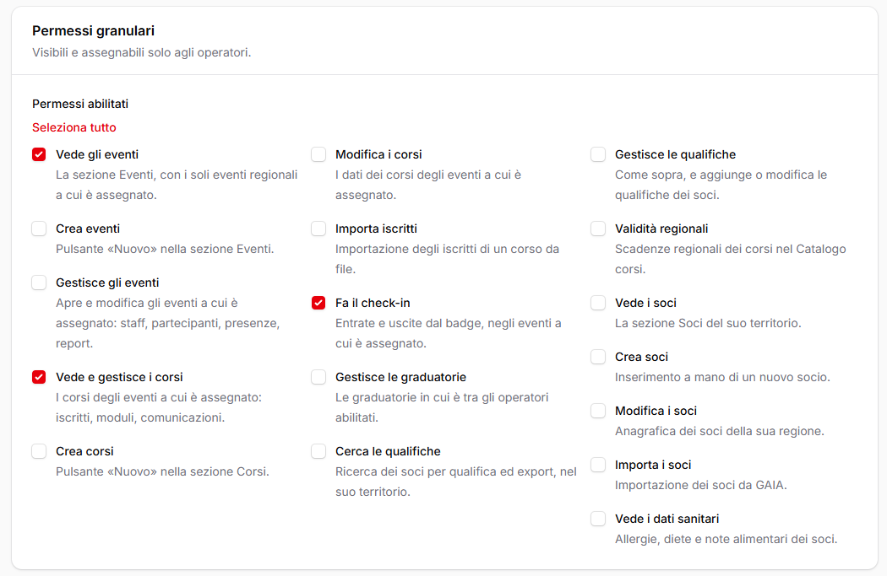

# Utenti

> **A chi serve:** amministratori (superadmin, regionali e locali).

**Impostazioni → Utenti** elenca chi può entrare nel pannello e permette di crearne di nuovi, assegnando **ruolo**, **territorio** e, per gli operatori, i **permessi**. Che cosa può fare ogni ruolo è spiegato in [Ruoli e permessi](../01-primi-passi/03-ruoli-e-permessi.md).

## Chi gestisce chi

- Il **superadmin** gestisce tutti gli utenti; è l'unico che vede la colonna e il filtro della regione e il filtro per ruolo.
- L'**amministratore regionale** gestisce gli altri amministratori regionali, gli amministratori locali e gli operatori della sua regione, ma non il proprio account (per non disattivarsi o declassarsi da solo).
- L'**amministratore locale** gestisce solo gli operatori del suo comitato locale e non li può eliminare.

## L'elenco

<!-- screenshot: route=/admin/utenti · v1.85.38-dev · 2026-11-18 · amministratore regionale, ridotto all'80% -->

| Colonna | Cosa mostra |
|---|---|
| Nome, Email | L'utente e l'indirizzo con cui accede |
| Ruolo | Superadmin, Admin Regionale, Admin Locale, Operatore |
| Comitato Locale | Per gli amministratori locali e gli operatori di un comitato (accorciato; nome intero al passaggio del mouse) |
| Login | Vuoto per chi accede con link o codice via email (è la norma); **Password temp.** per chi ha ancora una password temporanea, che si azzera al primo accesso via email |
| Attivo | Un utente non attivo non può entrare |
| Ultima attività | L'ultima volta che ha usato il pannello (aggiornata al massimo ogni 5 minuti); «Mai» se non è mai entrato |

Dal selettore delle colonne si attivano anche **Socio collegato** e **Creato il**. La casella **Cerca** trova per nome, email o comitato; il filtro **Stato** mostra gli utenti attivi o non attivi.

Le icone di riga sono la **matita** (modifica) e il menu dei **tre puntini rossi**, con **Reset sessioni** ed **Elimina**. Il superadmin ha in più la **chiave**, **Password temporanea**.

<!-- screenshot: route=/admin/utenti · v1.85.38-dev · 2026-11-18 · menu dei tre puntini -->

- **Reset sessioni** disconnette l'utente da tutti i dispositivi. Il suo modo di accedere resta valido: se l'account è compromesso, conviene anche disattivarlo.

<!-- screenshot: route=/admin/utenti · v1.85.38-dev · 2026-11-18 · conferma del reset sessioni -->

- **Password temporanea** (solo superadmin) genera una password nuova, la mostra una volta sola nella notifica insieme al link di accesso con password, e disconnette l'utente. Va comunicata a mano; si azzera da sola al primo accesso via email ([Accesso al pannello](../01-primi-passi/01-accesso.md)).
- **Elimina** toglie l'utente dopo una conferma. Per chi smette solo per un periodo è meglio spegnere **Attivo**.

## Creare e modificare un utente

<!-- screenshot: route=/admin/utenti/{id}/edit · v1.85.38-dev · 2026-11-18 · anagrafica, ruolo e territorio -->

**Anagrafica**

- **Nome completo** ed **Email** (obbligatori; l'email è quella con cui l'utente riceve link e codici di accesso e non può essere già usata da un altro utente).
- **Password**: di norma si lascia vuota, e l'utente accede solo con link o codice via email. In modifica, lasciarla vuota mantiene la situazione attuale.
- **Socio collegato**: la scheda socio della persona, cercata per codice fiscale, nome o cognome; scegliendola, nome ed email si compilano da soli. Serve, tra l'altro, perché il direttore di un corso e la commissione d'esame vedano il loro corso e il loro esame.

**Ruolo e territorio**

- **Ruolo**: l'amministratore regionale può creare amministratori regionali, amministratori locali e operatori; l'amministratore locale solo operatori.
- **Comitato Regionale**: per gli amministratori è già impostato sulla propria regione.
- **Comitato Locale**: compare per gli amministratori locali (obbligatorio) e per gli operatori creati da un amministratore locale, che restano limitati a quel comitato.
- **Attivo**.

**Permessi granulari** (solo per gli operatori): l'elenco dei permessi con la spiegazione di ciascuno; **Seleziona tutto** li accende tutti. Il significato di ogni permesso è in [Ruoli e permessi](../01-primi-passi/03-ruoli-e-permessi.md).

<!-- screenshot: route=/admin/utenti/{id}/edit · v1.85.38-dev · 2026-11-18 · permessi di un operatore -->

> Un permesso apre la sezione, ma per eventi, corsi, check-in e graduatorie l'operatore vede qualcosa solo dopo essere stato **assegnato** all'evento o alla graduatoria ([Elenco e creazione degli eventi](../02-gestione-operativa/01-eventi/01-elenco-e-creazione.md), [Graduatorie](../02-gestione-operativa/04-graduatorie/01-elenco-e-creazione.md)).
