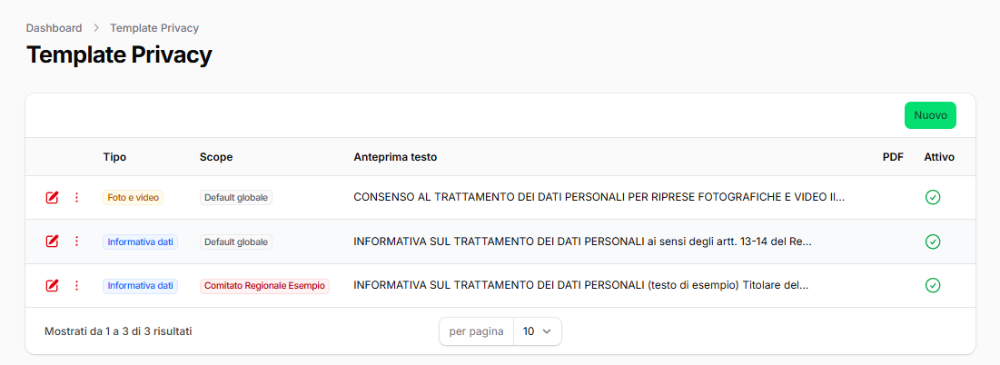
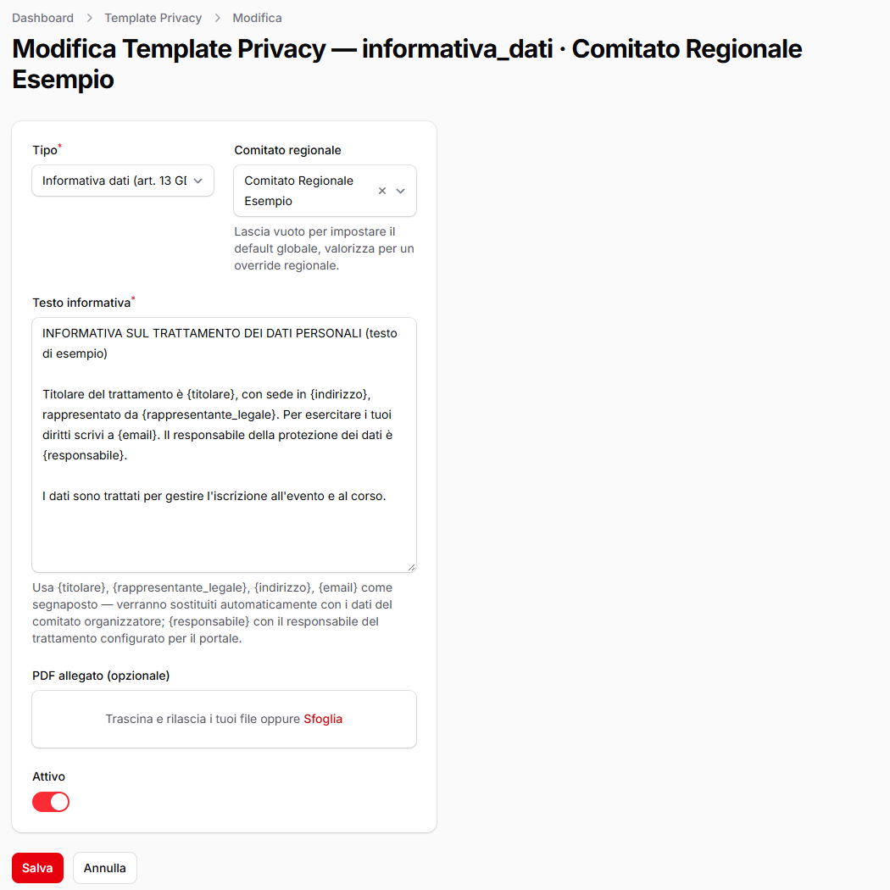

# Template privacy

> **A chi serve:** superadmin e amministratori regionali.

I testi dell'**informativa sul trattamento dei dati** e del **consenso alle riprese foto e video** che compaiono nei moduli pubblici (preregistrazione, candidature, check-in) e che chi si iscrive accetta ([Privacy e cookie](../../03-moduli-pubblici/07-privacy-e-cookie.md)).

Funzionano a due livelli:

- il **default globale** (regione vuota), scritto dal superadmin, vale per tutte le regioni;
- un **override regionale** sostituisce il default per gli eventi di quella regione. Lo può scrivere anche l'amministratore regionale, per la sua regione.

Per un singolo evento che richiede testi diversi c'è anche la sezione «Override privacy» nel modulo dell'evento ([Elenco e creazione degli eventi](../02-gestione-operativa/01-eventi/01-elenco-e-creazione.md)).

<!-- screenshot: route=/admin/template-privacy · v1.85.38-dev · 2026-11-18 · superadmin, ridotto all'85% -->

L'elenco mostra il tipo, l'ambito (**Default globale** o il nome della regione), l'inizio del testo, se c'è un PDF allegato e se il testo è attivo. L'amministratore regionale vede il default globale e i testi della sua regione, non quelli delle altre; modifica ed elimina solo i testi della sua regione.

## Il modulo

<!-- screenshot: route=/admin/template-privacy/{id}/edit · v1.85.38-dev · 2026-11-18 · testo di esempio -->

- **Tipo**: **Informativa dati (art. 13 GDPR)** o **Consenso foto e video**.
- **Comitato regionale**: vuoto per il default globale, oppure la regione dell'override.
- **Testo informativa**: il testo completo. I segnaposto vengono sostituiti con i dati del comitato che organizza l'evento:
  - `{titolare}`, `{rappresentante_legale}`, `{indirizzo}`, `{email}`: dai dati del comitato (regionale, o locale per gli eventi locali) in [Comitati regionali](../03-archivi/02-comitati-regionali.md) e [Comitati locali](../03-archivi/03-comitati-locali.md);
  - `{responsabile}`: il responsabile della protezione dei dati della regione.
- **PDF allegato** (facoltativo): la versione in PDF del testo, scaricabile da chi compila.
- **Attivo**.

Per ogni tipo e ogni regione c'è un solo testo.
