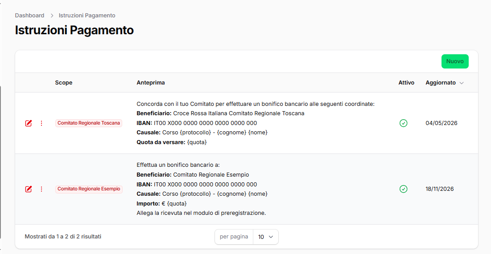
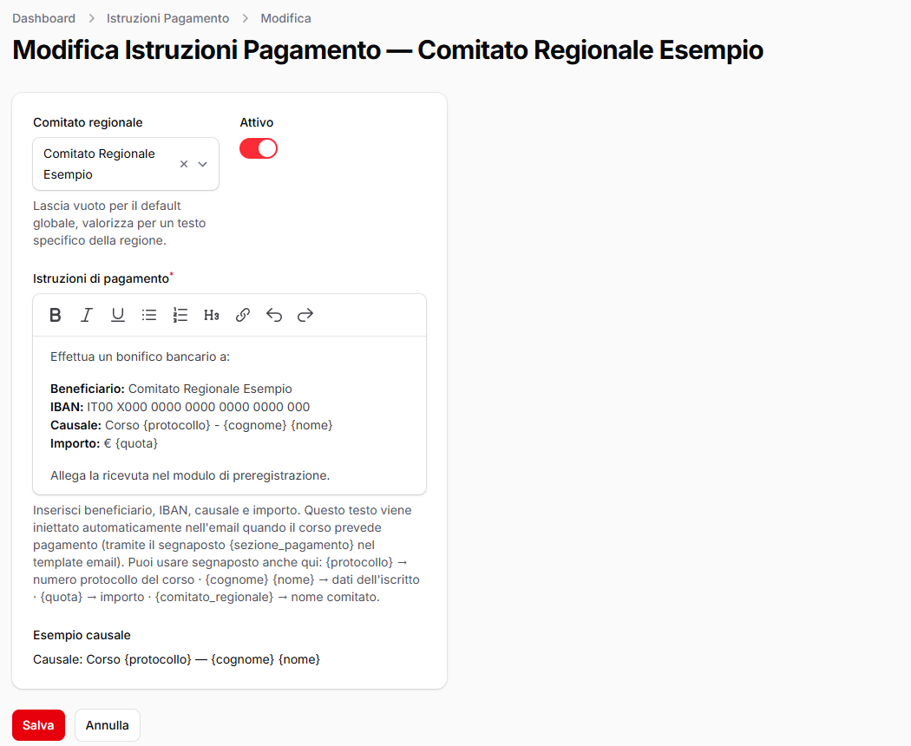

# Istruzioni di pagamento

> **A chi serve:** superadmin e amministratori regionali.

Le indicazioni per pagare la quota di un corso: beneficiario, IBAN, causale, importo. Il testo entra da solo nell'email del modulo di preregistrazione quando il corso richiede un pagamento ([Form e comunicazioni](../02-gestione-operativa/02-corsi/05-form-e-comunicazioni.md)), al posto del segnaposto `{sezione_pagamento}` del [template email](04-template-email.md).

Come per gli altri testi, c'è un **default globale** e un testo per regione, che lo sostituisce per i corsi di quella regione. L'amministratore regionale vede il default e il testo della sua regione, e crea o modifica solo quest'ultimo; eliminare spetta al superadmin.

<!-- screenshot: route=/admin/istruzioni-pagamento · v1.85.38-dev · 2026-11-18 · superadmin, IBAN sostituiti con valori finti -->

## Il modulo

<!-- screenshot: route=/admin/istruzioni-pagamento/{id}/edit · v1.85.38-dev · 2026-11-18 · testo di esempio -->

- **Comitato regionale**: vuoto per il default globale.
- **Attivo**.
- **Istruzioni di pagamento**: il testo, con grassetto, elenchi e collegamenti. Si possono usare i segnaposto `{protocollo}` (protocollo del corso), `{cognome}` e `{nome}` (dell'iscritto), `{quota}` (importo) e `{comitato_regionale}`. Sotto, l'esempio di causale ricorda la forma consigliata: «Corso {protocollo} — {cognome} {nome}», che permette alla segreteria di riconoscere i pagamenti ([Quote e pagamenti](../02-gestione-operativa/02-corsi/07-quote-e-pagamenti.md)).
