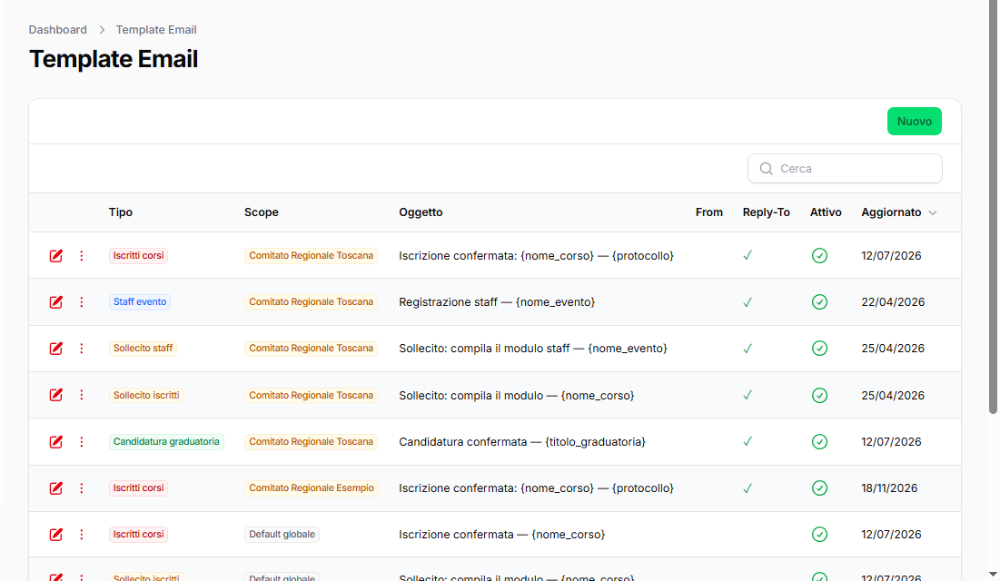
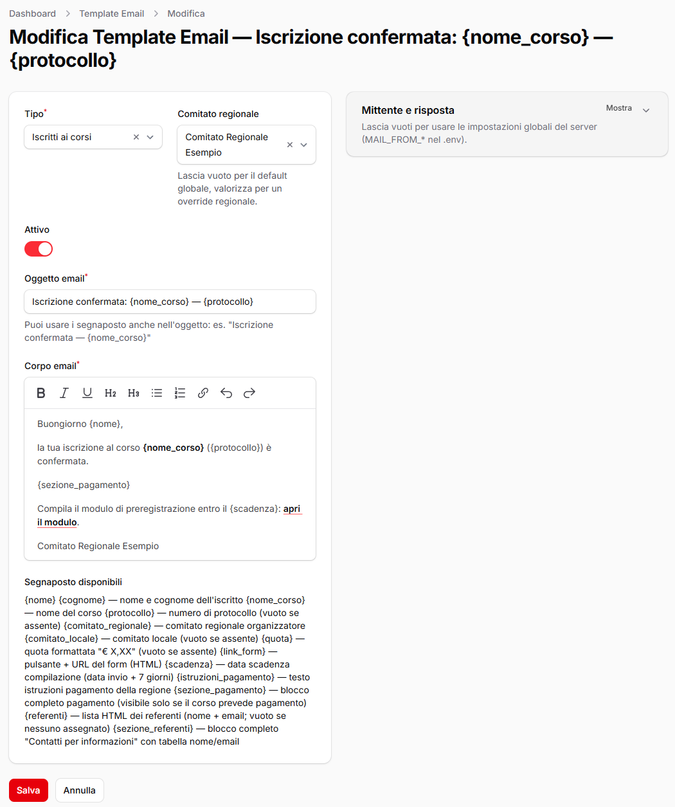

# Template email

> **A chi serve:** superadmin e amministratori regionali.

I testi delle email che il pannello invia: il modulo di preregistrazione agli iscritti, la registrazione allo staff, i solleciti, la conferma delle candidature alle graduatorie. Come i testi della privacy, esistono un **default globale** e degli **override regionali** che lo sostituiscono per gli eventi di una regione. L'amministratore regionale vede il default e i testi della sua regione, e crea o modifica solo questi ultimi; eliminare spetta al superadmin.

<!-- screenshot: route=/admin/template-email · v1.85.38-dev · 2026-11-18 · superadmin, ridotto all'88% -->

L'elenco mostra il tipo, l'ambito (**Default globale** o la regione), l'oggetto, se sono impostati un mittente o un indirizzo di risposta propri, lo stato e la data dell'ultima modifica.

## I tipi

| Tipo | Quando parte |
|---|---|
| **Iscritti ai corsi** | Invio del modulo di preregistrazione agli iscritti di un corso |
| **Sollecito iscritti** | Promemoria a chi non ha ancora compilato |
| **Staff evento** | Invio del modulo di preregistrazione allo staff di un evento |
| **Sollecito staff** | Promemoria allo staff che non ha compilato |
| **Candidatura graduatoria** | Conferma della candidatura a una graduatoria |

Per ogni invio il pannello usa il testo della regione dell'evento (o della graduatoria) se c'è ed è attivo, altrimenti il default globale. Le anteprime nelle pagine di gestione mostrano il testo che verrà usato davvero.

## Il modulo

<!-- screenshot: route=/admin/template-email/{id}/edit · v1.85.38-dev · 2026-11-18 · testo di esempio -->

- **Tipo** e **Comitato regionale** (vuoto per il default globale).
- **Attivo**.
- **Oggetto email**: si possono usare i segnaposto, per esempio «Iscrizione confermata — {nome_corso}».
- **Corpo email**: il testo, con grassetto, titoli, elenchi e collegamenti. Sotto, **Segnaposto disponibili** elenca quelli del tipo scelto. Per gli iscritti, tra gli altri: `{nome}` e `{cognome}`, `{nome_corso}` e `{protocollo}`, `{comitato_regionale}` e `{comitato_locale}`, `{quota}`, `{link_form}` (il pulsante con il link personale), `{scadenza}` (la data entro cui compilare), `{sezione_pagamento}` (il blocco con le [istruzioni di pagamento](03-istruzioni-pagamento.md), presente solo se il corso prevede un pagamento) e `{sezione_referenti}` (i contatti dei referenti dell'evento).
- **Mittente e risposta** (si apre con **Mostra**): **Nome mittente**, **Indirizzo mittente** e **Indirizzo risposta (Reply-To)**. Lasciati vuoti valgono le impostazioni generali di invio (l'account di posta della regione è in [Comitati regionali](../03-archivi/02-comitati-regionali.md)); il Reply-To serve a far arrivare le risposte dei destinatari a una casella della segreteria invece che all'indirizzo di invio.
