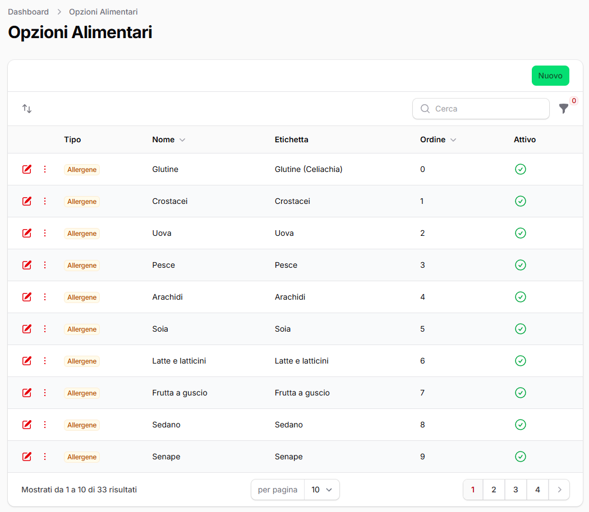
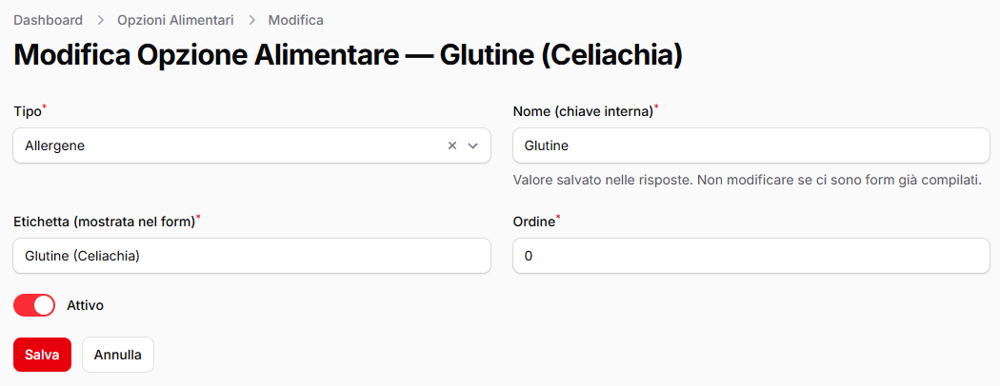

# Opzioni alimentari

> **A chi serve:** superadmin. Gli altri ruoli non vedono questa voce.

L'elenco degli **allergeni** e delle **diete o preferenze alimentari** che chi si iscrive può indicare nei moduli di preregistrazione e di candidatura. Le scelte arrivano poi nei riepiloghi dei pasti dell'evento ([Gestione dell'evento](../02-gestione-operativa/01-eventi/02-gestione-evento.md)) e nella scheda del socio.

<!-- screenshot: route=/admin/opzioni-alimentari · v1.85.38-dev · 2026-11-18 -->

L'elenco mostra tipo, nome, etichetta, ordine e stato; il filtro **Tipo** separa allergeni e diete, l'icona con le frecce permette di cambiare l'ordine trascinando le righe.

## Il modulo

<!-- screenshot: route=/admin/opzioni-alimentari/{id}/edit · v1.85.38-dev · 2026-11-18 -->

- **Tipo**: **Allergene** o **Dieta / preferenza alimentare**.
- **Nome (chiave interna)**: il valore che viene salvato nelle risposte dei moduli. **Non va cambiato** se qualcuno ha già compilato: le risposte già date resterebbero con il nome vecchio.
- **Etichetta**: il testo mostrato nel modulo, che si può correggere liberamente.
- **Ordine**: la posizione nell'elenco del modulo.
- **Attivo**: un'opzione non attiva non viene più proposta nei moduli nuovi.
