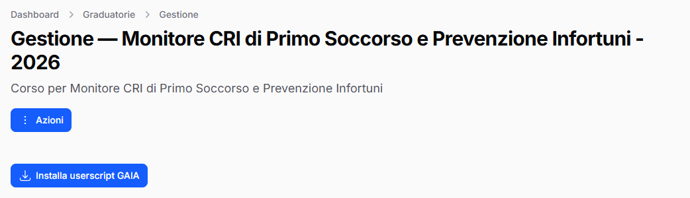
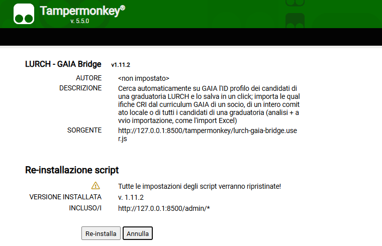
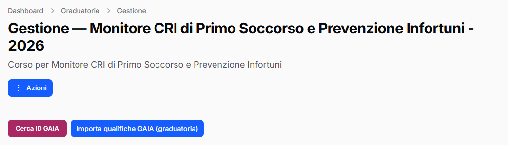
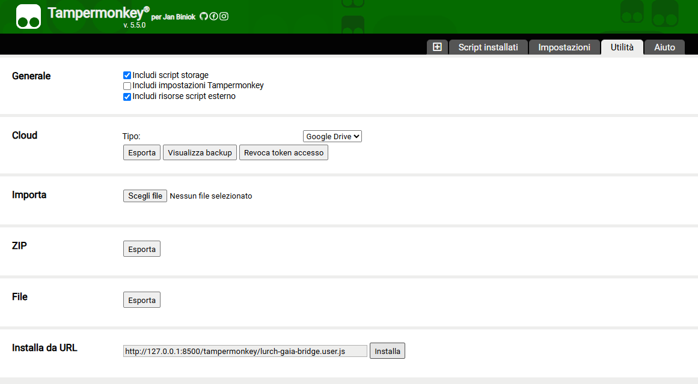
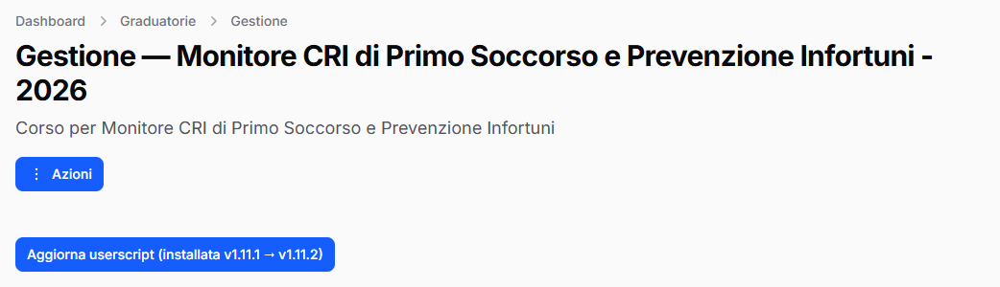

# Installazione e aggiornamento

> **A chi serve:** amministratori (superadmin, regionali e locali).

Lo userscript si installa una volta per browser. Funziona con Chrome, Edge e Firefox per computer; non sul telefono.

## 1. Installare Tampermonkey

1. Dal negozio delle estensioni del browser si installa **Tampermonkey** ([tampermonkey.net](https://www.tampermonkey.net/) porta al negozio giusto per ogni browser).
2. In **Chrome** ed **Edge** gli script utente vanno permessi: nella pagina dei dettagli dell'estensione Tampermonkey (menu Estensioni → Gestisci estensioni → Tampermonkey → Dettagli) si attiva **Consenti script utente**. Nelle versioni meno recenti del browser l'opzione non c'è e serve invece la **Modalità sviluppatore**, in alto a destra nella pagina delle estensioni.

## 2. Installare lo userscript

Finché lo userscript non è installato, nelle pagine in cui serve compare un solo collegamento.

<!-- screenshot: route=/admin/graduatorie/{id}/candidati · v1.85.38-dev · 2026-11-18 · userscript non installato -->

1. Si apre una delle pagine in cui compare lo userscript: la [scheda di un socio](../../03-archivi/01-soci/02-scheda-del-socio.md), la pagina dei candidati di una graduatoria o la ricerca qualifiche con un comitato locale scelto.
2. Si preme **Installa userscript GAIA** (nella ricerca qualifiche il collegamento si chiama già **Importa qualifiche GAIA (comitato)**). Il collegamento apre il file dello userscript in una nuova scheda.
3. Tampermonkey riconosce il file e mostra la sua pagina di conferma, con il nome **LURCH - GAIA Bridge**, la versione, l'indirizzo da cui arriva (**Sorgente**) e il sito su cui funzionerà (**Incluso/i**). Si preme **Installa**.

<!-- screenshot: Tampermonkey, pagina di conferma · v1.85.38-dev · 2026-11-18 · qui una reinstallazione della stessa versione -->

   La pagina è la stessa per un'installazione nuova, un aggiornamento e una reinstallazione della stessa versione (come nell'immagine); cambiano il titolo e il pulsante di conferma. **Annulla** chiude senza cambiare nulla.

4. Si torna al pannello e si ricarica la pagina: al posto del collegamento compaiono i pulsanti dello userscript.

<!-- screenshot: route=/admin/graduatorie/{id}/candidati · v1.85.38-dev · 2026-11-18 · userscript installato -->

Lo userscript viene scaricato dal sito LURCH su cui si lavora e funziona solo su quel sito.

### Se si apre il testo del file invece della pagina di Tampermonkey

A volte il browser mostra il codice dello userscript come testo, senza passare da Tampermonkey (per esempio se l'estensione non ha ancora il permesso «Consenti script utente»). Si controlla prima quel permesso e si riprova; se il problema resta, si installa dall'indirizzo:

1. si copia l'indirizzo della scheda che mostra il testo (termina con `lurch-gaia-bridge.user.js`);
2. si apre il menu di Tampermonkey (icona nella barra delle estensioni) → **Dashboard** → scheda **Utilità**;
3. nella riga **Installa da URL** si incolla l'indirizzo e si preme **Installa**: si apre la pagina di conferma descritta sopra.

<!-- screenshot: Tampermonkey, Dashboard → Utilità · v1.85.38-dev · 2026-11-18 -->

## 3. Aggiornare

Quando LURCH pubblica una nuova versione dello userscript, Tampermonkey la scarica da solo, ma non subito: controlla a intervalli. Nel frattempo il pannello se ne accorge e, al posto dei pulsanti, mostra **Aggiorna userscript (installata vX → vY)**, con la versione installata e quella nuova.

<!-- screenshot: route=/admin/graduatorie/{id}/candidati · v1.85.38-dev · 2026-11-18 · versione installata vecchia -->

1. Si preme il pulsante: si apre la pagina di conferma di Tampermonkey (se invece compare il testo del file, si usa **Installa da URL** come sopra).
2. Si conferma l'aggiornamento.
3. Si ricarica la pagina del pannello: tornano i pulsanti dello userscript.

Finché non si aggiorna, i pulsanti non compaiono: così non si lavora mai con una versione che il pannello non conosce più.

## Se i pulsanti non compaiono

- **Resta il collegamento «Installa userscript GAIA»**: lo userscript non è installato in questo browser, oppure Tampermonkey è disattivato, oppure (Chrome, Edge) manca il permesso «Consenti script utente».
- **Non c'è né il collegamento né i pulsanti**: il proprio ruolo non prevede lo userscript (operatori), oppure il socio o la graduatoria sono fuori dal proprio territorio. Nella ricerca qualifiche il pulsante compare solo dopo aver scelto un **comitato locale**.
