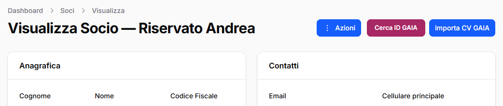
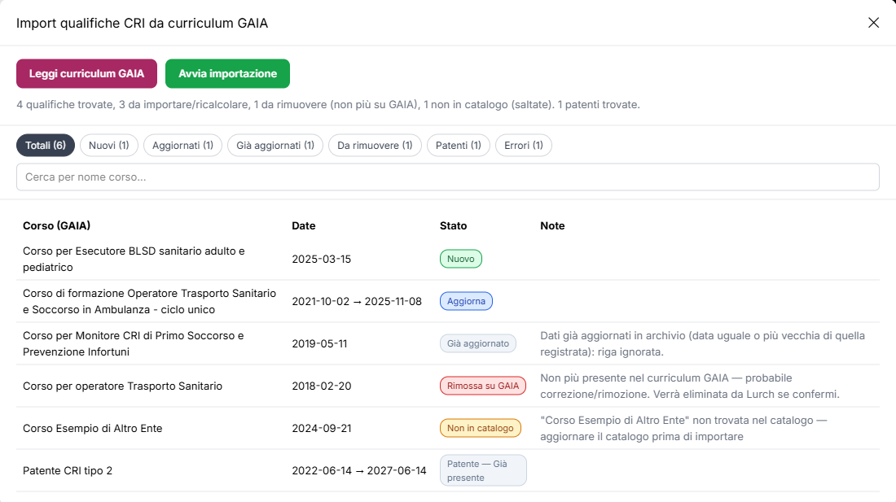
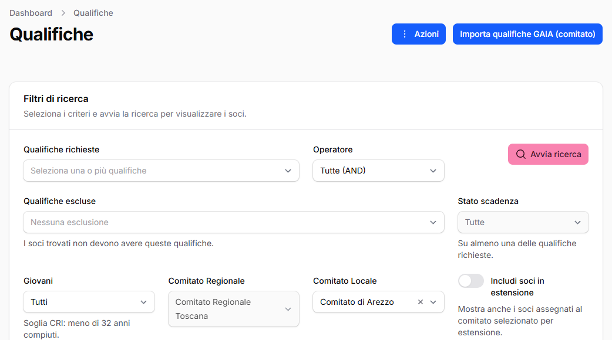
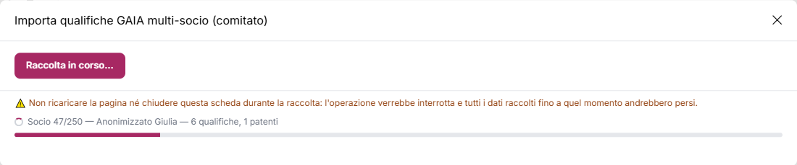

# Usarlo: socio, graduatoria, comitato

> **A chi serve:** amministratori (superadmin, regionali e locali).

Prima di tutto si entra su [GAIA](https://gaia.cri.it) nello stesso browser, in un'altra scheda. Ogni giro di lettura inizia con una prova: se la sessione GAIA non è attiva, lo userscript si ferma subito con il messaggio «GAIA non raggiungibile o sessione scaduta» e non fa nessun'altra richiesta.

Le letture da GAIA **non scrivono nulla**: le qualifiche passano sempre da un'anteprima e si salvano solo con **Avvia importazione** ([Anteprima e importazione](03-anteprima-e-importazione.md)). L'unica eccezione è l'ID GAIA trovato con **Cerca ID GAIA**, che si salva subito: è solo il collegamento al profilo, non cambia nessun dato del socio.

## Un singolo socio

Nella [scheda del socio](../../03-archivi/01-soci/02-scheda-del-socio.md), in alto a destra:

<!-- screenshot: route=/admin/soci/{id} · v1.85.38-dev · 2026-11-18 · userscript installato, socio con ID GAIA di prova -->

- **Cerca ID GAIA** cerca su GAIA il codice fiscale del socio e salva l'ID del suo profilo; la pagina si ricarica. Se GAIA non trova nessuno, lo dice e non salva nulla. Si può usare anche per correggere un ID già presente.
- **Importa CV GAIA** apre la finestra «Import qualifiche CRI da curriculum GAIA». È spento finché il socio non ha un ID GAIA: prima si cerca l'ID.

Nella finestra:

1. **Leggi curriculum GAIA** legge il curriculum del socio su GAIA e lo confronta con il [Catalogo corsi](../../03-archivi/04-catalogo-corsi.md) e con le qualifiche già registrate.
2. Compare l'anteprima con il riepilogo (quante qualifiche e patenti trovate, quante da importare, da rimuovere o saltate).
3. **Avvia importazione** scrive le modifiche; la pagina si ricarica e la tabella delle qualifiche è aggiornata.

<!-- screenshot: route=/admin/soci/{id} · v1.85.38-dev · 2026-11-18 · dati di esempio inseriti a video -->

Il menu **Azioni → Apri curriculum GAIA** della scheda apre invece il curriculum su GAIA, in una nuova scheda, senza importare nulla.

## I candidati di una graduatoria

Nella pagina dei [candidati](../../02-gestione-operativa/04-graduatorie/03-candidati.md) di una graduatoria:

<!-- screenshot: route=/admin/graduatorie/{id}/candidati · v1.85.38-dev · 2026-11-18 · userscript installato -->

- **Cerca ID GAIA** cerca l'ID GAIA di tutti i candidati che non l'hanno ancora (compresi quelli che si sono ritirati: l'ID riguarda il socio, non la candidatura). Il pulsante mostra l'avanzamento («Ricerca 12/40…»); alla fine un messaggio dice quanti ID sono stati trovati e salvati, e la pagina si ricarica. Da quel momento, nella tabella, l'icona con la freccia apre il curriculum GAIA del candidato.
- **Importa qualifiche GAIA (graduatoria)** apre la finestra di import per **tutti i candidati** con un socio collegato, ritirati compresi: legge il curriculum di ognuno e prepara un'unica anteprima.

Conviene ripetere l'import poco prima di chiudere la graduatoria, perché requisiti e punteggi si calcolano sulle qualifiche registrate.

## Un intero comitato locale

Nella [ricerca qualifiche](../../02-gestione-operativa/05-qualifiche/01-ricerca-ed-export.md), dopo aver scelto un **comitato locale** nei filtri, compare **Importa qualifiche GAIA (comitato)**.

<!-- screenshot: route=/admin/qualifiche-soci?locale={id} · v1.85.38-dev · 2026-11-18 · comitato locale scelto -->

Lavora su un comitato alla volta e comprende i soci del comitato, quelli in estensione e quelli dipendenti. Cambiando comitato nei filtri, il pulsante passa al nuovo comitato.

## Gli import per graduatoria e per comitato

Le due finestre funzionano allo stesso modo:

1. **Avvia raccolta dati** legge l'elenco dei soci, verifica la sessione GAIA e poi, **uno per volta**, cerca l'ID GAIA di chi non lo ha e ne legge il curriculum. Tra una lettura e l'altra lo userscript aspetta da 2 a 5 secondi, per non sovraccaricare GAIA.
2. Durante la raccolta una riga mostra l'ultimo socio letto con quante qualifiche e patenti ha («Socio 47/250 — …»), e una barra l'avanzamento.
3. Finita la raccolta, l'anteprima compare da sola, con la colonna **Socio** (il nome apre la sua scheda in una nuova scheda) e la ricerca anche per cognome e nome.
4. **Avvia importazione** salva prima gli ID GAIA trovati durante la raccolta, poi le qualifiche e le patenti; la pagina si ricarica.

<!-- screenshot: route=/admin/qualifiche-soci · v1.85.38-dev · 2026-11-18 · raccolta in corso, dati di esempio inseriti a video -->

**Tempi.** Ogni socio richiede qualche secondo: un comitato di 250 soci impiega dai 25 ai 45 minuti. La scheda del browser deve **restare aperta** e la pagina **non va ricaricata**: i dati raccolti restano solo nella finestra fino ad «Avvia importazione», e chiudendo la scheda si perdono (il browser chiede conferma prima di uscire). Si può intanto lavorare in un'altra scheda.

**Se qualcosa non va durante la raccolta.** Un socio che non si trova su GAIA o il cui curriculum non si legge viene saltato e contato tra gli errori; la raccolta continua. Dopo **3 errori di fila**, invece, si ferma: di solito vuol dire che la sessione GAIA è scaduta. Ciò che è stato letto fino a quel momento resta disponibile per l'anteprima; si rientra su GAIA e si può ripetere con **Rifai raccolta dati**.
