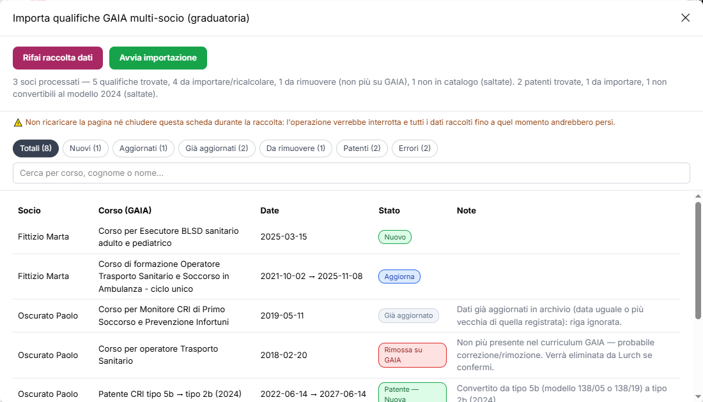

# Anteprima e importazione

> **A chi serve:** amministratori (superadmin, regionali e locali).

L'anteprima mostra, riga per riga, che cosa cambierà nel pannello se si preme **Avvia importazione**. È la stessa per un socio, per una graduatoria e per un comitato (nelle ultime due c'è in più la colonna «Socio»).

<!-- screenshot: route=/admin/graduatorie/{id}/candidati · v1.85.38-dev · 2026-11-18 · dati di esempio inseriti a video -->

## Che cosa viene letto

Dal curriculum GAIA lo userscript prende solo:

- le righe **Qualifica CRI** in stato «Confermato» o «Certificato» (quest'ultimo è lo stato delle qualifiche riconosciute per equipollenza), con le loro date;
- le righe **Patente CRI** valide, con data di rilascio, scadenza e protocollo.

Altre qualifiche, titoli di studio, patenti civili e righe non confermate non vengono considerate.

## Il riepilogo e i filtri

In alto, accanto ai pulsanti, una riga riassume l'esito, per esempio «12 qualifiche trovate, 5 da importare/ricalcolare, 1 da rimuovere (non più su GAIA), 1 non in catalogo (saltate). 2 patenti trovate, 1 da importare.».

I filtri sopra la tabella mostrano solo un tipo di righe, con il numero tra parentesi: **Totali**, **Nuovi**, **Aggiornati**, **Già aggiornati**, **Da rimuovere**, **Patenti**, **Errori**. La casella di ricerca filtra per nome del corso (e per cognome e nome negli import per graduatoria e comitato). Filtri e ricerca cambiano solo ciò che si vede: **Avvia importazione** applica sempre **tutte** le righe.

## Gli stati delle qualifiche

| Stato | Significato | Con «Avvia importazione» |
|---|---|---|
| **Nuovo** | Il socio non aveva questa qualifica | viene inserita |
| **Aggiorna** | Su GAIA c'è una data più recente | date aggiornate, scadenza ricalcolata |
| **Già aggiornato** | Il pannello ha già la stessa data o una più recente | solo la scadenza viene ricalcolata (utile se nel catalogo sono cambiate le regole di scadenza) |
| **Rimossa su GAIA** | La qualifica era stata importata in passato, ma su GAIA non c'è più | viene **cancellata** dal pannello |
| **Non in catalogo** | Il nome del corso su GAIA non corrisponde a nessun corso del catalogo | saltata |
| **Data mancante** | Qualifica valida su GAIA ma senza una data leggibile | saltata: va verificata a mano |

Le regole di confronto sono quelle dell'import da Excel ([Importare da GAIA](../../02-gestione-operativa/05-qualifiche/02-importare-da-gaia.md)): il corso si riconosce dal nome o da un nome alternativo del [Catalogo corsi](../../03-archivi/04-catalogo-corsi.md), una data più vecchia non sostituisce mai una più recente, e un corso di aggiornamento aggiorna anche il corso base. Per le righe «Non in catalogo» conviene aggiungere il corso al catalogo (o il nome di GAIA come nome alternativo) e ripetere la lettura.

### Quando una qualifica viene rimossa

Il curriculum GAIA si legge sempre per intero, quindi una qualifica importata in passato che non compare più vuol dire che su GAIA è stata tolta o corretta. Per questo l'import la propone come **Rimossa su GAIA**. Vale solo per le qualifiche arrivate da un **import** (userscript o Excel): quelle **inserite a mano** nel pannello non vengono mai rimosse. Per proteggere una qualifica importata da una rimozione, la si modifica nella scheda del socio e se ne imposta la **Fonte** su «Inserimento manuale».

L'import da Excel, al contrario, non rimuove mai nulla: un file Excel contiene un solo corso, quindi non dice che cosa manca.

### Da dove arriva una qualifica

Ogni qualifica ricorda la sua **fonte** (colonna «Fonte» delle qualifiche nella scheda del socio, nascosta di default): inserimento manuale, import Excel, import GAIA. GAIA è la fonte più affidabile, poi Excel, poi l'inserimento manuale. Quando l'import da GAIA ritrova una qualifica già registrata, la sua fonte diventa «import GAIA» anche se la data non cambia; un import da una fonte meno affidabile non toglie mai la fonte «import GAIA». La fonte conta perché l'amministratore locale può cancellare solo le qualifiche inserite a mano ([Qualifiche del socio](../../02-gestione-operativa/05-qualifiche/03-qualifiche-del-socio.md)).

## Le patenti CRI

Le patenti hanno stati propri: **Patente — Nuova**, **Patente — Aggiorna**, **Patente — Già presente**, **Patente — Da rimuovere** (importata in passato e non più su GAIA) e **Patente — Non convertibile**.

GAIA mostra patenti numerate con modelli diversi; il pannello le registra tutte con la numerazione del **modello 2024** ([Patenti CRI](../../03-archivi/05-patenti-cri.md)): i tipi da 1 a 8, 2b e 7b restano uguali, il vecchio **5b** diventa **2b**, il vecchio **4b** diventa **7b**. Il tipo **9** (macchine operatrici) nel modello 2024 non è più una patente CRI: compare come «Non convertibile» e viene saltato, senza bisogno di fare nulla. Se il curriculum riporta più rinnovi della stessa patente, si tiene il più recente.

## Dopo l'importazione

Alla fine la riga del riepilogo riporta quante qualifiche sono state inserite, aggiornate, ricalcolate e rimosse, e gli eventuali errori; poi la pagina si ricarica. Ricerche, graduatorie ed esami vedono subito le nuove scadenze. L'operazione non si annulla dalla finestra: una qualifica sbagliata si corregge nella scheda del socio.

Chiudendo la finestra (✕ o tasto Esc) prima di **Avvia importazione** non si scrive nulla.
