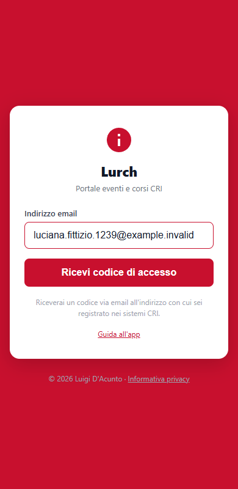
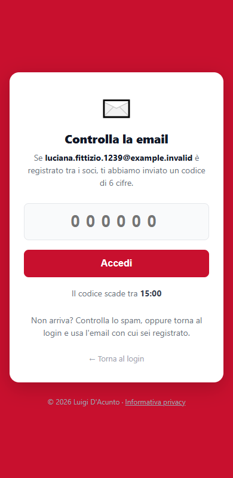

# Installazione e accesso

> **A chi serve:** volontari che usano l'app dei soci.

## Aprire l'app

L'app si apre dal browser del telefono (o del computer) con l'indirizzo del sito seguito da `/app`. Lo stesso indirizzo è nelle email inviate dagli organizzatori.

## Entrare con il codice

1. Si scrive l'**indirizzo email** e si preme **Ricevi codice di accesso**.
2. Si apre la pagina **Controlla la email**. Se l'indirizzo è tra quelli dei soci, arriva un'email con un **codice di 6 cifre**.
3. Si scrive il codice: appena inserita la sesta cifra l'accesso parte da solo, senza premere **Accedi**. Sul telefono il codice si può anche incollare dal suggerimento della tastiera.

<!-- screenshot: route=/app/login · v1.85.38-dev · 2026-11-18 · socia di prova -->

<!-- screenshot: route=/app/verifica · v1.85.38-dev · 2026-11-18 · socia di prova -->

**Quale email.** Serve l'indirizzo registrato nell'archivio dei soci, che arriva da GAIA. La pagina del codice compare sempre, anche con un indirizzo sbagliato: per riservatezza non dice se l'email è tra quelle dei soci. Se il codice non arriva entro qualche minuto, si controlla lo spam e poi si riprova con l'email registrata su GAIA. Se nemmeno così arriva, si scrive alla segreteria dell'evento: il socio potrebbe non essere nell'archivio o avere un indirizzo diverso.

**Regole del codice:**

- vale **15 minuti**; il conto alla rovescia è sotto il campo;
- chiedendone uno nuovo, il precedente non vale più;
- dopo **5 codici sbagliati** l'accesso si blocca per **30 minuti**;
- dalla stessa rete si possono chiedere al massimo **3 codici ogni 10 minuti**.

## Restare collegati e uscire

Dopo l'accesso l'app ricorda il socio su quel dispositivo per **90 giorni**: riaprendola si entra direttamente, senza un nuovo codice. Su un telefono o computer non proprio, conviene uscire con **Esci**, in alto a destra.

Se un socio teme che qualcun altro usi il suo accesso (per esempio ha perso il telefono), un amministratore può scollegarlo da tutti i dispositivi con [Reset sessioni app](../01-pannello/03-archivi/01-soci/01-ricerca-ed-elenco.md#reset-sessioni-app). Per rientrare basta un nuovo codice.

## Installare l'app sul telefono

L'app non si scarica dagli store: si aggiunge alla schermata Home dal browser, e da quel momento si apre con un'icona come le altre app, a schermo intero.

- **Android (Chrome)**: menu **⋮** → **Installa app** (in alcune versioni **Aggiungi a schermata Home**). Quando il browser lo consente, compare anche il pulsante **Installa app** in alto, accanto a **Esci**.
- **iPhone e iPad (Safari)**: pulsante **Condividi** (il quadrato con la freccia) → **Aggiungi alla schermata Home**.
- **Computer (Chrome o Edge)**: icona di installazione nella barra dell'indirizzo, oppure menu → **Installa**.

L'app installata e il sito aperto nel browser sono la stessa cosa: chi preferisce può usarla dal browser, senza installarla.
