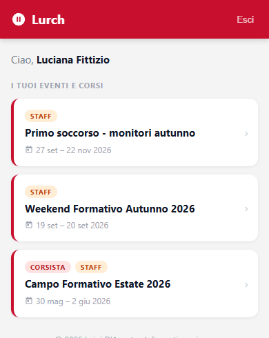
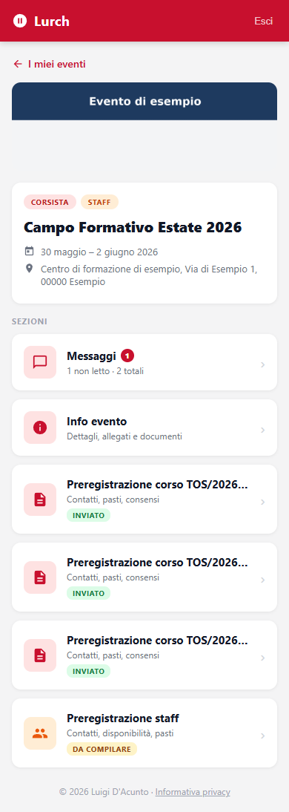
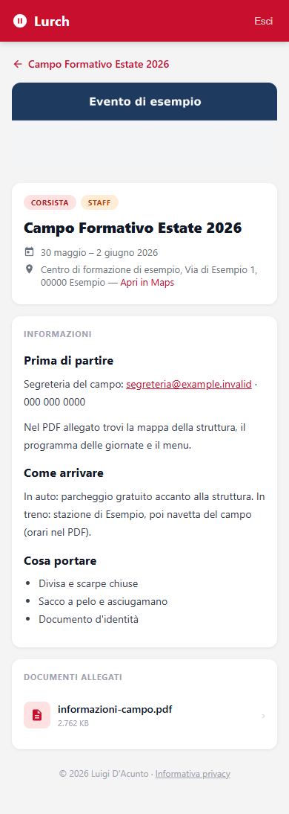

# I miei eventi

> **A chi serve:** volontari che usano l'app dei soci; agli organizzatori, per sapere da dove arriva ciò che i soci leggono.

## L'elenco

Dopo l'accesso l'app mostra **I tuoi eventi e corsi**: tutti gli eventi in cui il socio è iscritto ad almeno un corso o è nello staff, dal più recente al più vecchio. Un'etichetta dice il ruolo, **Corsista** o **Staff**; chi ha entrambi i ruoli nello stesso evento le vede tutte e due.

<!-- screenshot: route=/app · v1.85.38-dev · 2026-11-18 · socia di prova -->

Chi ha un ruolo in un esame trova sopra l'elenco anche il collegamento agli esami: **Area docenti → Esami da gestire** per docenti e commissione, **Esami → I tuoi esami** per chi deve svolgere il test scritto ([Esami](05-esami.md)).

Se un evento manca, il socio non risulta iscritto a nessuno dei suoi corsi né nello staff: è la segreteria a doverlo aggiungere dal pannello.

## La pagina dell'evento

Toccando un evento si apre la sua pagina: in alto l'eventuale immagine di intestazione, poi nome, date e sede. Sotto, le **sezioni**:

- **Messaggi**: i messaggi lasciati sul badge, con il numero di quelli non letti ([Messaggi](04-messaggi.md)).
- **Info evento**: informazioni e documenti pubblicati dagli organizzatori.
- **Preregistrazione corso** seguita dal protocollo del corso: una voce per ogni corso a cui il socio è iscritto in quell'evento.
- **Preregistrazione staff**, per chi è nello staff.

Ogni preregistrazione mostra il suo stato: **Da compilare** o **Inviato** ([Moduli dall'app](03-moduli-dall-app.md)).

<!-- screenshot: route=/app/evento/{id} · v1.85.38-dev · 2026-11-18 · sede e messaggi di esempio -->

## Info evento

La pagina **Info evento** riporta:

- date e sede, con **Apri in Maps** quando l'evento ha le coordinate o l'indirizzo;
- il riquadro **Informazioni**, cioè il testo scritto dagli organizzatori (come arrivare, cosa portare, programma, contatti della segreteria);
- **Documenti allegati**: ogni file si apre in una nuova scheda e si può salvare sul telefono.

<!-- screenshot: route=/app/evento/{id}/info · v1.85.38-dev · 2026-11-18 · testo e allegato di esempio -->

Il **QR per il check-in** non è nell'app: se l'evento lo usa, arriva stampato sul badge o dentro l'email informativa dell'evento, secondo come la segreteria lo organizza ([Badge e messaggi](../03-moduli-pubblici/06-badge-e-messaggi.md#il-qr-per-il-check-in)).

**Per gli organizzatori.** Questi contenuti si scrivono nella scheda dell'evento, scheda **Contenuti e documenti** ([Elenco e creazione](../01-pannello/02-gestione-operativa/01-eventi/01-elenco-e-creazione.md)): **Immagine intestazione app**, **Testo comunicazione / Note per l'app** e i documenti allegati. Lo stesso testo e gli stessi allegati partono anche come email informativa a staff e iscritti. Ogni modifica salvata è subito visibile nell'app, senza nuovi invii.
