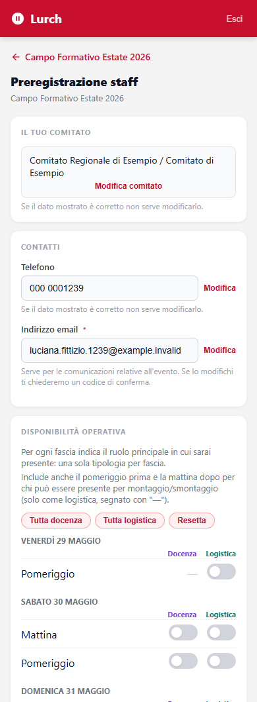
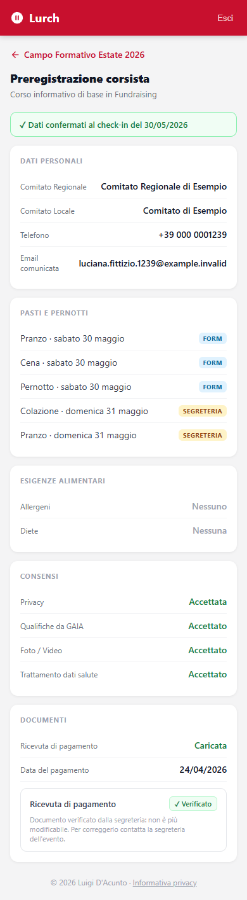
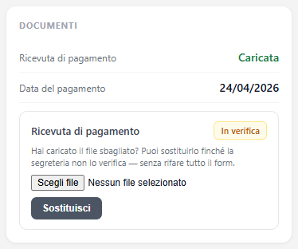

# Moduli dall'app

> **A chi serve:** volontari che usano l'app dei soci.

I form di preregistrazione (del corsista e dello staff) arrivano anche per email, con un link personale. Nell'app si trovano gli **stessi form**: stessi campi, stesse regole e stesso risultato. Chi compila dall'app non deve più usare il link dell'email, e viceversa: il form è uno solo e si invia una volta.

Cosa si compila, campo per campo, è spiegato nei Moduli pubblici:

- [Preregistrazione del corsista](../03-moduli-pubblici/01-preregistrazione-corsista.md)
- [Preregistrazione dello staff](../03-moduli-pubblici/02-preregistrazione-staff.md)

## Compilare dall'app

Nella pagina dell'evento ([I miei eventi](02-i-miei-eventi.md)), le voci **Preregistrazione corso** e **Preregistrazione staff** con lo stato **Da compilare** aprono il form.

<!-- screenshot: route=/app/evento/{id}/form/staff/{id} · v1.85.38-dev · 2026-11-18 · comitato di esempio -->

I dati già noti (comitato, telefono, email) sono precompilati e bloccati: si cambiano solo con **Modifica**, se non sono corretti. Cambiando l'email, dopo l'invio arriva un codice per confermare il nuovo indirizzo: si scrive nel riquadro **Conferma il tuo indirizzo email** del riepilogo, oppure si apre il link della stessa email.

Dopo **Invia** lo stato diventa **Inviato** e il form **non si può più modificare**: per correggere qualcosa si scrive alla segreteria dell'evento.

## Rivedere un form inviato

Aprendo un form già inviato si vede il riepilogo di ciò che è stato dichiarato. In cima una riga dice da dove vengono i dati:

- **Dati dal form di preregistrazione del …**: quanto inviato dal socio;
- **Dati confermati al check-in del …**: i dati aggiornati al primo ingresso all'evento, che prevalgono su quelli del form.

<!-- screenshot: route=/app/evento/{id}/form/corsista/{id} · v1.85.38-dev · 2026-11-18 · pasti e comitato di esempio -->

Le sezioni del riepilogo:

- **Dati personali**: comitato, telefono ed email comunicati.
- **Pasti e pernotti**, con l'origine di ciascuno: **Form** se scelto dal socio, **Segreteria** se aggiunto o cambiato dalla segreteria. Così il socio sa sempre quali pasti e pernotti risultano prenotati a suo nome.
- **Esigenze alimentari**: allergeni e diete, solo se il socio ha dato il consenso al trattamento dei dati sulla salute.
- **Consensi**: privacy, qualifiche da GAIA, foto e video, dati sulla salute.
- **Documenti**: ricevuta di pagamento con la data, nullaosta, documento aggiuntivo, se il corso li prevede.

## Sostituire un documento

Un documento caricato per errore (la ricevuta sbagliata, un PDF illeggibile) si sostituisce dal riepilogo, **senza rifare il form**, finché la segreteria non lo ha verificato:

- **In verifica**: si sceglie il nuovo file e si preme **Sostituisci**;
- **Verificato**: il documento non si cambia più; per correggerlo si scrive alla segreteria dell'evento;
- **Da caricare**: il corso ha cominciato a chiedere un documento aggiuntivo dopo l'invio del form; si carica qui con **Carica**.

<!-- screenshot: route=/app/evento/{id}/form/corsista/{id} · v1.85.38-dev · 2026-11-18 · stato «In verifica» ricostruito a video -->

La ricevuta accetta JPG, PNG o PDF; nullaosta e documento aggiuntivo solo PDF; massimo 10 MB per file.
