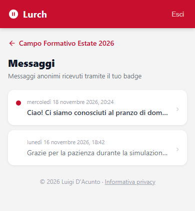
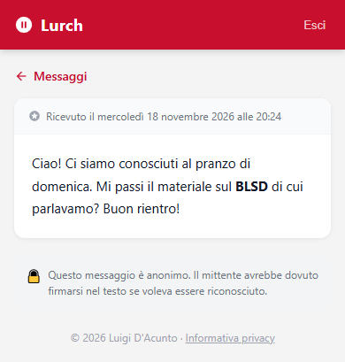

# Messaggi

> **A chi serve:** volontari che usano l'app dei soci.

Ogni badge ha un codice QR. Chi lo inquadra apre la pagina pubblica del badge e può lasciare un **messaggio anonimo** al suo proprietario: un ringraziamento, un saluto, una richiesta di contatto ([Badge e messaggi](../03-moduli-pubblici/06-badge-e-messaggi.md)). Il socio legge i messaggi nell'app.

## Leggere i messaggi

I messaggi sono legati all'evento del badge. Nella pagina dell'evento ([I miei eventi](02-i-miei-eventi.md)) la voce **Messaggi** mostra quanti sono e quanti non sono ancora stati letti; toccandola si apre l'elenco.

<!-- screenshot: route=/app/evento/{id}/messaggi · v1.85.38-dev · 2026-11-18 · messaggi di esempio -->

I messaggi **non letti** stanno in cima, con un pallino rosso e il testo in grassetto; sotto, quelli già letti, dal più recente. Ogni riga mostra data, ora e l'inizio del testo.

Toccando un messaggio lo si legge per intero, e da quel momento risulta letto.

<!-- screenshot: route=/app/evento/{id}/messaggi/{id} · v1.85.38-dev · 2026-11-18 · messaggio di esempio -->

## Anonimato

Il messaggio non dice chi lo ha scritto: se il mittente vuole farsi riconoscere, deve firmarsi nel testo. Non c'è un modo per rispondere dall'app.

Il testo può avere solo grassetto, corsivo, sottolineato ed elenchi: link, immagini e altri contenuti vengono tolti prima del salvataggio.
