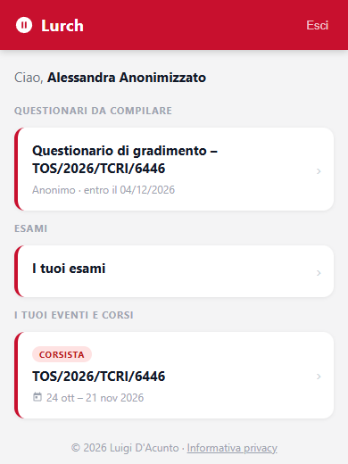
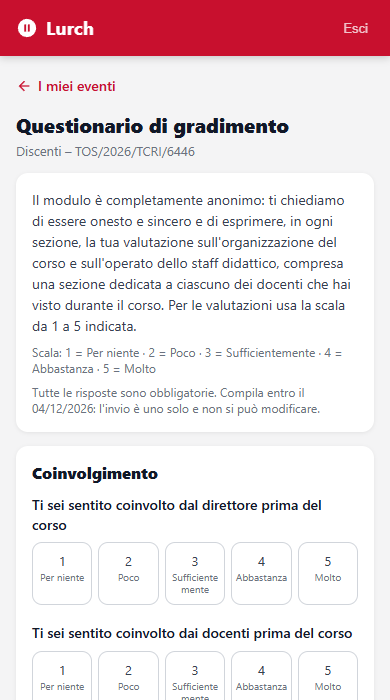
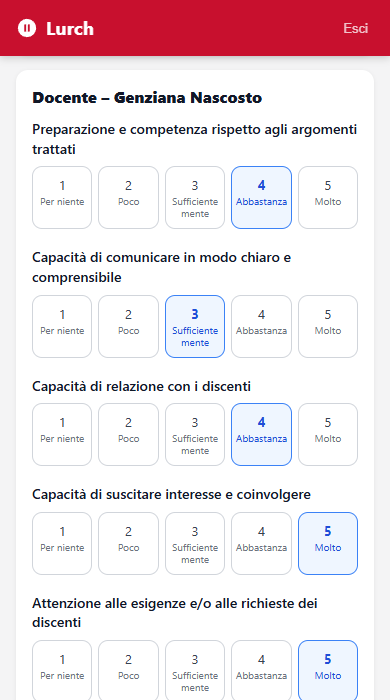
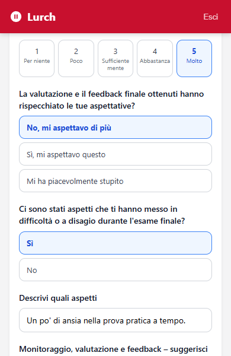
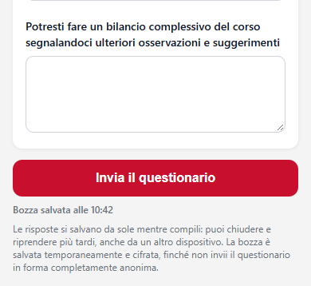
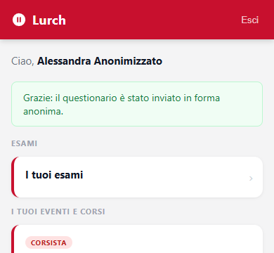
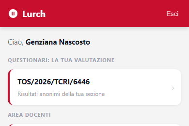
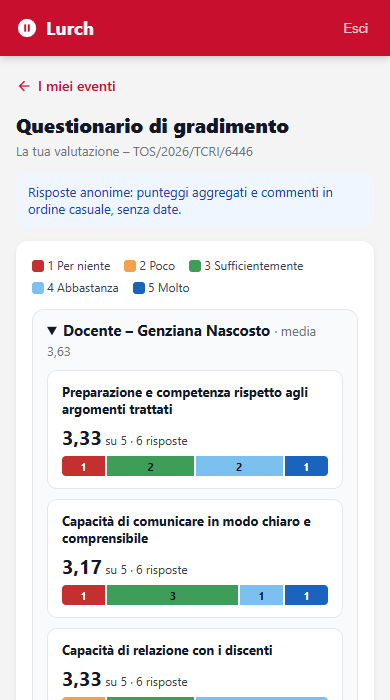
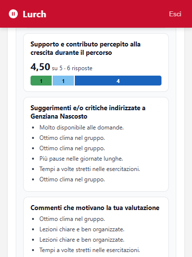

# Questionario di gradimento

> **A chi serve:** discenti dei corsi; docenti e direttori che vogliono vedere la propria valutazione.

Al termine di un corso chi lo organizza può inviare ai discenti un **questionario di gradimento anonimo** ([come si prepara nel pannello](../01-pannello/02-gestione-operativa/02-corsi/08-questionario.md)). Si compila solo dall'app, dopo l'[accesso](01-installazione-e-accesso.md): nel link dell'email non c'è nessun codice personale.

## Compilare il questionario

Chi riceve l'email trova il questionario nella pagina iniziale dell'app, nel riquadro **Questionari da compilare**, con la data entro cui compilarlo. Il pulsante dell'email porta all'app; se serve entrare, dopo l'accesso il questionario è comunque nella pagina iniziale.

<!-- screenshot: route=/app · v1.86.4-dev · 2026-11-27 -->

In apertura una nota ricorda che il modulo è anonimo e spiega la scala da 1 a 5 (1 = Per niente, 2 = Poco, 3 = Sufficientemente, 4 = Abbastanza, 5 = Molto).

<!-- screenshot: route=/app/questionari/{id} · v1.86.4-dev · 2026-11-27 -->

Le valutazioni si danno toccando un valore; quello scelto diventa blu. Le sezioni seguono l'ordine del questionario: coinvolgimento, contenuti, organizzazione e logistica, poi una sezione per il direttore e una per ogni docente, con il loro nome nel titolo.

<!-- screenshot: route=/app/questionari/{id} · v1.86.4-dev · 2026-11-27 -->

Alcune domande compaiono solo con una certa risposta: per esempio **Descrivi quali aspetti** compare se alla domanda sulle difficoltà durante l'esame finale si risponde **Sì**.

<!-- screenshot: route=/app/questionari/{id} · v1.86.4-dev · 2026-11-27 -->

**Tutte le risposte sono obbligatorie**, compresi i commenti. Toccando **Invia il questionario** con una risposta mancante, l'app porta alla prima da completare.

Le risposte **si salvano da sole** mentre si compila: sotto il pulsante d'invio compare l'ora dell'ultimo salvataggio. La bozza è salvata temporaneamente e cifrata, finché il questionario non viene inviato in forma completamente anonima. Si può chiudere l'app e riprendere più tardi, anche da un altro dispositivo: riaprendo il questionario le risposte già date ci sono ancora. Se il salvataggio non riesce, per esempio per la connessione, la pagina lo dice e riprova alla modifica successiva.

<!-- screenshot: route=/app/questionari/{id} · v1.86.4-dev · 2026-11-27 · ora del salvataggio di esempio -->

L'invio è **uno solo** e non si può modificare. Dopo l'invio la pagina iniziale conferma che il questionario è stato inviato in forma anonima e il riquadro sparisce; riaprendo il link compare «Hai già compilato questo questionario». Dopo la data di chiusura il questionario non si può più compilare e una bozza non inviata viene cancellata: non entra nei risultati.

<!-- screenshot: route=/app · v1.86.4-dev · 2026-11-27 -->

## Anonimato

Le risposte vengono salvate senza nome, senza data e ora e senza nessun collegamento all'iscrizione: si registra soltanto che l'iscritto ha già compilato, per non fargli compilare il questionario due volte. Chi organizza il corso vede solo i risultati complessivi, e soltanto quando hanno risposto almeno 5 discenti.

## La propria valutazione (docenti e direttore)

Il direttore e i docenti valutati trovano nella pagina iniziale il riquadro **Questionari: la tua valutazione**, con un elemento per ogni corso.

<!-- screenshot: route=/app · v1.86.4-dev · 2026-11-27 -->

Toccandolo si vede **solo la propria sezione**: per ogni domanda la media e una barra colorata con quante risposte per ciascun valore della scala (rosso e arancione per i voti bassi, verde per il 3, azzurro e blu per quelli alti), e i commenti in ordine casuale e senza date. Le altre sezioni e le valutazioni degli altri docenti non compaiono. Finché le compilazioni sono meno di 5 la pagina lo dice e non mostra dati.

<!-- screenshot: route=/app/questionari/{id}/risultati · v1.86.4-dev · 2026-11-27 · risposte di prova -->

<!-- screenshot: route=/app/questionari/{id}/risultati · v1.86.4-dev · 2026-11-27 · risposte di prova -->

