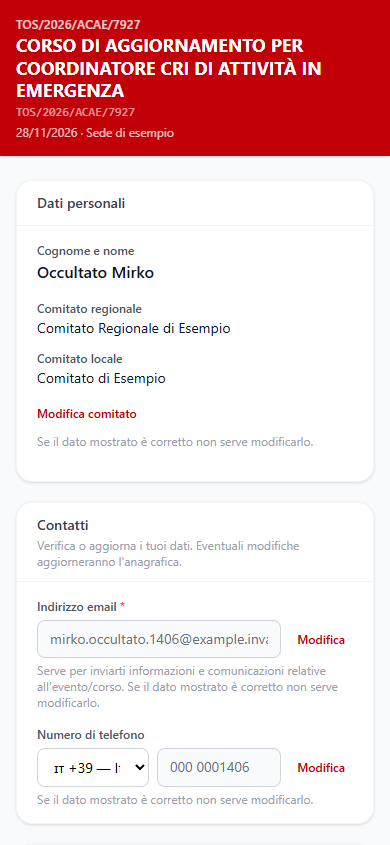
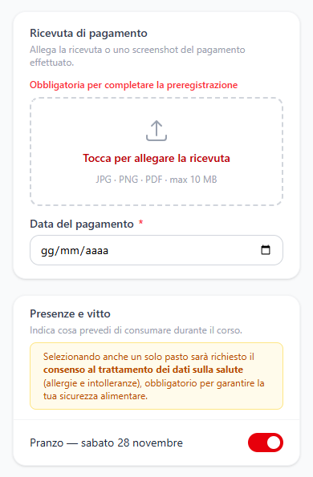
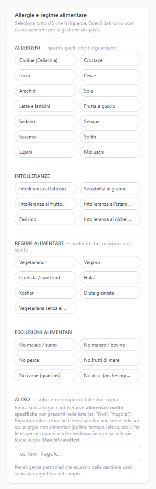
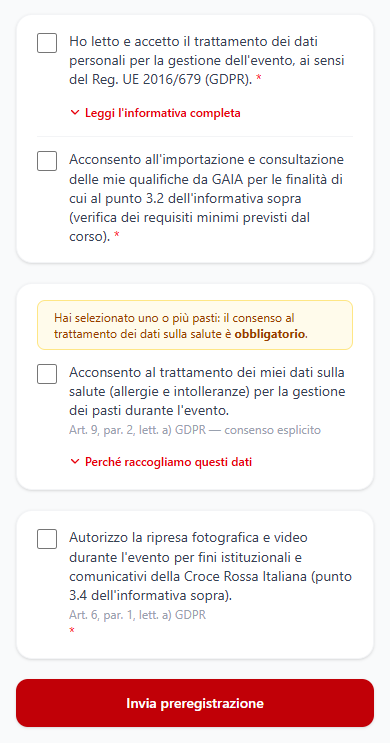
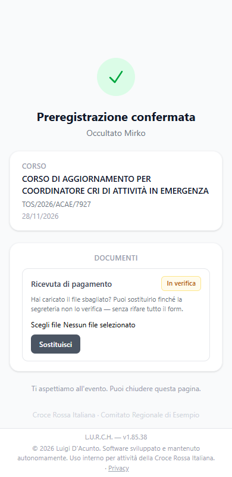

# Preregistrazione del corsista

> **A chi serve:** chi è iscritto a un corso; agli organizzatori, per sapere cosa compilano i corsisti.

Dopo l'iscrizione a un corso arriva un'email con il **link personale** al form di preregistrazione ([Form e comunicazioni](../01-pannello/02-gestione-operativa/02-corsi/05-form-e-comunicazioni.md)). Il form serve agli organizzatori per sapere chi viene ai pasti e ai pernottamenti, con quali esigenze alimentari, e per raccogliere i documenti richiesti dal corso. Si compila **una volta sola**, dal link oppure dall'[app dei soci](../02-app-soci/03-moduli-dall-app.md).

Il link è personale: chi lo apre vede i dati di quella persona. Non va inoltrato ad altri.

## Dati personali e contatti

In alto ci sono il corso, le date e la sede, poi i dati già presenti nell'archivio dei soci: cognome e nome, comitato regionale e comitato locale.

<!-- screenshot: route=/form/{token} · v1.85.38-dev · 2026-11-19 · comitati e sede di esempio -->

- **Modifica comitato** sblocca le due tendine, se il comitato mostrato non è più quello giusto.
- **Email** e **telefono** sono precompilati e bloccati; **Modifica** li sblocca. Il telefono ha il prefisso internazionale a parte.
- Le modifiche aggiornano l'anagrafica del socio. L'email nuova, però, prende il posto della vecchia solo dopo la [verifica dell'email](05-verifica-email.md).

## Ricevuta di pagamento, nullaosta e documento aggiuntivo

Queste sezioni compaiono solo quando servono.

- **Ricevuta di pagamento**: se il corso prevede una quota. Si allega la ricevuta o uno screenshot del pagamento (JPG, PNG o PDF, massimo 10 MB) e si indica la **data del pagamento**, che non può essere nel futuro.
- **Nullaosta del Presidente del Comitato Locale**: se il socio appartiene a un comitato di una **regione diversa** da quella che organizza il corso. Va allegato in PDF.
- **Documento aggiuntivo**: se il corso lo richiede (per esempio il titolo di studio). Il riquadro riporta ciò che chiedono gli organizzatori; il file va allegato in PDF.

<!-- screenshot: route=/form/{token} · v1.85.38-dev · 2026-11-19 · un pasto selezionato -->

## Presenze e vitto

Si accendono i pasti e i pernottamenti che si prevede di consumare: l'elenco dipende dal corso. Il riepilogo arriva alla segreteria, che può correggerlo in seguito.

Accendendo **anche un solo pasto** compare la sezione **Allergie e regime alimentare**, con quattro gruppi da spuntare (allergeni, intolleranze, regime alimentare, esclusioni) e un campo **Altro** per un'allergia alimentare molto specifica, massimo 50 caratteri. Chi non ha esigenze non spunta nulla.

<!-- screenshot: route=/form/{token} · v1.85.38-dev · 2026-11-19 · un pasto selezionato -->

## Consensi e invio

<!-- screenshot: route=/form/{token} · v1.85.38-dev · 2026-11-19 · un pasto selezionato -->

- **Trattamento dei dati personali**: obbligatorio. **Leggi l'informativa completa** apre il testo dell'informativa.
- **Qualifiche da GAIA**: obbligatorio. Autorizza a leggere le qualifiche su GAIA per verificare i requisiti del corso.
- **Dati sulla salute**: compare solo se è stato scelto almeno un pasto, e allora è obbligatorio. Copre allergie e intolleranze.
- **Foto e video**: obbligatorio.

**Invia preregistrazione** salva tutto. Se manca qualcosa, la pagina lo segnala in rosso accanto al campo.

## Dopo l'invio

Si apre la pagina **Preregistrazione confermata** con il corso e, se servono, due riquadri:

- **Conferma il tuo indirizzo email**: compare se l'email è nuova o non è mai stata verificata ([Verifica dell'email](05-verifica-email.md));
- **Documenti**: per ogni file caricato, lo stato **In verifica** o **Verificato**. Finché un documento è in verifica si può sostituire con **Sostituisci**, senza rifare il form. Se il corso comincia a chiedere un documento aggiuntivo dopo l'invio, qui compare **Da caricare**.

<!-- screenshot: route=/form/{token}/confermata · v1.85.38-dev · 2026-11-19 · piè di pagina come in produzione -->

Il form inviato **non si può più modificare**: riaprendo il link si torna a questa pagina. Per correggere qualcosa si scrive alla segreteria del corso.

Se il link mostra **Form non ancora disponibile**, gli organizzatori non hanno ancora impostato pasti e pernottamenti del corso: si riprova più tardi.
