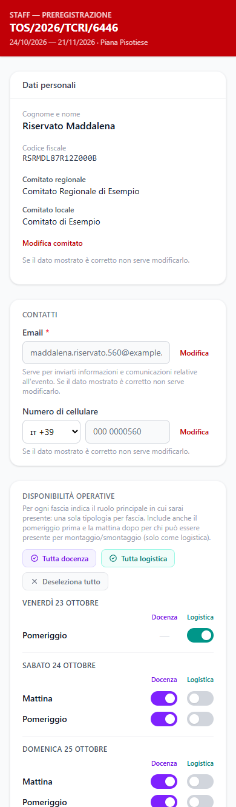
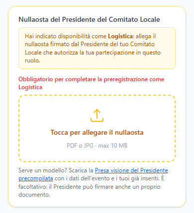

# Preregistrazione dello staff

> **A chi serve:** docenti e logistica di un evento; agli organizzatori, per sapere cosa compila lo staff.

Chi fa parte dello staff di un evento riceve un'email con il **link personale** al form dello staff ([Staff](../01-pannello/02-gestione-operativa/01-eventi/03-staff.md)). Il form raccoglie le **disponibilità** fascia per fascia, i pasti, i pernottamenti e le esigenze alimentari. Si compila una volta sola, dal link oppure dall'[app dei soci](../02-app-soci/03-moduli-dall-app.md).

Il link funziona solo dopo che gli organizzatori hanno attivato il form staff dell'evento: prima mostra **Form non ancora disponibile**.

## Dati personali e disponibilità

Dati personali e contatti funzionano come nel [form del corsista](01-preregistrazione-corsista.md#dati-personali-e-contatti): sono precompilati, si cambiano con **Modifica**, e un'email nuova vale solo dopo la verifica.

<!-- screenshot: route=/form-staff/{token} · v1.85.38-dev · 2026-11-19 · comitati e sede di esempio -->

In **Disponibilità operative** ogni giorno dell'evento è diviso in **mattina** e **pomeriggio**. Per ogni fascia si sceglie un solo ruolo:

- **Docenza**: docenti e direttori di corso;
- **Logistica**: cucina, pulizie, movimentazione e ogni altra mansione operativa.

L'elenco comprende anche il **pomeriggio del giorno prima** e la **mattina del giorno dopo**, per chi aiuta a montare e smontare: in quelle fasce si può scegliere solo Logistica (la Docenza è segnata con «—»). I pulsanti **Tutta docenza**, **Tutta logistica** e **Deseleziona tutto** fanno in un colpo solo; se la segreteria aveva già indicato delle fasce, il form le propone già scelte.

## Nullaosta per la logistica

Chi sceglie **Logistica** in almeno una fascia deve allegare il **nullaosta** del Presidente del proprio Comitato Locale, che autorizza la partecipazione in quel ruolo (PDF o JPG, massimo 10 MB). Il riquadro compare da solo appena si sceglie la prima fascia di logistica.

<!-- screenshot: route=/form-staff/{token} · v1.85.38-dev · 2026-11-19 · una fascia di logistica scelta -->

Per chi non ha un modello, il link **Presa visione del Presidente precompilata** scarica un PDF già riempito con i dati dell'evento e della persona, da far firmare. Non è obbligatorio: il Presidente può firmare anche un proprio documento. Un modello vuoto, uguale per tutti, si scarica da `/modelli/presa-visione-staff`.

## Pasti, consensi e invio

**Presenze e vitto** elenca, giorno per giorno, pranzi, cene e pernottamenti dell'evento, compresi quelli del giorno prima. Allergie e regime alimentare funzionano come nel [form del corsista](01-preregistrazione-corsista.md#presenze-e-vitto).

I consensi sono il **trattamento dei dati personali** e **foto e video**, entrambi obbligatori, più il consenso ai **dati sulla salute** quando si sceglie almeno un pasto. **Invia preregistrazione** salva tutto.

## Dopo l'invio

La pagina **Preregistrazione inviata!** conferma la ricezione e, se serve, chiede di [verificare l'email](05-verifica-email.md). Il nullaosta si può sostituire finché la segreteria non lo ha verificato. Il form non si modifica più: per correggere qualcosa si scrive alla segreteria dell'evento.
